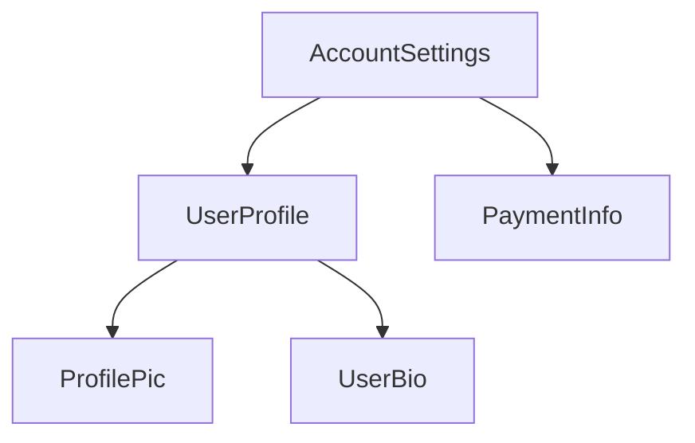
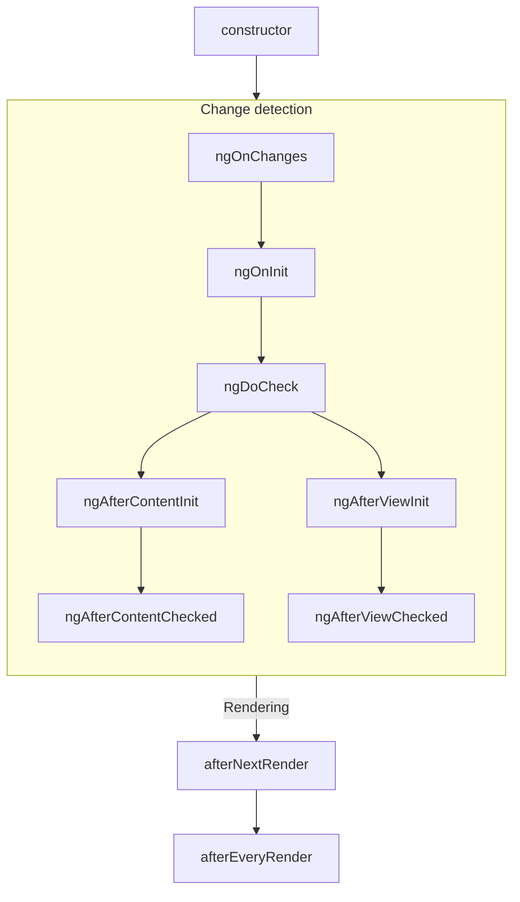
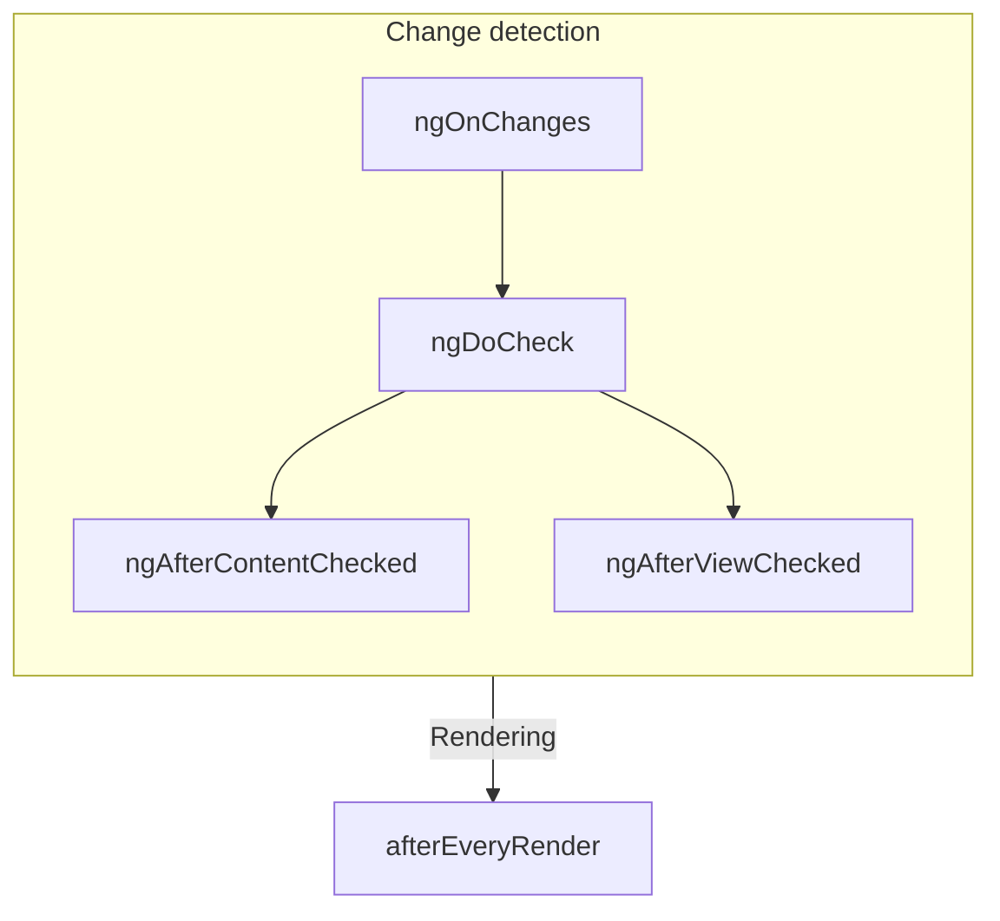

# Angular — llms.txt (offline, fully inlined)

> Generated from https://angular.dev/llms.txt (source: https://github.com/angular/angular, `adev/src/llms.txt`).
> Every page linked in the original llms.txt is inlined below as its own section, so no external fetching is required.


# Angular

Angular — Deliver web apps with confidence 🚀

## Table of Contents

### What is Angular
Source: https://angular.dev/overview

  Angular is a web framework that empowers<br/>
  developers to build fast, reliable applications that users love.

  Maintained by a dedicated team at Google, Angular provides a broad suite of tools, APIs, and
  libraries to simplify and streamline your development workflow. Angular gives you
  a solid platform on which to build fast, reliable applications that scale with both the size of
  your team and the size of your codebase. Angular.dev is the official home for Angular documentation.

    An overview of what it's like to use Angular
    Step-by-step instructions in your browser

    Angular components make it easy to split your code into well-encapsulated parts.
    Our fine-grained reactivity model, combined with compile-time optimizations, simplifies development and helps build faster apps by default.
    Angular supports both server-side rendering (SSR) and static site generation (SSG) along with full DOM hydration.
    Easily share code across components throughout your entire application.
    Provides a feature-rich navigation toolkit, including support for route guards, data resolution, lazy-loading, and much more.
    Provides a standardized system for form participation and validation.

    Angular CLI gets your project running in under a minute with the commands you need to grow into a deployed production application.
    Angular DevTools sits alongside your browser's developer tools. It helps debug and analyze your app, including a component tree inspector, dependency injection tree view, and custom performance profiling flame chart.
    Angular CLI's `ng update` runs automated code transformations that automatically handle routine breaking changes, dramatically simplifying major version updates. Keeping up with the latest version keeps your app as fast and secure as possible.
    Angular's IDE language service powers code completion, navigation, refactoring, and real-time diagnostics in your favorite editor.

    Angular's predictable, time-based release schedule gives your organization confidence in the stability and backwards compatibility of the framework. Long Term Support (LTS) windows make sure you get critical security fixes when you need them. First-party update tools, guides and automated migration schematics help keep your apps up-to-date with the latest advancements to the framework and the web platform.

    Angular's internationalization features handle message translations and formatting, including
    support for unicode standard ICU syntax.
    In collaboration with Google's world-class security engineers, Angular aims to make development
    safe by default. Built-in security features, including HTML sanitization and
    trusted type support, help protect your users from common vulnerabilities like
    cross-site scripting and cross-site request forgery.
    Angular CLI includes a fast, modern build pipeline using Vite and esbuild. Developers report
    building projects with hundreds of thousands of lines of code in less than a minute.
    Large Google products build on top of Angular's architecture and help develop new features that
    further improve Angular's scalability, from [Google Fonts](https://fonts.google.com/) to [Google Cloud](https://console.cloud.google.com).

    Curious what we’re working on? Every PR and commit is available on our GitHub. Run into an issue or bug? We triage GitHub issues regularly to ensure we’re responsive and engaged with our community, and solving the real world problems you’re facing.
    Our team publishes a public roadmap of our current and future work and values your feedback. We publish Request for Comments (RFCs) to collect feedback on larger feature changes and ensure the community voice is heard while shaping the future direction of Angular.

    Our community is composed of talented developers, writers, instructors, podcasters, and more. The Google for Developers library is just a sample of the high quality resources available for new and experienced developers to continue developing.
    We are thankful for the open source contributors who make Angular a better framework for everyone. From fixing a typo in the docs, to adding major features, we encourage anyone interested to get started on our GitHub.
    Our team partners with individuals, educators, and enterprises to ensure we consistently are supporting developers. Angular Google Developer Experts (GDEs) represent community leaders around the world educating, organizing, and developing with Angular. Enterprise partnerships help ensure that Angular scales well for technology industry leaders.


---

### Installation guide
Source: https://angular.dev/installation


Get started with Angular quickly with online starters or locally with your terminal.

## Play Online

If you just want to play around with Angular in your browser without setting up a project, you can use our online sandbox:

The fastest way to play with an Angular app. No setup required.

## Set up a new project locally

If you're starting a new project, you'll most likely want to create a local project so that you can use tooling such as Git.

### Prerequisites

- **Node.js** - [v22.22.3 or newer](/reference/versions)
- **Text editor** - We recommend [Visual Studio Code](https://code.visualstudio.com/)
- **Terminal** - Required for running [Angular CLI](/tools/cli) commands
- **Development Tool** - To improve your development workflow, we recommend the [Angular Language Service](/tools/language-service)

### Instructions

The following guide will walk you through setting up a local Angular project.

#### Install Angular CLI

Open a terminal (if you're using [Visual Studio Code](https://code.visualstudio.com/), you can open an [integrated terminal](https://code.visualstudio.com/docs/editor/integrated-terminal)) and run the following command:

  <docs-code
    header="npm"
    language="shell"
    >
    npm install -g @angular/cli
  <docs-code
    header="pnpm"
    language="shell"
    >
    pnpm install -g @angular/cli
  <docs-code
    header="yarn"
    language="shell"
    >
    yarn global add @angular/cli
  <docs-code
    header="bun"
    language="shell"
    >
    bun install -g @angular/cli

If you are having issues running this command in Windows or Unix, check out the [CLI docs](/tools/cli/setup-local#install-the-angular-cli) for more info.

#### Create a new project

In your terminal, run the CLI command [`ng new`](cli/new) with the desired project name. In the following examples, we'll be using the example project name of `my-first-angular-app`.

```shell
ng new <project-name>
```

You will be presented with some configuration options for your project. Use the arrow and enter keys to navigate and select which options you desire.

If you don't have any preferences, just hit the enter key to take the default options and continue with the setup.

After you select the configuration options and the CLI runs through the setup, you should see the following message:

```text
✔ Packages installed successfully.
    Successfully initialized git.
```

At this point, you're now ready to run your project locally!

#### Running your new project locally

In your terminal, switch to your new Angular project.

```shell
cd my-first-angular-app
```

All of your dependencies should be installed at this point (which you can verify by checking for the existence of a `node_modules` folder in your project), so you can start your project by running the command:

```shell
npm start
```

If everything is successful, you should see a similar confirmation message in your terminal:

```text
Watch mode enabled. Watching for file changes...
NOTE: Raw file sizes do not reflect development server per-request transformations.
  ➜  Local:   http://localhost:4200/
  ➜  press h + enter to show help
```

And now you can visit the path in `Local` (e.g., `http://localhost:4200`) to see your application. Happy coding! 🎉

### Using AI for Development

To get started with building in your preferred AI powered IDE, [check out Angular prompt rules and best practices](/ai/develop-with-ai).

## Next steps

Now that you've created your Angular project, you can learn more about Angular in our [Essentials guide](/essentials) or choose a topic in our in-depth guides!

---

### Style Guide
Source: https://next.angular.dev/style-guide

# Angular coding style guide

## Introduction

This guide covers a range of style conventions for Angular application code. These recommendations
are not required for Angular to work, but instead establish a set of coding practices that promote
consistency across the Angular ecosystem. A consistent set of practices makes it easier to share
code and move between projects.

This guide does _not_ cover TypeScript or general coding practices unrelated to Angular. For
TypeScript, check
out [Google's TypeScript style guide](https://google.github.io/styleguide/tsguide.html).

### When in doubt, prefer consistency

Whenever you encounter a situation in which these rules contradict the style of a particular file,
prioritize maintaining consistency within a file. Mixing different style conventions in a single
file creates more confusion than diverging from the recommendations in this guide.

## Naming

### Separate words in file names with hyphens

Separate words within a file name with hyphens (`-`). For example, a component named `UserProfile`
has a file name `user-profile.ts`.

### Use the same name for a file's tests with `.spec` at the end

For unit tests, end file names with `.spec.ts`. For example, the unit test file for
the `UserProfile` component has the file name `user-profile.spec.ts`.

### Match file names to the TypeScript identifier within

File names should generally describe the contents of the code in the file. When the file contains a
TypeScript class, the file name should reflect that class name. For example, a file containing a
component named `UserProfile` has the name `user-profile.ts`.

If the file contains more than one primary namable identifier, choose a name that describes the
common theme to the code within. If the code in a file does not fit within a common theme or feature
area, consider breaking the code up into different files. Avoid overly generic file names
like `helpers.ts`, `utils.ts`, or `common.ts`.

### Use the same file name for a component's TypeScript, template, and styles

Components typically consist of one TypeScript file, one template file, and one style file. These
files should share the same name with different file extensions. For example, a `UserProfile`
component can have the files `user-profile.ts`, `user-profile.html`, and `user-profile.css`.

If a component has more than one style file, append the name with additional words that describe the
styles specific to that file. For example, `UserProfile` might have style
files `user-profile-settings.css` and `user-profile-subscription.css`.

## Project structure

### All the application's code goes in a directory named `src`

All of your Angular UI code (TypeScript, HTML, and styles) should live inside a directory
named `src`. Code that's not related to UI, such as configuration files or scripts, should live
outside the `src` directory.

This keeps the root application directory consistent between different Angular projects and creates
a clear separation between UI code and other code in your project.

### Bootstrap your application in a file named `main.ts` directly inside `src`

The code to start up, or **bootstrap**, an Angular application should always live in a file
named `main.ts`. This represents the primary entry point to the application.

### Group closely related files together in the same directory

Angular components consist of a TypeScript file and, optionally, a template and one or more style
files. You should group these together in the same directory.

Unit tests should live in the same directory as the code-under-test. Avoid collecting unrelated
tests into a single `tests` directory.

### Organize your project by feature areas

Organize your project into subdirectories based on the features of your application or common themes
to the code in those directories. For example, the project structure for a movie theater site,
MovieReel, might look like this:

```
src/
├─ movie-reel/
│ ├─ show-times/
│ │ ├─ film-calendar/
│ │ ├─ film-details/
│ ├─ reserve-tickets/
│ │ ├─ payment-info/
│ │ ├─ purchase-confirmation/
```

Avoid creating subdirectories based on the type of code that lives in those directories. For
example, avoid creating directories like `components`, `directives`, and `services`.

Avoid putting so many files into one directory that it becomes hard to read or navigate. As the
number of files in a directory grows, consider splitting further into additional sub-directories.

### One concept per file

Prefer focusing source files on a single _concept_. For Angular classes specifically, this usually
means one component, directive, or service per file. However, it's okay if a file contains more than
one component or directive if your classes are relatively small and they tie together as part of a
single concept.

When in doubt, go with the approach that leads to smaller files.

## Dependency injection

### Prefer the `inject` function over constructor parameter injection

Prefer using the [`inject`](/api/core/inject) function over injecting constructor parameters. The [`inject`](/api/core/inject) function works the same way as constructor parameter injection, but offers several style advantages:

- [`inject`](/api/core/inject) is generally more readable, especially when a class injects many dependencies.
- It's more syntactically straightforward to add comments to injected dependencies
- [`inject`](/api/core/inject) offers better type inference.
- When targeting ES2022+ with [`useDefineForClassFields`](https://www.typescriptlang.org/tsconfig/#useDefineForClassFields), you can avoid separating field declaration and initialization when fields read on injected dependencies.

[You can refactor existing code to `inject` with an automatic tool](reference/migrations/inject-function).

## Components and directives

### Choosing component selectors

See
the [Components guide for details on choosing component selectors](guide/components/selectors#choosing-a-selector).

### Naming component and directive members

See the Components guide for details
on [naming input properties](guide/components/inputs#choosing-input-names)
and [naming output properties](guide/components/outputs#choosing-event-names).

### Choosing directive selectors

Directives should use the
same [application-specific prefix](guide/components/selectors#selector-prefixes)
as your components.

When using an attribute selector for a directive, use a camelCase attribute name. For example, if
your application is named "MovieReel" and you build a directive that adds a tooltip to an element,
you might use the selector `[mrTooltip]`.

### Group Angular-specific properties before methods

Components and directives should group Angular-specific properties together, typically near the top
of the class declaration. This includes injected dependencies, inputs, outputs, and queries. Define
these and other properties before the class's methods.

This practice makes it easier to find the class's template APIs and dependencies.

### Keep components and directives focused on presentation

Code inside your components and directives should generally relate to the UI shown on the page. For
code that makes sense on its own, decoupled from the UI, prefer refactoring to other files. For
example, you can factor form validation rules or data transformations into separate functions or
classes.

### Avoid overly complex logic in templates

Angular templates are designed to
accommodate [JavaScript-like expressions](guide/templates/expression-syntax).
You should take advantage of these expressions to capture relatively straightforward logic directly
in template expressions.

When the code in a template gets too complex, though, refactor logic into the TypeScript code (typically with a [computed](guide/signals#computed-signals)).

There's no one hard-and-fast rule that determines what constitutes "complex". Use your best
judgement.

### Use `protected` on class members that are only used by a component's template

A component class's public members intrinsically define a public API that's accessible via
dependency injection and [queries](guide/components/queries). Prefer `protected`
access for any members that are meant to be read from the component's template.

```ts
@Component({
  ...,
  template: `<p>{{ fullName() }}</p>`,
})
export class UserProfile {
  firstName = input();
  lastName = input();

// `fullName` is not part of the component's public API, but is used in the template.
  protected fullName = computed(() => `${this.firstName()} ${this.lastName()}`);
}
```

### Use `readonly` for properties that shouldn't change

Mark component and directive properties initialized by Angular as `readonly`. This includes
properties initialized by `input`, `model`, `output`, and queries. The readonly access modifier
ensures that the value set by Angular is not overwritten.

```ts
@Component(/* ... */)
export class UserProfile {
  readonly userId = input();
  readonly userSaved = output();
  readonly userName = model();
}
```

For components and directives that use the decorator-based `@Input`, `@Output`, and query APIs, this
advice applies to output properties and queries, but not input properties.

```ts
@Component(/* ... */)
export class UserProfile {
  @Output() readonly userSaved = new EventEmitter<void>();
  @ViewChildren(PaymentMethod) readonly paymentMethods?: QueryList<PaymentMethod>;
}
```

### Prefer `class` and `style` over `ngClass` and `ngStyle`

Prefer `class` and `style` bindings over using the [`NgClass`](/api/common/NgClass) and [`NgStyle`](/api/common/NgStyle) directives.

```html {prefer}
```

```html {avoid}
```

Both `class` and `style` bindings use a more straightforward syntax that aligns closely with
standard HTML attributes. This makes your templates easier to read and understand, especially for
developers familiar with basic HTML.

Additionally, the `NgClass` and `NgStyle` directives incur an additional performance cost compared
to the built-in `class` and `style` binding syntax.

For more details, refer to the [bindings guide](/guide/templates/binding#css-class-and-style-property-bindings)

### Name event handlers for what they _do_, not for the triggering event

Prefer naming event handlers for the action they perform rather than for the triggering event:

```html {prefer}
```

```html {avoid}
```

Using meaningful names like this makes it easier to tell what an event does from reading the
template.

For keyboard events, you can use Angular's key event modifiers with specific handler names:

```html
```

Sometimes, event handling logic is especially long or complex, making it impractical to declare a
single well-named handler. In these cases, it's fine to fall back to a name like 'handleKeydown' and
then delegate to more specific behaviors based on the event details:

```ts
@Component(/* ... */)
class RichText {
  handleKeydown(event: KeyboardEvent) {
    if (event.ctrlKey) {
      if (event.key === 'B') {
        this.activateBold();
      } else if (event.key === 'I') {
        this.activateItalic();
      }
      // ...
    }
  }
}
```

### Keep lifecycle methods simple

Avoid putting long or complex logic inside lifecycle hooks like `ngOnInit`. Instead, prefer creating
well-named methods to contain that logic and then _call those methods_ in your lifecycle hooks.
Lifecycle hook names describe _when_ they run, meaning that the code inside doesn't have a
meaningful name that describes what the code inside is doing.

```ts {prefer}
ngOnInit() {
  this.startLogging();
  this.runBackgroundTask();
}
```

```ts {avoid}
ngOnInit() {
  this.logger.setMode('info');
  this.logger.monitorErrors();
  // ...and all the rest of the code that would be unrolled from these methods.
}
```

### Use lifecycle hook interfaces

Angular provides a TypeScript interface for each lifecycle method. When adding a lifecycle hook to
your class, import and `implement` these interfaces to ensure that the methods are named correctly.

```ts
import {Component, OnInit} from '@angular/core';

@Component(/* ... */)
export class UserProfile implements OnInit {
  // The `OnInit` interface ensures this method is named correctly.
  ngOnInit() {
    /* ... */
  }
}
```

---


## Components

### What is a component
Source: https://angular.dev/guide/components


TIP: This guide assumes you've already read the [Essentials Guide](essentials). Read that first if you're new to Angular.

Every component must have:

- A TypeScript class with _behaviors_ such as handling user input and fetching data from a server
- An HTML template that controls what renders into the DOM
- A [CSS selector](https://developer.mozilla.org/docs/Learn/CSS/Building_blocks/Selectors) that defines how the component is used in HTML

You provide Angular-specific information for a component by adding a `@Component` [decorator](https://www.typescriptlang.org/docs/handbook/decorators.html) on top of the TypeScript class:

```angular-ts {highlight: [1, 2, 3, 4]}
@Component({
  selector: 'profile-photo',
  template: ``,
})
export class ProfilePhoto {}
```

For full details on writing Angular templates, including data binding, event handling, and control flow, see the [Templates guide](guide/templates).

The object passed to the `@Component` decorator is called the component's **metadata**. This includes the `selector`, `template`, and other properties described throughout this guide.

Components can optionally include a list of CSS styles that apply to that component's DOM:

```angular-ts {highlight: [4]}
@Component({
  selector: 'profile-photo',
  template: ``,
  styles: `
    img {
      border-radius: 50%;
    }
  `,
})
export class ProfilePhoto {}
```

By default, a component's styles only affect elements defined in that component's template. See [Styling Components](guide/components/styling) for details on Angular's approach to styling.

You can alternatively choose to write your template and styles in separate files:

```ts {highlight: [3,4]}
@Component({
  selector: 'profile-photo',
  templateUrl: 'profile-photo.html',
  styleUrl: 'profile-photo.css',
})
export class ProfilePhoto {}
```

This can help separate the concerns of _presentation_ from _behavior_ in your project. You can choose one approach for your entire project, or you can decide which to use for each component.

Both `templateUrl` and `styleUrl` are relative to the directory in which the component resides.

## Using components

### Imports in the `@Component` decorator

To use a component, [directive](guide/directives), or [pipe](guide/templates/pipes), you must add
it to the `imports` array in the `@Component` decorator:

```ts
import {Component} from '@angular/core';
import {ProfilePhoto} from './profile-photo';

@Component({
  // Import the `ProfilePhoto` component in
  // order to use it in this component's template.
  imports: [ProfilePhoto],
  /* ... */
})
export class UserProfile {}
```

By default, Angular components are _standalone_, meaning that you can directly add them to the `imports` array of other components. Components created with an earlier version of Angular may instead specify `standalone: false` in their `@Component` decorator. For these components, you instead import the `NgModule` in which the component is defined. See the full [`NgModule` guide](guide/ngmodules/overview) for details.

IMPORTANT: In Angular versions before 19.0.0, the `standalone` option defaults to `false`.

### Showing components in a template

Every component defines a [CSS selector](https://developer.mozilla.org/docs/Learn/CSS/Building_blocks/Selectors):

```angular-ts {highlight: [2]}
@Component({
  selector: 'profile-photo',
  ...
})
export class ProfilePhoto { }
```

See [Component Selectors](guide/components/selectors) for details about which types of selectors Angular supports and guidance on choosing a selector.

You show a component by creating a matching HTML element in the template of _other_ components:

```angular-ts {highlight: [8]}
@Component({
  selector: 'profile-photo',
})
export class ProfilePhoto {}

@Component({
  imports: [ProfilePhoto],
  template: `<profile-photo />`,
})
export class UserProfile {}
```

Angular creates an instance of the component for every matching HTML element it encounters. The DOM element that matches a component's selector is referred to as that component's **host element**. The contents of a component's template are rendered inside its host element.

The DOM rendered by a component, corresponding to that component's template, is called that
component's **view**.

In composing components in this way, **you can think of your Angular application as a tree of components**.



This tree structure is important to understanding several other Angular concepts, including [dependency injection](guide/di) and [child queries](guide/components/queries).

---

### Component selectors
Source: https://angular.dev/guide/components/selectors

# Component selectors

TIP: This guide assumes you've already read the [Essentials Guide](essentials). Read that first if you're new to Angular.

Every component defines
a [CSS selector](https://developer.mozilla.org/docs/Web/CSS/CSS_selectors) that determines how
the component is used:

```angular-ts {highlight: [2]}
@Component({
  selector: 'profile-photo',
  ...
})
export class ProfilePhoto { }
```

You use a component by creating a matching HTML element in the templates of _other_ components:

```angular-ts {highlight: [3]}
@Component({
  template: `
    <button>Upload a new profile photo</button>`,
  ...,
})
export class UserProfile { }
```

**Angular matches selectors statically at compile-time**. Changing the DOM at run-time, either via
Angular bindings or with DOM APIs, does not affect the components rendered.

**An element can match exactly one component selector.** If multiple component selectors match a
single element, Angular reports an error.

**Component selectors are case-sensitive.**

## Types of selectors

Angular supports a limited subset
of [basic CSS selector types](https://developer.mozilla.org/docs/Web/CSS/CSS_Selectors) in
component selectors:

| **Selector type**  | **Description**                                                                                                 | **Examples**                  |
| ------------------ | --------------------------------------------------------------------------------------------------------------- | ----------------------------- |
| Type selector      | Matches elements based on their HTML tag name, or node name.                                                    | `profile-photo`               |
| Attribute selector | Matches elements based on the presence of an HTML attribute and, optionally, an exact value for that attribute. | `[dropzone]` `[type="reset"]` |
| Class selector     | Matches elements based on the presence of a CSS class.                                                          | `.menu-item`                  |

For attribute values, Angular supports matching an exact attribute value with the equals (`=`)
operator. Angular does not support other attribute value operators.

Angular component selectors do not support combinators, including
the [descendant combinator](https://developer.mozilla.org/docs/Web/CSS/Descendant_combinator)
or [child combinator](https://developer.mozilla.org/docs/Web/CSS/Child_combinator).

Angular component selectors do not support
specifying [namespaces](https://developer.mozilla.org/docs/Web/SVG/Namespaces_Crash_Course).

### The `:not` pseudo-class

Angular supports [the `:not` pseudo-class](https://developer.mozilla.org/docs/Web/CSS/:not).
You can append this pseudo-class to any other selector to narrow which elements a component's
selector matches. For example, you could define a `[dropzone]` attribute selector and prevent
matching `textarea` elements:

```angular-ts {highlight: [2]}
@Component({
  selector: '[dropzone]:not(textarea)',
  ...
})
export class DropZone { }
```

Angular does not support any other pseudo-classes or pseudo-elements in component selectors.

### Combining selectors

You can combine multiple selectors by concatenating them. For example, you can match `<button>`
elements that specify `type="reset"`:

```angular-ts {highlight: [2]}
@Component({
  selector: 'button[type="reset"]',
  ...
})
export class ResetButton { }
```

You can also define multiple selectors with a comma-separated list:

```angular-ts {highlight: [2]}
@Component({
  selector: 'drop-zone, [dropzone]',
  ...
})
export class DropZone { }
```

Angular creates a component for each element that matches _any_ of the selectors in the list.

## Choosing a selector

The vast majority of components should use a custom element name as their selector. All custom
element names should include a hyphen as described
by [the HTML specification](https://html.spec.whatwg.org/multipage/custom-elements.html#valid-custom-element-name).
By default, Angular reports an error if it encounters a custom tag name that does not match any
available components, preventing bugs due to mistyped component names.

See [Advanced component configuration](guide/components/advanced-configuration) for details on
using [native custom elements](https://developer.mozilla.org/docs/Web/Web_Components) in
Angular templates.

### Selector prefixes

The Angular team recommends using a short, consistent prefix for all the custom components
defined inside your project. For example, if you were to build YouTube with Angular, you might
prefix your components with `yt-`, with components like `yt-menu`, `yt-player`, etc. Namespacing
your selectors like this makes it immediately clear where a particular component comes from. By
default, the Angular CLI uses `app-`.

IMPORTANT: Angular uses the `ng` selector prefix for its own framework APIs. Never use `ng` as a selector prefix for your own custom components.

### When to use an attribute selector

You should consider an attribute selector when you want to create a component on a standard native
element. For example, if you want to create a custom button component, you can take advantage of the
standard `<button>` element by using an attribute selector:

```angular-ts {highlight: [2]}
@Component({
  selector: 'button[yt-upload]',
   ...
})
export class YouTubeUploadButton { }
```

This approach allows consumers of the component to directly use all the element's standard APIs
without extra work. This is especially valuable for ARIA attributes such as `aria-label`.

Angular does not report errors when it encounters custom attributes that don't match an available
component. When using components with attribute selectors, consumers may forget to import the
component or its NgModule, resulting in the component not rendering.
See [Importing and using components](guide/components#imports-in-the-component-decorator) for more information.

Components that define attribute selectors should use lowercase, dash-case attributes. You can
follow the same prefixing recommendation described above.

---

### Styling components
Source: https://angular.dev/guide/components/styling

# Styling components

TIP: This guide assumes you've already read the [Essentials Guide](essentials). Read that first if you're new to Angular.

Components can optionally include CSS styles that apply to that component's DOM:

```angular-ts {highlight:[4]}
@Component({
  selector: 'profile-photo',
  template: ``,
  styles: `
    img {
      border-radius: 50%;
    }
  `,
})
export class ProfilePhoto {}
```

You can also choose to write your styles in separate files:

```angular-ts {highlight:[4]}
@Component({
  selector: 'profile-photo',
  templateUrl: 'profile-photo.html',
  styleUrl: 'profile-photo.css',
})
export class ProfilePhoto {}
```

When Angular compiles your component, these styles are emitted with your component's JavaScript
output. This means that component styles participate in the JavaScript module system. When you
render an Angular component, the framework automatically includes its associated styles, even when
lazy-loading a component.

Angular works with any tool that outputs CSS,
including [Sass](https://sass-lang.com), [Less](https://lesscss.org),
and [Stylus](https://stylus-lang.com).

## Style scoping

Every component has a **view encapsulation** setting that determines how the framework scopes a
component's styles. There are four view encapsulation modes: `Emulated`, `ShadowDom`, `ExperimentalIsolatedShadowDom`, and `None`.
You can specify the mode in the `@Component` decorator:

```angular-ts {highlight:[3]}
@Component({
  ...,
  encapsulation: ViewEncapsulation.None,
})
export class ProfilePhoto { }
```

### ViewEncapsulation.Emulated

By default, Angular uses emulated encapsulation so that a component's styles only apply to elements
defined in that component's template. In this mode, the framework generates a unique HTML attribute
for each component instance, adds that attribute to elements in the component's template, and
inserts that attribute into the CSS selectors defined in your component's styles.

This mode ensures that a component's styles do not leak out and affect other components. However,
global styles defined outside of a component may still affect elements inside a component with
emulated encapsulation.

In emulated mode, Angular supports
the [`:host`](https://developer.mozilla.org/docs/Web/CSS/:host) pseudo-class.
While the [`:host-context()`](https://developer.mozilla.org/docs/Web/CSS/:host-context) pseudo-class
is deprecated in modern browsers, Angular's compiler provides full support for it. Both pseudo-classes
can be used without relying on native
[Shadow DOM](https://developer.mozilla.org/docs/Web/Web_Components/Using_shadow_DOM).
During compilation, the framework transforms these pseudo classes into attributes so it doesn't
comply with these native pseudo classes' rules at runtime (e.g. browser compatibility, specificity). Angular's
emulated encapsulation mode does not support any other pseudo classes related to Shadow DOM, such
as `::shadow` or `::part`.

#### `::ng-deep`

Angular's emulated encapsulation mode supports a custom pseudo class, `::ng-deep`.
**The Angular team strongly discourages new use of `::ng-deep`**. These APIs remain
exclusively for backwards compatibility.

When a selector contains `::ng-deep`, Angular stops applying view-encapsulation boundaries after that point in the selector. Any part of the selector that follows `::ng-deep` can match elements outside the component’s template.

For example:

- a CSS rule selector like `p a`, using the emulated encapsulation, will match `<a>` elements that are descendants of a `<p>` element,
  both being within the component's own template.

- A selector like `::ng-deep p a` will match `<a>` elements anywhere in the application, descendants of a `<p>` element anywhere in the application.

  That effectively makes it behave like a global style.

- In `p ::ng-deep a`, Angular requires the `<p>` element to come from the component's own template, but the `<a>` element may be anywhere in the application.

  So, in effect, the `<a>` element may be in the component's template, or in any of its projected or child content.

- With `:host ::ng-deep p a`, both the `<a>` and `<p>` elements must be descendants of the component's host element.

  They can come from the component's template or the views of its child components, but not elsewhere in the app.

### ViewEncapsulation.ShadowDom

This mode scopes styles within a component by
using [the web standard Shadow DOM API](https://developer.mozilla.org/docs/Web/Web_Components/Using_shadow_DOM).
When enabling this mode, Angular attaches a shadow root to the component's host element and renders
the component's template and styles into the corresponding shadow tree.

Styles inside the shadow tree cannot affect elements outside of that shadow tree.

Enabling `ShadowDom` encapsulation, however, impacts more than style scoping. Rendering the
component in a shadow tree affects event propagation, interaction
with [the `<slot>` API](https://developer.mozilla.org/docs/Web/Web_Components/Using_templates_and_slots),
and how browser developer tools show elements. Always understand the full implications of using
Shadow DOM in your application before enabling this option.

### ViewEncapsulation.ExperimentalIsolatedShadowDom

Behaves as above, except this mode strictly guarantees that _only_ that component's styles apply to elements in the
component's template. Global styles cannot affect elements in a shadow tree and styles inside the
shadow tree cannot affect elements outside of that shadow tree.

### ViewEncapsulation.None

This mode disables all style encapsulation for the component. Any styles associated with the
component behave as global styles.

NOTE: In `Emulated` and `ShadowDom` modes, Angular doesn't 100% guarantee that your component's styles will always override styles coming from outside it.
It is assumed that these styles have the same specificity as your component's styles in case of collision.

## Defining styles in templates

You can use the `<style>` element in a component's template to define additional styles. The
component's view encapsulation mode applies to styles defined this way.

Angular does not support bindings inside of style elements.

## Referencing external style files

Component templates can
use [the `<link>` element](https://developer.mozilla.org/docs/Web/HTML/Element/link) to
reference CSS files. Additionally, your CSS may
use [the `@import`at-rule](https://developer.mozilla.org/docs/Web/CSS/@import) to reference
CSS files. Angular treats these references as _external_ styles. External styles are not affected by
emulated view encapsulation.

## Namespacing CSS custom properties

Angular can add a prefix to the CSS custom properties (also called CSS variables) that your
component styles declare and read. Custom properties inherit down the DOM tree, so when something
outside your application defines a custom property such as `--primary-color` on an ancestor
element, your components read that value. This matters when your application shares a page with another
application or with markup you do not control. Angular does not namespace custom properties until
you ask it to, and an application that owns its page does not need namespacing.

To scope the custom properties in your component styles to your application, add
[`provideCssVarNamespacing`](api/platform-browser/provideCssVarNamespacing) to your application's
providers. It uses the application's [`APP_ID`](api/core/APP_ID) as the namespace:

```ts {header: "app.config.ts"}
import {APP_ID, ApplicationConfig} from '@angular/core';
import {provideCssVarNamespacing} from '@angular/platform-browser';

export const appConfig: ApplicationConfig = {
  providers: [{provide: APP_ID, useValue: 'my-app'}, provideCssVarNamespacing()],
};
```

Angular prefixes the custom properties in your component styles with that namespace followed by an
underscore, so `--primary-color` becomes `--my-app_primary-color`. The prefix applies to
declarations, `var()` references, `@property` rules, and style bindings such as
`[style.--primary-color]`, including the style bindings a component declares in its `host` object.

`APP_ID` is `ng` unless you set it, so give each application on the page its own `APP_ID`.
Otherwise, the applications share a prefix and collide again. To use a namespace that differs from
the application id, pass it to `provideCssVarNamespacing`. Angular appends the underscore itself:
`provideCssVarNamespacing('my-app_')` produces `--my-app__primary-color`.

Angular namespaces the styles it compiles into a component: the `styles` and `styleUrl` of the
component, the styles you [write in a `<style>` element](#defining-styles-in-templates) in its
template, stylesheets its template references with a relative `<link rel="stylesheet">`, and
the styles of a component that uses `ViewEncapsulation.None`. Angular does not namespace a stylesheet the browser
loads at runtime, such as a global stylesheet your build configuration lists or an
[external style](#referencing-external-style-files) that your build does not inline.

Namespacing applies to every component Angular compiles, including the components of the libraries
you install. When a library's styles read a custom property that a global stylesheet defines, such
as the properties of a theme, the reference no longer matches, the browser uses the `var()`
fallback if there is one or otherwise
[the property's inherited or initial value](https://www.w3.org/TR/css-variables-1/#invalid-variables),
and nothing reports an error. Before you enable namespacing in an
existing application, review the custom properties that cross between your global stylesheets and
your components.

IMPORTANT: Angular rewrites custom property names only in the styles and bindings it compiles.
Everywhere else keeps the name you write, and nothing reports the mismatch.

Angular does not rewrite the name in:

- Static style attributes, such as `style="--primary-color: red"`, including the `style` entry of a
  component's `host` object.
- Object and string style bindings, such as `[style]="{'--primary-color': color}"`,
  `[style]="'--primary-color: red'"` and `ngStyle`, including the `[style]` entry of a component's
  `host` object.
- Custom property names inside a binding's value, such as
  `[style.border-color]="'var(--primary-color)'"`.
- Calls to `Renderer2.setStyle`.

Each of these produces a property that your namespaced styles no longer read. Namespace those
names yourself, as described in
[Using namespaced properties in TypeScript](#using-namespaced-properties-in-typescript).

### Opting out of namespacing

To declare or read a custom property that Angular does not namespace, such as one defined in a
global stylesheet, prefix its name with `--global--`. Angular removes `--global` and leaves the
remaining `--` and the rest of the name unchanged:

```css
:host {
  /* Declares --accent-color and reads --brand-color, not --my-app_brand-color. */
  --global--accent-color: navy;
  color: var(--global--brand-color);
}
```

Write two hyphens after `global`. A single hyphen, as in `--global-brand-color`, does not opt out,
and Angular namespaces that name like any other. Avoid names that start with `--global-` followed
by anything but a second hyphen; a future major version is planned to reject them at build time.
Angular removes `--global` in every application, including applications that never configure a
namespace.

### Using namespaced properties in TypeScript

Prefer a style binding such as `[style.--primary-color]`, which Angular namespaces for you. When
you go through a DOM API instead, pass the name you wrote in your styles to
[`CssVarNamespacer`](api/platform-browser/CssVarNamespacer), including the leading `--`:

```angular-ts {header: "profile-photo.ts"}
import {Component, ElementRef, inject} from '@angular/core';
import {CssVarNamespacer} from '@angular/platform-browser';

@Component({
  selector: 'profile-photo',
  template: ``,
  styles: `
    img {
      border: 2px solid var(--primary-color);
    }
  `,
})
export class ProfilePhoto {
  private readonly host: HTMLElement = inject(ElementRef).nativeElement;
  private readonly cssVarNamespacer = inject(CssVarNamespacer);

  setPrimaryColor(color: string): void {
    this.host.style.setProperty(this.cssVarNamespacer.namespace('--primary-color'), color);
  }
}
```

Use the plain name for a property you declared with `--global--`, since Angular never namespaces
those. For everything else, `namespace` returns the name unchanged when an application configures
no namespace, so a library can call it for the custom properties its own styles declare.

---

### Accepting data with input properties
Source: https://angular.dev/guide/components/inputs

# Accepting data with input properties

TIP: This guide assumes you've already read the [Essentials Guide](essentials). Read that first if you're new to Angular. If you're familiar with other web frameworks, input properties are similar to _props_.

When you use a component, you commonly want to pass some data to it. A component specifies the data that it accepts by declaring
**inputs**:

```ts {highlight:[6]}
import {Component, input} from '@angular/core';

@Component(/* ... */)
export class CustomSlider {
  // Declare an input named 'value' with a default value of zero.
  value = input(0);
}
```

This lets you bind to the property in a template:

```angular-html
```

If an input has a default value, TypeScript infers the type from the default value:

```ts
@Component(/* ... */)
export class CustomSlider {
  // TypeScript infers that this input is a number, returning InputSignal<number>.
  value = input(0);
}
```

You can explicitly declare a type for the input by specifying a generic parameter to the function.

If an input without a default value is not set, its value is `undefined`:

```ts
@Component(/* ... */)
export class CustomSlider {
  // Produces an InputSignal<number | undefined> because `value` may not be set.
  value = input<number>();
}
```

**Angular records inputs statically at compile-time**. Inputs cannot be added or removed at run-time.

The `input` function has special meaning to the Angular compiler. **You can exclusively call `input` in component and directive property initializers.**

When extending a component class, **inputs are inherited by the child class.**

**Input names are case-sensitive.**

## Reading inputs

The `input` function returns an `InputSignal`. You can read the value by calling the signal:

```ts {highlight:[9]}
import {Component, input, computed} from '@angular/core';

@Component(/* ... */)
export class CustomSlider {
  // Declare an input named 'value' with a default value of zero.
  value = input(0);

  // Create a computed expression that reads the value input
  label = computed(() => `The slider's value is ${this.value()}`);
}
```

Signals created by the `input` function are read-only.

## Required inputs

You can declare that an input is `required` by calling `input.required` instead of `input`:

```ts {highlight:[4]}
@Component(/* ... */)
export class CustomSlider {
  // Declare a required input named value. Returns an `InputSignal<number>`.
  value = input.required<number>();
}
```

Angular enforces that required inputs _must_ be set when the component is used in a template. If you try to use a component without specifying all of its required inputs, Angular reports an error at build-time.

Required inputs do not automatically include `undefined` in the generic parameter of the returned `InputSignal`.

## Configuring inputs

The `input` function accepts a config object as a second parameter that lets you change the way that input works.

### Input transforms

You can specify a `transform` function to change the value of an input when it's set by Angular.

```ts {highlight:[6]}
@Component({
  selector: 'custom-slider',
  /*...*/
})
export class CustomSlider {
  label = input('', {transform: trimString});
}

function trimString(value: string | undefined): string {
  return value?.trim() ?? '';
}
```

```angular-html
```

In the example above, whenever the value of `systemVolume` changes, Angular runs `trimString` and sets `label` to the result.

The most common use-case for input transforms is to accept a wider range of value types in templates, often including `null` and `undefined`.

**Input transform function must be statically analyzable at build-time.** You cannot set transform functions conditionally or as the result of an expression evaluation.

**Input transform functions should always be [pure functions](https://en.wikipedia.org/wiki/Pure_function).** Relying on state outside the transform function can lead to unpredictable behavior.

#### Type checking

When you specify an input transform, the type of the transform function's parameter determines the types of values that can be set to the input in a template.

```ts
@Component(/* ... */)
export class CustomSlider {
  widthPx = input('', {transform: appendPx});
}

function appendPx(value: number): string {
  return `${value}px`;
}
```

In the example above, the `widthPx` input accepts a `number` while the `InputSignal` property returns a `string`.

#### Built-in transformations

Angular includes two built-in transform functions for the two most common scenarios: coercing values to boolean and numbers.

```ts
import {Component, input, booleanAttribute, numberAttribute} from '@angular/core';

@Component(/* ... */)
export class CustomSlider {
  disabled = input(false, {transform: booleanAttribute});
  value = input(0, {transform: numberAttribute});
}
```

`booleanAttribute` imitates the behavior of standard HTML [boolean attributes](https://developer.mozilla.org/docs/Glossary/Boolean/HTML), where the
_presence_ of the attribute indicates a "true" value. However, Angular's `booleanAttribute` treats the literal string `"false"` as the boolean `false`.

`numberAttribute` attempts to parse the given value to a number, producing `NaN` if parsing fails.

### Input aliases

You can specify the `alias` option to change the name of an input in templates.

```ts {highlight:[3]}
@Component(/* ... */)
export class CustomSlider {
  value = input(0, {alias: 'sliderValue'});
}
```

```angular-html
```

This alias does not affect usage of the property in TypeScript code.

While you should generally avoid aliasing inputs for components, this feature can be useful for renaming properties while preserving an alias for the original name or for avoiding collisions with the name of native DOM element properties.

## Model inputs

**Model inputs** are a special type of input that enable a component to propagate new values back to its parent component.

When creating a component, you can define a model input similarly to how you create a standard input.

Both types of input allow someone to bind a value into the property. However, **model inputs allow the component author to write values into the property**. If the property is bound with a two-way binding, the new value propagates to that binding.

```ts
@Component(/* ... */)
export class CustomSlider {
  // Define a model input named "value".
  value = model(0);

  increment() {
    // Update the model input with a new value, propagating the value to any bindings.
    this.value.update((oldValue) => oldValue + 10);
  }
}

@Component({
  /* ... */
  // Using the two-way binding syntax means that any changes to the slider's
  // value automatically propagate back to the `volume` signal.
  // Note that this binding uses the signal *instance*, not the signal value.
  template: `<custom-slider [(value)]="volume" />`,
})
export class MediaControls {
  // Create a writable signal for the `volume` local state.
  volume = signal(0);
}
```

In the above example, the `CustomSlider` can write values into its `value` model input, which then propagates those values back to the `volume` signal in `MediaControls`. This binding keeps the values of `value` and `volume` in sync. Notice that the binding passes the `volume` signal instance, not the _value_ of the signal.

In other respects, model inputs work similarly to standard inputs. You can read the value by calling the signal function, including in [reactive contexts](guide/signals#reactive-contexts) like `computed` and `effect`.

See [Two-way binding](guide/templates/two-way-binding) for more details on two-way binding in templates.

### Two-way binding with plain properties

You can bind a plain JavaScript property to a model input.

```angular-ts
@Component({
  /* ... */
  // `value` is a model input.
  // The parenthesis-inside-square-brackets syntax (aka "banana-in-a-box") creates a two-way binding
  template: '<custom-slider [(value)]="volume" />',
})
export class MediaControls {
  protected volume = 0;
}
```

In the example above, the `CustomSlider` can write values into its `value` model input, which then propagates those values back to the `volume` property in `MediaControls`. This binding keeps the values of `value` and `volume` in sync.

### Implicit `change` events

When you declare a model input in a component or directive, Angular automatically creates a corresponding [output](guide/components/outputs) for that model. The output's name is the model input's name suffixed with "Change".

```ts
@Directive(/* ... */)
export class CustomCheckbox {
  // This automatically creates an output named "checkedChange".
  // Can be subscribed to using `(checkedChange)="handler()"` in the template.
  checked = model(false);
}
```

Angular emits this change event whenever you write a new value into the model input by calling its `set` or `update` methods.

See [Custom events with outputs](guide/components/outputs) for more details on outputs.

### Customizing model inputs

You can mark a model input as [required](#required-inputs) or provide an [alias](#input-aliases) in the same way as a standard input.

Model inputs do not support input transforms.

### When to use model inputs

Use model inputs when you want a component to support two-way binding. This is typically appropriate when a component exists to modify a value based on user interaction. Most commonly, custom form controls, such as a date picker or combobox, should use model inputs for their primary value.

## Choosing input names

Avoid choosing input names that collide with properties on DOM elements like HTMLElement. Name collisions introduce confusion about whether the bound property belongs to the component or the DOM element.

Avoid adding prefixes for component inputs like you would with component selectors. Since a given element can only host one component, any custom properties can be assumed to belong to the component.

## Declaring inputs with the `@Input` decorator

TIP: While the Angular team recommends using the signal-based `input` function for new projects, the original decorator-based `@Input` API remains fully supported.

You can alternatively declare component inputs by adding the `@Input` decorator to a property:

```ts {highlight:[3]}
@Component(/* ... */)
export class CustomSlider {
  @Input() value = 0;
}
```

Binding to an input is the same in both signal-based and decorator-based inputs:

```angular-html
```

### Customizing decorator-based inputs

The `@Input` decorator accepts a config object that lets you change the way that input works.

#### Required inputs {#required-inputs-decorator}

You can specify the `required` option to enforce that a given input must always have a value.

```ts {highlight:[3]}
@Component(/* ... */)
export class CustomSlider {
  @Input({required: true}) value = 0;
}
```

If you try to use a component without specifying all of its required inputs, Angular reports an error at build-time.

#### Input transforms {#input-transforms-decorator}

You can specify a `transform` function to change the value of an input when it's set by Angular. This transform function works identically to transform functions for signal-based inputs described above.

```ts {highlight:[6]}
@Component({
  selector: 'custom-slider',
  ...
})
export class CustomSlider {
  @Input({transform: trimString}) label = '';
}

function trimString(value: string | undefined) {
  return value?.trim() ?? '';
}
```

#### Input aliases {#input-aliases-decorator}

You can specify the `alias` option to change the name of an input in templates.

```ts {highlight:[3]}
@Component(/* ... */)
export class CustomSlider {
  @Input({alias: 'sliderValue'}) value = 0;
}
```

```angular-html
```

The `@Input` decorator also accepts the alias as its first parameter in place of the config object.

Input aliases work the same way as for signal-based inputs described above.

### Inputs with getters and setters

When using decorator-based inputs, a property implemented with a getter and setter can be an input:

```ts
export class CustomSlider {
  @Input()
  get value(): number {
    return this.internalValue;
  }

  set value(newValue: number) {
    this.internalValue = newValue;
  }

  private internalValue = 0;
}
```

You can even create a _write-only_ input by only defining a public setter:

```ts
export class CustomSlider {
  @Input()
  set value(newValue: number) {
    this.internalValue = newValue;
  }

  private internalValue = 0;
}
```

**Prefer using input transforms instead of getters and setters** if possible.

Avoid complex or costly getters and setters. Angular may invoke an input's setter multiple times, which may negatively impact application performance if the setter performs any costly behaviors, such as DOM manipulation.

## Specify inputs in the `@Component` decorator

In addition to the `@Input` decorator, you can also specify a component's inputs with the `inputs` property in the `@Component` decorator. This can be useful when a component inherits a property from a base class:

```ts {highlight:[4]}
// `CustomSlider` inherits the `disabled` property from `BaseSlider`.
@Component({
  ...,
  inputs: ['disabled'],
})
export class CustomSlider extends BaseSlider { }
```

You can additionally specify an input alias in the `inputs` list by putting the alias after a colon in the string:

```ts {highlight:[4]}
// `CustomSlider` inherits the `disabled` property from `BaseSlider`.
@Component({
  ...,
  inputs: ['disabled: sliderDisabled'],
})
export class CustomSlider extends BaseSlider { }
```

---

### Custom events with output
Source: https://angular.dev/guide/components/outputs

# Custom events with outputs

TIP: This guide assumes you've already read the [Essentials Guide](essentials). Read that first if you're new to Angular.

Angular components can define custom events by assigning a property to the `output` function:

```ts {highlight:[5]}
@Component({
  /*...*/
})
export class ExpandablePanel {
  panelClosed = output<void>();
}
```

```angular-html
```

The `output` function returns an `OutputEmitterRef`. You can emit an event by calling the `emit` method on the `OutputEmitterRef`:

```ts
this.panelClosed.emit();
```

Angular refers to properties initialized with the `output` function as **outputs**. You can use outputs to raise custom events, similar to native browser events like `click`.

**Angular custom events do not bubble up the DOM**.

**Output names are case-sensitive.**

When extending a component class, **outputs are inherited by the child class.**

The `output` function has special meaning to the Angular compiler. **You can exclusively call `output` in component and directive property initializers.**

## Emitting event data

You can pass event data when calling `emit`:

```ts
// You can emit primitive values.
this.valueChanged.emit(7);

// You can emit custom event objects
this.thumbDropped.emit({
  pointerX: 123,
  pointerY: 456,
});
```

When defining an event listener in a template, you can access the event data from the `$event` variable:

```angular-html
```

Receive the event data in the parent component:

```ts
@Component({
 /*...*/
})
export class App {
  logValue(value: number) {
    ...
  }
}

```

## Customizing output names

The `output` function accepts a parameter that lets you specify a different name for the event in a template:

```ts
@Component(/* ... */)
export class CustomSlider {
  changed = output({alias: 'valueChanged'});
}
```

```angular-html
```

This alias does not affect usage of the property in TypeScript code.

While you should generally avoid aliasing outputs for components, this feature can be useful for renaming properties while preserving an alias for the original name or for avoiding collisions with the name of native DOM events.

## Subscribing to outputs programmatically

When creating a component dynamically, you can programmatically subscribe to output events
from the component instance. The `OutputRef` type includes a `subscribe` method:

```ts
const someComponentRef: ComponentRef<SomeComponent> = viewContainerRef.createComponent(/*...*/);

someComponentRef.instance.someEventProperty.subscribe((eventData) => {
  console.log(eventData);
});
```

Angular automatically cleans up event subscriptions when it destroys components with subscribers. Alternatively, you can manually unsubscribe from an event. The `subscribe` function returns an `OutputRefSubscription` with an `unsubscribe` method:

```ts
const eventSubscription = someComponent.someEventProperty.subscribe((eventData) => {
  console.log(eventData);
});

// ...

eventSubscription.unsubscribe();
```

## Choosing event names

Avoid choosing output names that collide with events on DOM elements like HTMLElement. Name collisions introduce confusion about whether the bound property belongs to the component or the DOM element.

Avoid adding prefixes for component outputs like you would with component selectors. Since a given element can only host one component, any custom properties can be assumed to belong to the component.

Always use [camelCase](https://en.wikipedia.org/wiki/Camel_case) output names. Avoid prefixing output names with "on".

## Using outputs with RxJS

See [RxJS interop with component and directive outputs](ecosystem/rxjs-interop/output-interop) for details on interoperability between outputs and RxJS.

## Declaring outputs with the `@Output` decorator

TIP: While the Angular team recommends using the `output` function for new projects, the
original decorator-based `@Output` API remains fully supported.

You can alternatively define custom events by assigning a property to a new `EventEmitter` and adding the `@Output` decorator:

```ts
@Component(/* ... */)
export class ExpandablePanel {
  @Output() panelClosed = new EventEmitter<void>();
}
```

You can emit an event by calling the `emit` method on the `EventEmitter`.

### Aliases with the `@Output` decorator

The `@Output` decorator accepts a parameter that lets you specify a different name for the event in a template:

```ts
@Component(/* ... */)
export class CustomSlider {
  @Output('valueChanged') changed = new EventEmitter<number>();
}
```

```angular-html
```

This alias does not affect usage of the property in TypeScript code.

## Specify outputs in the `@Component` decorator

In addition to the `@Output` decorator, you can also specify a component's outputs with the `outputs` property in the `@Component` decorator. This can be useful when a component inherits a property from a base class:

```ts
// `CustomSlider` inherits the `valueChanged` property from `BaseSlider`.
@Component({
  /*...*/
  outputs: ['valueChanged'],
})
export class CustomSlider extends BaseSlider {}
```

You can additionally specify an output alias in the `outputs` list by putting the alias after a colon in the string:

```ts
// `CustomSlider` inherits the `valueChanged` property from `BaseSlider`.
@Component({
  /*...*/
  outputs: ['valueChanged: volumeChanged'],
})
export class CustomSlider extends BaseSlider {}
```

---

### Content projection
Source: https://angular.dev/guide/components/content-projection

# Content projection with ng-content

TIP: This guide assumes you've already read the [Essentials Guide](essentials). Read that first if you're new to Angular.

You often need to create components that act as containers for different types of content. For
example, you may want to create a custom card component:

```angular-ts
@Component({
  selector: 'custom-card',
  template: '<div class="card-shadow"> <!-- card content goes here --> </div>',
})
export class CustomCard {
  /* ... */
}
```

**You can use the `<ng-content>` element as a placeholder to mark where content should go**:

```angular-ts
@Component({
  selector: 'custom-card',
  template: '<div class="card-shadow"> <ng-content/> </div>',
})
export class CustomCard {
  /* ... */
}
```

TIP: `<ng-content>` works similarly
to [the native `<slot>` element](https://developer.mozilla.org/docs/Web/HTML/Element/slot),
but with some Angular-specific functionality.

When you use a component with `<ng-content>`, any children of the component host element are
rendered, or **projected**, at the location of that `<ng-content>`:

```angular-ts
// Component source
@Component({
  selector: 'custom-card',
  template: `
  `,
})
export class CustomCard {
  /* ... */
}
```

```angular-html
```

```angular-html
```

Angular refers to any children of a component passed this way as that component's **content**. This
is distinct from the component's **view**, which refers to the elements defined in the component's
template.

**The `<ng-content>` element is neither a component nor DOM element**. Instead, it is a special
placeholder that tells Angular where to render content. Angular's compiler processes
all `<ng-content>` elements at build-time. You cannot insert, remove, or modify `<ng-content>` at
run time. You cannot add directives, styles, or arbitrary attributes to `<ng-content>`.

IMPORTANT: You should not conditionally include `<ng-content>` with `@if`, `@for`, or `@switch`. Angular always
instantiates and creates DOM nodes for content rendered to a `<ng-content>` placeholder, even if
that `<ng-content>` placeholder is hidden. For conditional rendering of component content,
see [Template fragments](api/core/ng-template).

## Multiple content placeholders

Angular supports projecting multiple different elements into different `<ng-content>` placeholders
based on CSS selector. Expanding the card example from above, you could create two placeholders for
a card title and a card body by using the `select` attribute:

```angular-ts
@Component({
  selector: 'card-title',
  template: `<ng-content>card-title</ng-content>`,
})
export class CardTitle {}

@Component({
  selector: 'card-body',
  template: `<ng-content>card-body</ng-content>`,
})
export class CardBody {}
```

```angular-ts
@Component({
  selector: 'custom-card',
  template: `
  `,
})
export class CustomCard {}
```

```angular-ts
@Component({
  selector: 'app-root',
  imports: [CustomCard, CardTitle, CardBody],
  template: `
`,
})
export class App {}
```

```angular-html
```

The `<ng-content>` placeholder supports the same CSS selectors
as [component selectors](guide/components/selectors).

If you include one or more `<ng-content>` placeholders with a `select` attribute and
one `<ng-content>` placeholder without a `select` attribute, the latter captures all elements that
did not match a `select` attribute:

```angular-html
```

```angular-html
```

```angular-html
```

If a component does not include an `<ng-content>` placeholder without a `select` attribute, any
elements that don't match one of the component's placeholders do not render into the DOM.

## Fallback content

Angular can show _fallback content_ for a component's `<ng-content>` placeholder if that component doesn't have any matching child content. You can specify fallback content by adding child content to the `<ng-content>` element itself.

```angular-html
```

```angular-html
```

```angular-html
    Default Body
```

## Aliasing content for projection

Angular supports a special attribute, `ngProjectAs`, that allows you to specify a CSS selector on
any element. Whenever an element with `ngProjectAs` is checked against an `<ng-content>`
placeholder, Angular compares against the `ngProjectAs` value instead of the element's identity:

```angular-html
```

```angular-html

```

```angular-html
```

`ngProjectAs` supports only static values and cannot be bound to dynamic expressions.

## Caveats

### Projected content lives in the parent's view

Even though projected content is _rendered_ inside the receiving component, it is still owned by the component that declared it. Angular tracks it as part of the parent's view, which has a couple of side effects worth knowing about.

**Change detection:** Projected content is checked when the _parent_ runs change detection. If the receiving component uses `OnPush`, Angular can skip checking that component's own template — but it won't skip the projected content, because that belongs to the parent.

```angular-html
```

**Dependency injection:** Projected content gets its dependencies from the parent's injector, not from the receiving component's `viewProviders`. See [Providers and viewProviders](guide/di/hierarchical-dependency-injection) for details.

### Some library components don't support projected children

Certain components — menus, tabs, lists — use `ContentChildren` to find their children and wire up behavior like keyboard navigation, focus management, or ARIA attributes. They're written assuming they own their children directly, so projecting external content into them tends to break things in subtle ways.

For example, wrapping `<mat-menu-item>` elements in an extra layer and projecting them into `<mat-menu>` can silently break keyboard navigation and screen reader support. The query still finds the items, but the internal setup that makes them interactive may not work correctly when the items come from a different view context.

If a library component manages its children's behavior, check its docs before reaching for content projection — it may not be supported.

---

### Component lifecycle
Source: https://angular.dev/guide/components/lifecycle

# Component Lifecycle

TIP: This guide assumes you've already read the [Essentials Guide](essentials). Read that first if you're new to Angular.

A component's **lifecycle** is the sequence of steps that happen between the component's creation
and its destruction. Each step represents a different part of Angular's process for rendering
components and checking them for updates over time.

In your components, you can implement **lifecycle hooks** to run code during these steps.
Lifecycle hooks that relate to a specific component instance are implemented as methods on your
component class. Lifecycle hooks that relate the Angular application as a whole are implemented
as functions that accept a callback.

A component's lifecycle is tightly connected to how Angular checks your components for changes over
time. For the purposes of understanding this lifecycle, you only need to know that Angular walks
your application tree from top to bottom, checking template bindings for changes. The lifecycle
hooks described below run while Angular is doing this traversal. This traversal visits each
component exactly once, so you should always avoid making further state changes in the middle of the
process.

## Summary

          Standard JavaScript class constructor
        </a>. Runs when Angular instantiates the component.

### ngOnInit

The `ngOnInit` method runs after Angular has initialized all the components inputs with their
initial values. A component's `ngOnInit` runs exactly once.

This step happens _before_ the component's own template is initialized. This means that you can
update the component's state based on its initial input values.

### ngOnChanges

The `ngOnChanges` method runs after any component inputs have changed.

This step happens _before_ the component's own template is checked. This means that you can update
the component's state based on its initial input values.

During initialization, the first `ngOnChanges` runs before `ngOnInit`.

#### Inspecting changes

The `ngOnChanges` method accepts one `SimpleChanges` argument. This object is
a [`Record`](https://www.typescriptlang.org/docs/handbook/utility-types.html#recordkeys-type)
mapping each component input name to a `SimpleChange` object. Each `SimpleChange` contains the
input's previous value, its current value, and a flag for whether this is the first time the input
has changed.

You can optionally pass the current class or this as the first generic argument for stronger type checking.

```ts
@Component({/* ... */})
export class UserProfile {
  name = input('');

  ngOnChanges(changes: SimpleChanges<UserProfile>) {
    if (changes.name) {
      console.log(`Previous: ${changes.name.previousValue}`);
      console.log(`Current: ${changes.name.currentValue}`);
      console.log(`Is first ${changes.name.firstChange}`);
    }
  }
}
```

If you provide an `alias` for any input properties, the `SimpleChanges` Record still uses the
TypeScript property name as a key, rather than the alias.

### ngOnDestroy

The `ngOnDestroy` method runs once just before a component is destroyed. Angular destroys a
component when it is no longer shown on the page, such as being hidden by `@if` or upon navigating
to another page.

#### DestroyRef

As an alternative to the `ngOnDestroy` method, you can inject an instance of `DestroyRef`. You can
register a callback to be invoked upon the component's destruction by calling the `onDestroy` method
of `DestroyRef`.

```ts
@Component({/* ... */})
export class UserProfile {
  constructor() {
    inject(DestroyRef).onDestroy(() => {
      console.log('UserProfile destruction');
    });
  }
}
```

You can pass the `DestroyRef` instance to functions or classes outside your component. Use this
pattern if you have other code that should run some cleanup behavior when the component is
destroyed.

You can also use `DestroyRef` to keep setup code close to cleanup code, rather than putting
all cleanup code in the `ngOnDestroy` method.

##### Detecting instance destruction

`DestroyRef` provides a `destroyed` property that allows checking whether a given instance has already been destroyed. This is useful for avoiding operations on destroyed components, especially when dealing with delayed or asynchronous logic.

By checking `destroyRef.destroyed`, you can prevent executing code after the instance has been cleaned up, avoiding potential errors such as `NG0911: View has already been destroyed.`.

### ngDoCheck

The `ngDoCheck` method runs before every time Angular checks a component's template for changes.

You can use this lifecycle hook to manually check for state changes outside of Angular's normal
change detection, manually updating the component's state.

This method runs very frequently and can significantly impact your page's performance. Avoid
defining this hook whenever possible, only using it when you have no alternative.

During initialization, the first `ngDoCheck` runs after `ngOnInit`.

### ngAfterContentInit

The `ngAfterContentInit` method runs once after all the children nested inside the component (its
_content_) have been initialized.

You can use this lifecycle hook to read the results of
[content queries](guide/components/queries#content-queries). While you can access the initialized
state of these queries, avoid changing non-signal state that an ancestor's template has already
rendered. Doing so can result in an
[ExpressionChangedAfterItHasBeenCheckedError](errors/NG0100).

### ngAfterContentChecked

The `ngAfterContentChecked` method runs every time the children nested inside the component (its
_content_) have been checked for changes.

This method runs very frequently and can significantly impact your page's performance. Avoid
defining this hook whenever possible, only using it when you have no alternative.

While you can access the updated state
of [content queries](guide/components/queries#content-queries) here, avoid changing non-signal
state that an ancestor's template has already rendered. Doing so can result in
an [ExpressionChangedAfterItHasBeenCheckedError](errors/NG0100).

### ngAfterViewInit

The `ngAfterViewInit` method runs once after all the children in the component's template (its
_view_) have been initialized.

You can use this lifecycle hook to read the results of
[view queries](guide/components/queries#view-queries). While you can access the initialized state of
these queries, avoid changing non-signal state that a template has already rendered. Doing so can
result in an [ExpressionChangedAfterItHasBeenCheckedError](errors/NG0100).

### ngAfterViewChecked

The `ngAfterViewChecked` method runs every time the children in the component's template (its
_view_) have been checked for changes.

This method runs very frequently and can significantly impact your page's performance. Avoid
defining this hook whenever possible, only using it when you have no alternative.

While you can access the updated state of [view queries](guide/components/queries#view-queries)
here, avoid changing non-signal state that a template has already rendered. Doing so can result
in an [ExpressionChangedAfterItHasBeenCheckedError](errors/NG0100).

### afterEveryRender and afterNextRender

The `afterEveryRender` and `afterNextRender` functions let you register a **render callback** to be
invoked after Angular has finished rendering _all components_ on the page into the DOM.

These functions are different from the other lifecycle hooks described in this guide. Rather than a
class method, they are standalone functions that accept a callback. The execution of render
callbacks are not tied to any specific component instance, but instead an application-wide hook.

`afterEveryRender` and `afterNextRender` must be called in
an [injection context](guide/di/dependency-injection-context), typically a
component's constructor.

You can use render callbacks to perform manual DOM operations.
See [Using DOM APIs](guide/components/dom-apis) for guidance on working with the DOM in Angular.

Render callbacks do not run during server-side rendering or during build-time pre-rendering.

#### after\*Render phases

When using `afterEveryRender` or `afterNextRender`, you can optionally split the work into phases. The
phase gives you control over the sequencing of DOM operations, letting you sequence _write_
operations before _read_ operations in order to minimize
[layout thrashing](https://web.dev/avoid-large-complex-layouts-and-layout-thrashing). In order to
communicate across phases, a phase function may return a result value that can be accessed in the
next phase.

```ts
import {Component, ElementRef, afterNextRender, inject} from '@angular/core';

@Component(/* ... */)
export class UserProfile {
  private prevPadding = 0;
  private elementHeight = 0;

  constructor() {
    const elementRef = inject(ElementRef);
    const nativeElement = elementRef.nativeElement;

    afterNextRender({
      // Use the `Write` phase to write to a geometric property.
      write: () => {
        const padding = computePadding();
        const changed = padding !== this.prevPadding;
        if (changed) {
          nativeElement.style.padding = padding;
        }
        return changed; // Communicate whether anything changed to the read phase.
      },

      // Use the `Read` phase to read geometric properties after all writes have occurred.
      read: (didWrite) => {
        if (didWrite) {
          this.elementHeight = nativeElement.getBoundingClientRect().height;
        }
      },
    });
  }
}
```

There are four phases, run in the following order:

| Phase            | Description                                                                                                                                                                                           |
| ---------------- | ----------------------------------------------------------------------------------------------------------------------------------------------------------------------------------------------------- |
| `earlyRead`      | Use this phase to read any layout-affecting DOM properties and styles that are strictly necessary for subsequent calculation. Avoid this phase if possible, preferring the `write` and `read` phases. |
| `write`          | Use this phase to write layout-affecting DOM properties and styles.                                                                                                                                   |
| `mixedReadWrite` | Default phase. Use for any operations need to both read and write layout-affecting properties and styles. Avoid this phase if possible, preferring the explicit `write` and `read` phases.            |
| `read`           | Use this phase to read any layout-affecting DOM properties.                                                                                                                                           |

## Lifecycle interfaces

Angular provides a TypeScript interface for each lifecycle method. You can optionally import
and `implement` these interfaces to ensure that your implementation does not have any typos or
misspellings.

Each interface has the same name as the corresponding method without the `ng` prefix. For example,
the interface for `ngOnInit` is `OnInit`.

```ts
@Component({/* ... */})
export class UserProfile implements OnInit {
  ngOnInit() {
    /* ... */
  }
}
```

## Execution order

The following diagrams show the execution order of Angular's lifecycle hooks.

### During initialization



### Subsequent updates



### Ordering with directives

When you put one or more directives on the same element as a component, either in a template or with
the `hostDirectives` property, the framework does not guarantee any ordering of a given lifecycle
hook between the component and the directives on a single element. Never depend on an observed
ordering, as this may change in later versions of Angular.

---


## Templates guides

### Template Overview
Source: https://angular.dev/guide/templates

In Angular, a template is a chunk of HTML.
Use special syntax within a template to leverage many of Angular's features.

TIP: Check out Angular's [Essentials](essentials/templates) before diving into this comprehensive guide.

Every Angular component has a **template** that defines the [DOM](https://developer.mozilla.org/en-US/docs/Web/API/Document_Object_Model) that the component renders onto the page. By using templates, Angular is able to automatically keep your page up-to-date as data changes.

Templates are usually found within either the `template` property of a `*.ts` file or the `*.html` file. To learn more, check out the [in-depth components guide](/guide/components).

## How do templates work?

Templates are based on [HTML](https://developer.mozilla.org/en-US/docs/Web/HTML) syntax, with additional features such as built-in template functions, data binding, event listening, variables, and more.

Angular compiles templates into JavaScript in order to build up an internal understanding of your application. One of the benefits of this are built-in rendering optimizations that Angular applies to your application automatically.

### Differences from standard HTML

Some differences between templates and standard HTML syntax include:

- Comments in the template source code are not included in the rendered output
- Component and directive elements can be self-closed (e.g., `<UserProfile />`)
- Attributes with certain characters (i.e., `[]`, `()`, etc.) have special meaning to Angular. See [binding docs](guide/templates/binding) and [adding event listeners docs](guide/templates/event-listeners) for more information.
- The `@` character has a special meaning to Angular for adding dynamic behavior, such as [control flow](guide/templates/control-flow), to templates. You can include a literal `@` character by escaping it as an HTML entity code (`&commat;` or `&#64;`).
- Angular ignores and collapses unnecessary whitespace characters. See [whitespace in templates](guide/templates/whitespace) for more details.
- Angular may add comment nodes to a page as placeholders for dynamic content, but developers can ignore these.

In addition, while most HTML syntax is valid template syntax, Angular does not support `<script>` element in templates. For more information, see the [Security](best-practices/security) page.

## What's next?

You might also be interested in the following:

| Topics                                                                      | Details                                                                                 |
| :-------------------------------------------------------------------------- | :-------------------------------------------------------------------------------------- |
| [Binding dynamic text, properties, and attributes](guide/templates/binding) | Bind dynamic data to text, properties and attributes.                                   |
| [Adding event listeners](guide/templates/event-listeners)                   | Respond to events in your templates.                                                    |
| [Two-way binding](guide/templates/two-way-binding)                          | Simultaneously binds a value and propagate changes.                                     |
| [Control flow](guide/templates/control-flow)                                | Conditionally show, hide and repeat elements.                                           |
| [Pipes](guide/templates/pipes)                                              | Transform data declaratively.                                                           |
| [Slotting child content with ng-content](guide/templates/ng-content)        | Control how components render content.                                                  |
| [Create template fragments with ng-template](guide/templates/ng-template)   | Declare a template fragment.                                                            |
| [Grouping elements with ng-container](guide/templates/ng-container)         | Group multiple elements together or mark a location for rendering.                      |
| [Variables in templates](guide/templates/variables)                         | Learn about variable declarations.                                                      |
| [Deferred loading with @defer](guide/templates/defer)                       | Create deferrable views with `@defer`.                                                  |
| [Expression syntax](guide/templates/expression-syntax)                      | Learn similarities and differences between Angular expressions and standard JavaScript. |
| [Whitespace in templates](guide/templates/whitespace)                       | Learn how Angular handles whitespace.                                                   |

---

### Adding event listeners
Source: https://angular.dev/guide/templates/event-listeners

# Adding event listeners

Angular supports defining event listeners on an element in your template by specifying the event name inside parentheses along with a statement that runs every time the event occurs.

## Listening to native events

When you want to add event listeners to an HTML element, you wrap the event with parentheses, `()`, which allows you to specify a listener statement.

```angular-ts
@Component({
  template: `
  `,
  ...
})
export class App{
  updateField(): void {
    console.log('Field is updated!');
  }
}
```

In this example, Angular calls `updateField` every time the `<input>` element emits a `keyup` event.

You can add listeners for any native events, such as: `click`, `keydown`, `mouseover`, etc. To learn more, check out the [all available events on elements on MDN](https://developer.mozilla.org/en-US/docs/Web/API/Element#events).

## Accessing the event argument

In every template event listener, Angular provides a variable named `$event` that contains a reference to the event object.

```angular-ts
@Component({
  template: `
  `,
  ...
})
export class App {
  updateField(event: KeyboardEvent): void {
    console.log(`The user pressed: ${event.key}`);
  }
}
```

## Using key modifiers

When you want to capture specific keyboard events for a specific key, you might write some code like the following:

```angular-ts
@Component({
  template: `
  `,
  ...
})
export class App {
  updateField(event: KeyboardEvent): void {
    if (event.key === 'Enter') {
      console.log('The user pressed enter in the text field.');
    }
  }
}
```

However, since this is a common scenario, Angular lets you filter the events by specifying a specific key using the period (`.`) character. By doing so, code can be simplified to:

```angular-ts
@Component({
  template: `
  `,
  ...
})
export class App{
  updateField(event: KeyboardEvent): void {
    console.log('The user pressed enter in the text field.');
  }
}
```

You can also add additional key modifiers:

```angular-html
```

Angular supports the modifiers `alt`, `control`, `meta`, and `shift`.

You can specify the key or code that you would like to bind to keyboard events. The key and code fields are a native part of the browser keyboard event object. By default, event binding assumes you want to use the [Key values for keyboard events](https://developer.mozilla.org/docs/Web/API/UI_Events/Keyboard_event_key_values).

Angular also allows you to specify [Code values for keyboard events](https://developer.mozilla.org/docs/Web/API/UI_Events/Keyboard_event_code_values) by providing a built-in `code` suffix.

```angular-html
```

This can be useful for handling keyboard events consistently across different operating systems. For example, when using the Alt key on macOS devices, the `key` property reports the key based on the character already modified by the Alt key. This means that a combination like Alt + S reports a `key` value of `'ß'`. The `code` property, however, corresponds to the physical or virtual button pressed rather than the character produced.

## Listening on global targets

Global target names can be used to prefix an event. The 3 supported global targets are `window`, `document` and `body`.

```angular-ts
@Component({
  /* ... */
  host: {
    '(window:click)': 'onWindowClick()',
    '(document:click)': 'onDocumentClick()',
    '(body:click)': 'onBodyClick()',
  },
})
export class MyView {}
```

## Preventing event default behavior

If your event handler should replace the native browser behavior, you can use the event object's [`preventDefault` method](https://developer.mozilla.org/en-US/docs/Web/API/Event/preventDefault):

```angular-ts
@Component({
  template: `
  `,
  ...
})
export class App{
  showOverlay(event: PointerEvent): void {
    event.preventDefault();
    console.log('Show overlay without updating the URL!');
  }
}
```

If the event handler statement evaluates to `false`, Angular automatically calls `preventDefault()`, similar to [native event handler attributes](https://developer.mozilla.org/en-US/docs/Web/HTML/Reference/Attributes#event_handler_attributes). _Always prefer explicitly calling `preventDefault`_, as this approach makes the code's intent obvious.

## Extend event handling

Angular’s event system is extensible via custom event plugins registered with the `EVENT_MANAGER_PLUGINS` injection token.

### Implementing Event Plugin

To create a custom event plugin, extend the `EventManagerPlugin` class and implement the required methods.

```ts
import {Injectable} from '@angular/core';
import {EventManagerPlugin} from '@angular/platform-browser';

@Injectable()
export class DebounceEventPlugin extends EventManagerPlugin {
  constructor() {
    super(document);
  }

  // Define which events this plugin supports
  override supports(eventName: string) {
    return /debounce/.test(eventName);
  }

  // Handle the event registration
  override addEventListener(element: HTMLElement, eventName: string, handler: Function) {
    // Parse the event: e.g., "click.debounce.500"
    // event: "click", delay: 500
    const [event, , delay = '300'] = eventName.split('.');

    let timeoutId: ReturnType<typeof setTimeout>;

    const listener = (e: Event) => {
      clearTimeout(timeoutId);
      timeoutId = setTimeout(() => {
        handler(e);
      }, Number(delay));
    };

    element.addEventListener(event, listener);

    // Return cleanup function
    return () => {
      clearTimeout(timeoutId);
      element.removeEventListener(event, listener);
    };
  }
}
```

Register your custom plugin using the `EVENT_MANAGER_PLUGINS` token in your application's providers:

```ts
import {bootstrapApplication, EVENT_MANAGER_PLUGINS} from '@angular/platform-browser';
import {App} from './app';
import {DebounceEventPlugin} from './debounce-event-plugin';

bootstrapApplication(App, {
  providers: [
    {
      provide: EVENT_MANAGER_PLUGINS,
      useClass: DebounceEventPlugin,
      multi: true,
    },
  ],
});
```

Once registered, you can use your custom event syntax in templates, as well as with the `host` property:

```angular-ts
@Component({
  template: `
    <input
      type="text"
      (input.debounce.500)="onSearch($event.target.value)"
      placeholder="Search..."
    />
  `,
  ...
})
export class Search {
 onSearch(query: string): void {
    console.log('Searching for:', query);
  }
}
```

```ts
@Component({
  ...,
  host: {
    '(click.debounce.500)': 'handleDebouncedClick()',
  },
})
export class AwesomeCard {
  handleDebouncedClick(): void {
   console.log('Debounced click!');
  }
}
```

---

### Binding text, properties and attributes
Source: https://angular.dev/guide/templates/binding

# Binding dynamic text, properties and attributes

In Angular, a **binding** creates a dynamic connection between a component's template and its data. This connection ensures that changes to the component's data automatically update the rendered template.

## Render dynamic text with text interpolation

You can bind dynamic text in templates with double curly braces, which tells Angular that it is responsible for the expression inside and ensuring it is updated correctly. This is called **text interpolation**.

```angular-ts
@Component({
  template: `
  `,
  ...
})
export class App {
  theme = 'dark';
}
```

In this example, when the snippet is rendered to the page, Angular will replace `{{ theme }}` with `dark`.

```angular-html
```

Bindings that change over time should read values from [signals](/guide/signals). Angular tracks the signals read in the template, and updates the rendered page when those signal values change.

```angular-ts
@Component({
  template: `

  `
  ...
})
export class App {
  welcomeMessage = "Welcome, enjoy this app that we built for you";
  theme = signal('dark');
}
```

For more details, see the [Signals guide](/guide/signals).

Continuing the theme example, if a user clicks on a button that updates the `theme` signal to `'light'` after the page loads, the page updates accordingly to:

```angular-html
```

You can use text interpolation anywhere you would normally write text in HTML.

Expression values are converted to a string. `null` and `undefined` render as an empty string. Objects and arrays are converted using the value’s `toString` method.

## Binding dynamic properties and attributes

Angular supports binding dynamic values into object properties and HTML attributes with square brackets.

You can bind to properties on an HTML element's DOM instance, a [component](/guide/components) instance, or a [directive](/guide/directives) instance.

### Native element properties

Every HTML element has a corresponding DOM representation. For example, each `<button>` HTML element corresponds to an instance of `HTMLButtonElement` in the DOM. In Angular, you use property bindings to set values directly to the DOM representation of the element.

```angular-html
```

In this example, every time `isFormValid` changes, Angular automatically sets the `disabled` property of the `HTMLButtonElement` instance.

### Component and directive properties

When an element is an Angular component, you can use property bindings to set component input properties using the same square bracket syntax.

```angular-html
```

In this example, every time `mySelection` changes, Angular automatically sets the `value` property of the `MyListbox` instance.

You can bind to directive properties as well.

```angular-html
```

### Attributes

When you need to set HTML attributes that do not have corresponding DOM properties, such as SVG attributes, you can bind attributes to elements in your template with the `attr.` prefix.

```angular-html
```

In this example, every time `listRole` changes, Angular automatically sets the `role` attribute of the `<ul>` element by calling `setAttribute`.

If the value of an attribute binding is `null` or `undefined`, Angular removes the attribute by calling `removeAttribute`.

### Text interpolation in properties and attributes

You can also use text interpolation syntax in properties and attributes by using the double curly brace syntax instead of square braces around the property or attribute name. When using this syntax, Angular treats the assignment as a property binding.

```angular-html
```

## CSS class and style property bindings

Angular supports additional features for binding CSS classes and CSS style properties to elements.

### CSS classes

You can create a CSS class binding to conditionally add or remove a CSS class on an element based on whether the bound value is [truthy or falsy](https://developer.mozilla.org/en-US/docs/Glossary/Truthy).

```angular-html
```

You can also bind directly to the `class` property. Angular accepts three types of value:

| Description of `class` value                                                                                                                                      | TypeScript type       |
| ----------------------------------------------------------------------------------------------------------------------------------------------------------------- | --------------------- |
| A string containing one or more CSS classes separated by spaces                                                                                                   | `string`              |
| An array of CSS class strings                                                                                                                                     | `string[]`            |
| An object where each property name is a CSS class name and each corresponding value determines whether that class is applied to the element, based on truthiness. | `Record<string, any>` |

```angular-ts
@Component({
  template: `
  `,
  ...
})
export class UserProfile {
  listClasses = 'full-width outlined';
  sectionClasses = signal(['expandable', 'elevated']);
  buttonClasses = signal({
    highlighted: true,
    embiggened: false,
  });
}
```

The above example renders the following DOM:

```angular-html
```

Angular splits a string value on whitespace and ignores empty strings.

When using static CSS classes, directly binding `class`, and binding specific classes, Angular intelligently combines all of the classes in the rendered result.

```angular-ts
@Component({
  template: `<ul class="list" [class]="listType()" [class.expanded]="isExpanded()"> ...`,
  ...
})
export class Listbox {
  listType = signal('box');
  isExpanded = signal(true);
}
```

In the example above, Angular renders the `ul` element with all three CSS classes.

```angular-html
```

Angular does not guarantee any specific order of CSS classes on rendered elements.

When binding `class` to an array or an object, Angular compares the previous value to the current value with the triple-equals operator (`===`). You must create a new object or array instance when you modify these values in order for Angular to apply any updates.

If an element has multiple bindings for the same CSS class, Angular resolves collisions by following its style precedence order.

NOTE: Class bindings do not support space-separated class names in a single key. They also don't support mutations on objects as the reference of the binding remains the same. If you need one or the other, use the [ngClass](/api/common/NgClass) directive.

### CSS style properties

You can also bind to CSS style properties directly on an element.

```angular-html
```

You can further specify units for CSS properties that accept units.

```angular-html
```

You can also set multiple style values in one binding. Angular accepts the following types of value:

| Description of `style` value                                                                                              | TypeScript type       |
| ------------------------------------------------------------------------------------------------------------------------- | --------------------- |
| A string containing zero or more CSS declarations, such as `"display: flex; margin: 8px"`.                                | `string`              |
| An object where each property name is a CSS property name and each corresponding value is the value of that CSS property. | `Record<string, any>` |

```angular-ts
@Component({
  template: `
  `,
  ...
})
export class UserProfile {
  listStyles = signal('display: flex; padding: 8px');
  sectionStyles = signal({
    border: '1px solid black',
    'font-weight': 'bold',
  });
}
```

The above example renders the following DOM.

```angular-html
```

When binding `style` to an object, Angular compares the previous value to the current value with the triple-equals operator (`===`). You must create a new object instance when you modify these values in order for Angular to apply any updates.

If an element has multiple bindings for the same style property, Angular resolves collisions by following its style precedence order.

## ARIA attributes

Angular supports binding string values to ARIA attributes.

```angular-html
  {{ actionLabel() }}
```

Angular writes the string value to the element’s `aria-label` attribute and removes it when the bound value is `null` or `undefined`.

Some ARIA features expose DOM properties or directive inputs that accept structured values (such as element references). Use standard property bindings for those cases. See the [accessibility guide](/best-practices/a11y#aria-attributes-and-properties) for examples and additional guidance.

---

### Control Flow
Source: https://angular.dev/guide/templates/control-flow

# Control flow

Angular templates support control flow blocks that let you conditionally show, hide, and repeat elements.

## Conditionally display content with `@if`, `@else if` and `@else`

The `@if` block conditionally displays its content when its condition expression is truthy:

```angular-html
@if (a > b) {
}
```

If you want to display alternative content, you can do so by providing any number of `@else if` blocks and a singular `@else` block.

```angular-html
@if (a > b) {
  {{ a }} is greater than {{ b }}
} @else if (b > a) {
  {{ a }} is less than {{ b }}
} @else {
  {{ a }} is equal to {{ b }}
}
```

### Referencing the conditional expression's result

The `@if` conditional supports saving the result of the conditional expression into a variable for reuse inside of the block.

```angular-html
@if (user.profile.settings.startDate; as startDate) {
  {{ startDate }}
}
```

This can be useful for referencing longer expressions that would be easier to read and maintain within the template.

## Repeat content with the `@for` block

The `@for` block loops through a collection and repeatedly renders the content of a block. The collection can be any JavaScript [iterable](https://developer.mozilla.org/docs/Web/JavaScript/Reference/Iteration_protocols), but Angular has additional performance optimizations for `Array` values.

A typical `@for` loop looks like:

```angular-html
@for (item of items; track item.id) {
  {{ item.name }}
}
```

Angular's `@for` block does not support flow-modifying statements like JavaScript's `continue` or `break`.

### Why is `track` in `@for` blocks important?

The `track` expression allows Angular to maintain a relationship between your data and the DOM nodes on the page. This allows Angular to optimize performance by executing the minimum necessary DOM operations when the data changes.

Using track effectively can significantly improve your application's rendering performance when looping over data collections.

Select a property that uniquely identifies each item in the `track` expression. If your data model includes a uniquely identifying property, commonly `id` or `uuid`, use this value. If your data does not include a field like this, strongly consider adding one.

For static collections that never change, you can use `$index` to tell Angular to track each item by its index in the collection.

If no other option is available, you can use the item itself as a tracking key. This tells Angular to track the item by its reference identity using the triple-equals operator (`===`). Avoid this option whenever possible as it can lead to significantly slower rendering updates, as Angular has no way to map which data item corresponds to which DOM nodes.

```angular-html
@for (item of items; track item) {
  {{ item.name }}
}
```

NOTE: Unlike `*ngFor`, the `@for` block prioritizes view reuse. If a tracked property changes but the object reference remains the same, Angular updates the view's bindings (including component inputs) rather than destroying and recreating the entire element.

### Contextual variables in `@for` blocks

Inside `@for` blocks, several implicit variables are always available:

| Variable | Meaning                                       |
| -------- | --------------------------------------------- |
| `$count` | Number of items in a collection iterated over |
| `$index` | Index of the current row                      |
| `$first` | Whether the current row is the first row      |
| `$last`  | Whether the current row is the last row       |
| `$even`  | Whether the current row index is even         |
| `$odd`   | Whether the current row index is odd          |

These variables are always available with these names, but can be aliased via a `let` segment:

```angular-html
@for (item of items; track item.id; let idx = $index, e = $even) {
}
```

The aliasing is useful when nesting `@for` blocks, letting you read variables from the outer `@for` block from an inner `@for` block.

### Providing a fallback for `@for` blocks with the `@empty` block

You can optionally include an `@empty` section immediately after the `@for` block content. The content of the `@empty` block displays when there are no items:

```angular-html
@for (item of items; track item.name) {
} @empty {
}
```

## Conditionally display content with the `@switch` block

While the `@if` block is great for most scenarios, the `@switch` block provides an alternate syntax to conditionally render data. Its syntax closely resembles JavaScript's `switch` statement.

```angular-html
@switch (userPermissions) {
  @case ('admin') {
  }
  @case ('reviewer')
  @case ('editor') {
  }
  @default {
  }
}
```

The value of the conditional expression is compared to the case expression using the triple-equals (`===`) operator.

**`@switch` does not have a fallthrough**, so you do not need an equivalent to a `break` or `return` statement in the block.

You can specify multiple conditions for a single block by having consecutive `@case` statements.

You can optionally include a `@default` block. The content of the `@default` block displays if none of the preceding case expressions match the switch value.

If no `@case` matches the expression and there is no `@default` block, nothing is shown.

### Exhaustive type checking

`@switch` supports exhaustive type checking, allowing Angular to verify at compile time that all possible values of a union type are handled.

By using `@default never;`, you explicitly declare that no remaining cases should exist. If the union type is later extended and a new case is not covered by an @case, Angular’s template type checker will report an error, helping you catch missing branches early.

NOTE: Exhaustiveness checking relies on TypeScript's type narrowing, which only works on variables. It will not work if the switch condition is a function call or a signal (for example, `@switch (state())`). To work around this, assign the signal to a `@let` variable, e.g.: `@let mySignal = this.mySignal()`.

```angular-ts
@Component({
  template: `
    @switch (state) {
      @case ('loggedOut') {
      }

      @case ('loggedIn') {
      }

      @default never;
    }
  `,
})
export class AppComponent {
  state: 'loggedOut' | 'loading' | 'loggedIn' = 'loggedOut';
}
```

When the switched expression is nested within a union, you must explicitly specify the expression to check for exhaustiveness.

```angular-ts
@Component({
  template: `
    @switch (state.mode) {
      @case ('show') {
        {{ state.menu }};
      }
      @case ('hide') {}
      @default never(state);
    }
  `,
})
export class App {
  state!: {mode: 'hide'} | {mode: 'show'; menu: number};
}
```

---

