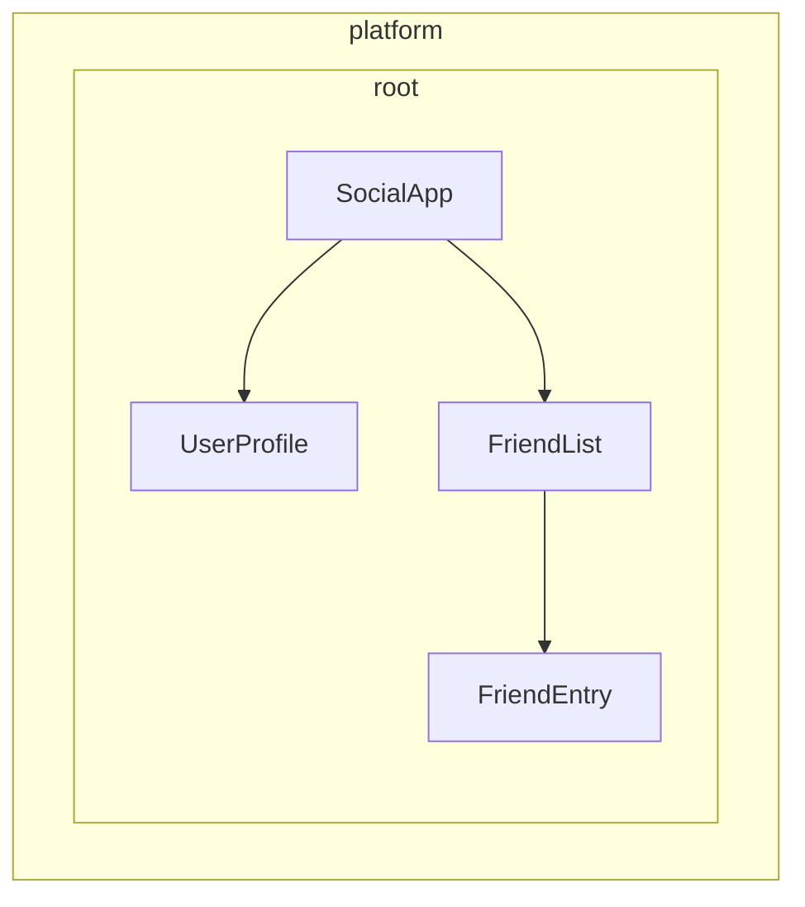
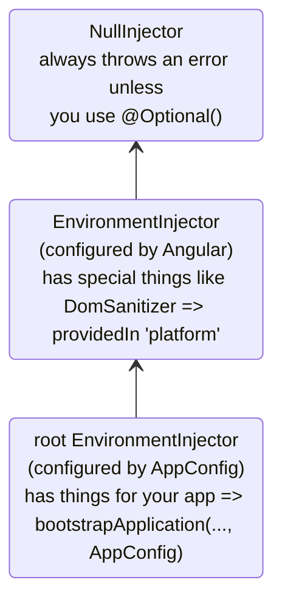
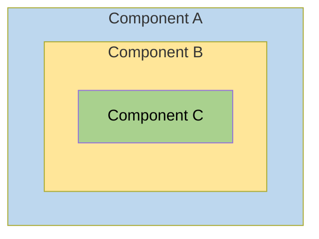
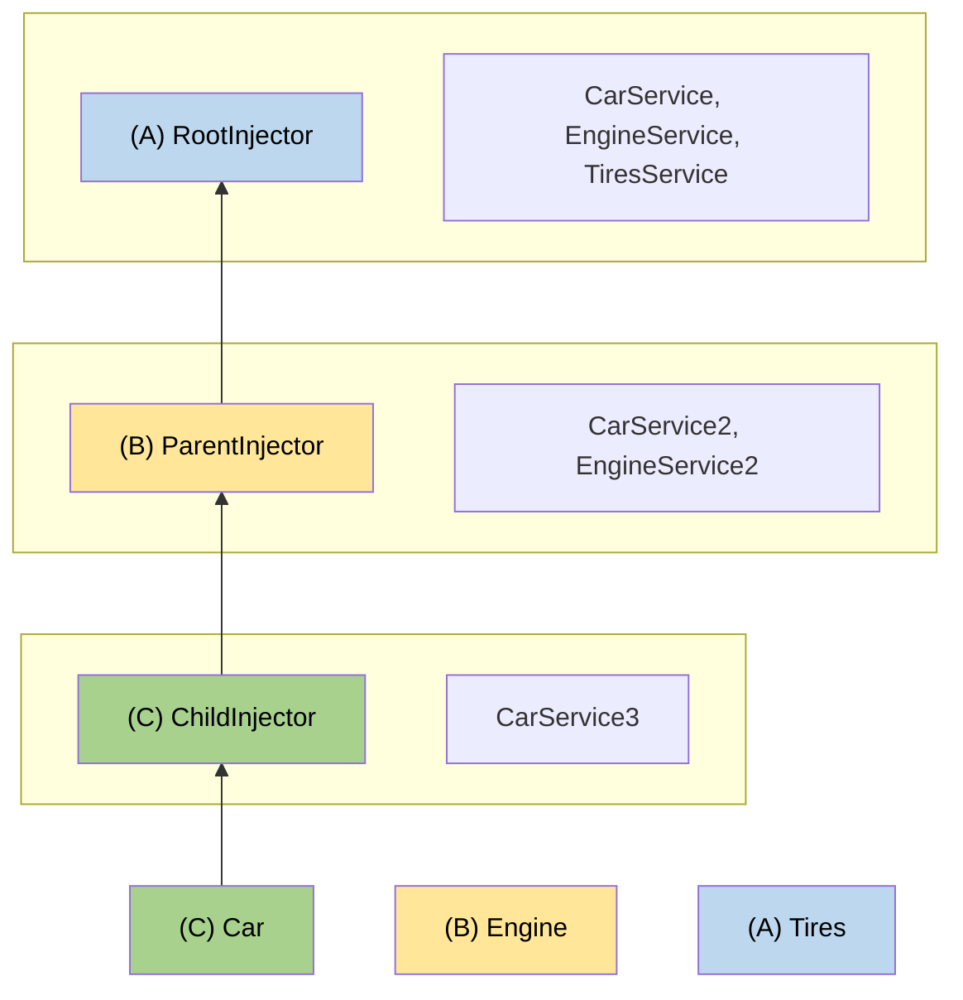

### Async reactivity with resources
Source: https://angular.dev/guide/signals/resource

# Async reactivity with resources

All signal APIs are synchronous— `signal`, `computed`, `input`, etc. However, applications often need to deal with data that is available asynchronously. A `Resource` gives you a way to incorporate async data into your application's signal-based code and still allow you to access its data synchronously.

You can use a `Resource` to perform any kind of async operation, but the most common use-case for `Resource` is fetching data from a server. The following example creates a resource to fetch some user data.

The easiest way to create a `Resource` is the `resource` function.

```typescript
import {computed, resource, Signal} from '@angular/core';

const userId: Signal<string> = getUserId();

const userResource = resource({
  // Define a reactive computation.
  // The params value recomputes whenever any read signals change.
  params: () => ({id: userId()}),

  // Define an async loader that retrieves data.
  // The resource calls this function every time the `params` value changes.
  loader: ({params}) => fetchUser(params),
});

// Create a computed signal based on the result of the resource's loader function.
const firstName = computed(() => {
  if (userResource.hasValue()) {
    // `hasValue` serves 2 purposes:
    // - It acts as type guard to strip `undefined` from the type
    // - It protects against reading a throwing `value` when the resource is in error state
    return userResource.value().firstName;
  }

  // fallback in case the resource value is `undefined` or if the resource is in error state
  return undefined;
});
```

The `resource` function accepts a `ResourceOptions` object with two main properties: `params` and `loader`.

The `params` property defines a reactive computation that produces a parameter value. Whenever signals read in this computation change, the resource produces a new parameter value, similar to `computed`.

The `loader` property defines a `ResourceLoader`— an async function that retrieves some state. The resource calls the loader every time the `params` computation produces a new value, passing that value to the loader. See [Resource loaders](#resource-loaders) below for more details.

`Resource` has a `value` signal that contains the results of the loader.

## Resource loaders

When creating a resource, you specify a `ResourceLoader`. This loader is an async function that accepts a single parameter— a `ResourceLoaderParams` object— and returns a value.

The `ResourceLoaderParams` object contains three properties: `params`, `previous`, and `abortSignal`.

| Property      | Description                                                                                                                                      |
| ------------- | ------------------------------------------------------------------------------------------------------------------------------------------------ |
| `params`      | The value of the resource's `params` computation.                                                                                                |
| `previous`    | An object with a `status` property, containing the previous `ResourceStatus`.                                                                    |
| `abortSignal` | An [`AbortSignal`](https://developer.mozilla.org/en-US/docs/Web/API/AbortSignal). See [Aborting requests](#aborting-requests) below for details. |

If the `params` computation returns `undefined`, the loader function does not run and the resource status becomes `'idle'`.

### Streaming resources

Some asynchronous data sources produce multiple values over time instead of returning a single result. Examples include WebSockets, Server-Sent Events (SSE), and Firestore `onSnapshot` listeners.

Use `stream` for these continuously updating data sources. Unlike `loader`, which resolves once for each request, `stream` returns a signal whose value can continue to update as new data becomes available.

Use `loader` for one-time asynchronous operations, such as fetching data from an HTTP endpoint.

In this example, `userUpdates` simulates an external source such as a WebSocket or SSE connection.

```typescript
const userUpdates = signal({value: 'Alice'});

const userResource = resource({
  stream: () => userUpdates,
});

// Simulate a new value arriving from the external data source:
userUpdates.set({value: 'Bob'});
```

### Aborting requests

A resource aborts an outstanding loading operation if the `params` computation changes while the resource is loading.

You can use the `abortSignal` in `ResourceLoaderParams` to respond to aborted requests. For example, the native `fetch` function accepts an `AbortSignal`:

```typescript
const userId: Signal<string> = getUserId();

const userResource = resource({
  params: () => ({id: userId()}),
  loader: ({params, abortSignal}): Promise<User> => {
    // fetch cancels any outstanding HTTP requests when the given `AbortSignal`
    // indicates that the request has been aborted.
    return fetch(`users/${params.id}`, {signal: abortSignal}).then((res) => res.json());
  },
});
```

See [`AbortSignal` on MDN](https://developer.mozilla.org/en-US/docs/Web/API/AbortSignal) for more details on request cancellation with `AbortSignal`.

### Reloading

You can programmatically trigger a resource's `loader` by calling the `reload` method.

```typescript
const userId: Signal<string> = getUserId();

const userResource = resource({
  params: () => ({id: userId()}),
  loader: ({params}) => fetchUser(params),
});

// ...

userResource.reload();
```

## Resource status

The resource object has several signal properties for reading the status of the asynchronous loader.

| Property    | Description                                                                                                                                                                                  |
| ----------- | -------------------------------------------------------------------------------------------------------------------------------------------------------------------------------------------- |
| `value`     | The most recent value of the resource, or the default value (`undefined` unless `defaultValue` is set) if no value has been received. Reading `value()` throws when the status is `'error'`. |
| `hasValue`  | Whether the resource has a value.                                                                                                                                                            |
| `error`     | The most recent error encountered while running the resource's loader, or `undefined` if no error has occurred.                                                                              |
| `isLoading` | Whether the resource loader is currently running.                                                                                                                                            |
| `status`    | The resource's specific `ResourceStatus`, as described below.                                                                                                                                |

The `status` signal provides a specific `ResourceStatus` that describes the state of the resource using a string constant.

| Status        | `value()`         | Description                                                                  |
| ------------- | :---------------- | ---------------------------------------------------------------------------- |
| `'idle'`      | `undefined`       | The resource has no valid request and the loader has not run.                |
| `'error'`     | Throws an error   | The loader has encountered an error.                                         |
| `'loading'`   | `undefined`       | The loader is running as a result of the `params` value changing.            |
| `'reloading'` | Previous value    | The loader is running as a result of calling the resource's `reload` method. |
| `'resolved'`  | Resolved value    | The loader has completed.                                                    |
| `'local'`     | Locally set value | The resource's value has been set locally via `.set()` or `.update()`        |

You can use this status information to conditionally display user interface elements, such as loading indicators and error messages.

## Caching `resource` data with SSR

When an application renders on the server, a resource loader runs once to produce the initial HTML. During hydration, the browser normally runs the same loader again.

To reuse the server result, provide an `id` for the resource. Angular stores the resolved value in `TransferState` on the server and uses it on the client to initialize the resource in a `'resolved'` state.

```ts
const userId: Signal<string> = getUserId();

const userResource = resource({
  params: () => ({id: userId()}),
  loader: ({params}) => fetchUser(params),
  id: 'user-unique-id',
});
```

The `id` value must be unique within your application and identical on the server and the client so that Angular can match the cached entry to the resource that requested it.

IMPORTANT: Because the cached value is serialized into the page's HTML, avoid setting `id` on resources that load data specific to the user who triggered the server-side render, especially if the rendered HTML can be cached or shared between users.

## Chaining resources

Sometimes one resource depends on the result of another. You can express this dependency using the `chain` function available in the `params` context object.

```typescript
import {resource} from '@angular/core';

const userResource = resource({
  params: () => ({id: getUserId()}),
  loader: ({params}) => fetchUser(params),
});

const companyResource = resource({
  params: ({chain}) => chain(userResource)?.companyId,
  loader: ({params: companyId}) => fetchCompany(companyId),
});
```

Here `companyResource` depends on the user's `companyId`, which is only known once `userResource` has loaded. `chain(userResource)` reads the value of `userResource` and automatically propagates its status to `companyResource`:

- If `userResource` is **idle**, `companyResource` also becomes `idle`.
- If `userResource` is **loading** or **reloading**, `companyResource` enters the `loading` state and its loader does not run. Note that during `reloading`, `chain` does not return the previously resolved value.
- If `userResource` is in an **error** state, `companyResource` also enters the `error` state.
- If `userResource` is **resolved** or **local**, `chain` returns its current value, which `companyResource` then uses as its params.

When `chain` propagates a status from `userResource` (`idle`, `loading`, `reloading`, or `error`), the params function does not continue. When `userResource` is `resolved` or `local`, `chain` returns its value, which can itself be `undefined`. The example handles this with `chain(userResource)?.companyId`, so an `undefined` value results in `undefined` params and `companyResource` becomes `idle`.

NOTE: Pass the chained value directly as the params value rather than wrapping it in an object. A params value like `{companyId: undefined}` is still a defined value, so the loader would run with an `undefined` `companyId` instead of the resource becoming `idle`.

### Chaining vs. reading resource values directly

You might be tempted to read a resource's value directly inside `params`:

```typescript {avoid, header: 'reads value() directly without status propagation'}
const companyResource = resource({
  params: () => {
    const user = userResource.value(); // may be undefined
    return user ? {companyId: user.companyId} : undefined;
  },
  loader: ({params}) => fetchCompany(params.companyId),
});
```

While this works, returning `undefined` from `params` makes the resource go `idle` rather than reflecting the actual state of the upstream resource. Using `chain` is preferred because it correctly mirrors `loading` and `error` states.

Reach for `chain` only when the downstream resource performs its own async work that depends on the upstream value. If you only need to derive a value synchronously from a resource, use `computed` instead.

## Reactive data fetching with `httpResource`

[`httpResource`](/guide/http/http-resource) is a wrapper around `HttpClient` that gives you the request status and response as signals. It makes HTTP requests through the Angular HTTP stack, including interceptors.

## Resource composition with snapshots

A `ResourceSnapshot` is a structured representation of a resource's current state. Every resource has a `snapshot` property that provides a signal of its current state.

```ts
const userId: Signal<string> = getUserId();

const userResource = resource({
  params: () => ({id: userId()}),
  loader: ({params}) => fetchUser(params),
});

const userSnapshot = userResource.snapshot;
```

Each snapshot contains a `status` and either a `value` or an `error`.

### Composing resources with snapshots

IMPORTANT: `resourceFromSnapshots` is [experimental](reference/releases#experimental). It's ready for you to try, but it might change before it is stable.

You can create new resources from snapshots using `resourceFromSnapshots`. This enables composition with signal APIs like `computed` and `linkedSignal` to transform resource behavior.

```ts
import {
  Component,
  input,
  linkedSignal,
  resourceFromSnapshots,
  Resource,
  ResourceSnapshot,
} from '@angular/core';
import {httpResource} from '@angular/common/http';

function withPreviousValue<T>(input: Resource<T>): Resource<T> {
  const derived = linkedSignal<ResourceSnapshot<T>, ResourceSnapshot<T>>({
    source: input.snapshot,
    computation: (snap, previous) => {
      if (snap.status === 'loading' && previous && previous.value.status !== 'error') {
        // When the input resource enters loading state, we keep the value
        // from its previous state, if any.
        return {status: 'loading' as const, value: previous.value.value};
      }

      // Otherwise we simply forward the state of the input resource.
      return snap;
    },
  });

  return resourceFromSnapshots(derived);
}

@Component({/*... */})
export class AwesomeProfile {
  userId = input.required<number>();
  user = withPreviousValue(httpResource(() => `/user/${this.userId()}`));
  // When userId changes, user.value() keeps the old user data until the new one loads
}
```

---


## Dependency injection (DI)

### Dependency Injection overview
Source: https://angular.dev/guide/di


Dependency Injection (DI) is a design pattern you use to organize and share code across your application by supplying dependencies to a class instead of creating them inside it.

TIP: Check out Angular's [Essentials](essentials/dependency-injection) before diving into this comprehensive guide.

As an application grows, developers often need to reuse and share functionality across different parts of the codebase. [Dependency Injection (DI)](https://en.wikipedia.org/wiki/Dependency_injection) helps you achieve this by allowing you to provide dependencies to a class instead of creating them directly inside it. This makes different parts of the application more reusable and easier to manage.

Dependency injection is a popular pattern because it allows developers to address common challenges such as:

- **Improved code maintainability**: Dependency injection promotes a clear separation of concerns, making code easier to refactor and reducing duplication.
- **Scalability**: You can reuse modular functionality across different parts of an application, making it easier to scale.
- **Better testing**: DI allows unit tests to use [test doubles](https://en.wikipedia.org/wiki/Test_double) in place of real implementations when needed.

## How does dependency injection work in Angular?

A dependency is any object, value, function, or service that a class requires to work but does not create itself. Instead, you provide it from the outside, creating a clear relationship between different parts of the application.

You interact with a dependency injection system in two main ways:

- You can _provide_, or make available, values.
- You can _inject_, or ask for, those values as dependencies.

In this context, "values" can refer to any JavaScript value, including objects, functions, or class instances. Common types of injected dependencies include:

- **Configuration values**: Environment-specific constants, API URLs, feature flags, etc.
- **Factories**: Functions that create objects or values based on runtime conditions
- **Services**: Classes that provide common functionality, business logic, or state

Angular components and directives automatically participate in DI, meaning that you can inject dependencies into them and make them available for injection.

## What are services?

An Angular _service_ is a TypeScript class decorated with `@Service`, which allows you to inject an instance of the class as a dependency. Services are the most common way of sharing data and functionality across an application.

Common types of services include:

- **Data clients:** Abstracts the details of making requests to a server for data retrieval and mutation
- **State management:** Defines state shared across multiple components or pages
- **Authentication and authorization:** Manages user authentication, token storage, and access control
- **Logging and error handling:** Establishes a common API for logging or communicating error states to the user
- **Event handling and dispatch:** Handles events or notifications that are not associated with a specific component, or for dispatching events and notifications to components, following the [observer pattern](https://en.wikipedia.org/wiki/Observer_pattern)
- **Utility functions:** Offers reusable utility functions like data formatting, validation, or calculations

The following example declares a service named `AnalyticsLogger`:

```ts
import {Service} from '@angular/core';

@Service()
export class AnalyticsLogger {
  trackEvent(category: string, value: string) {
    console.log('Analytics event logged:', {
      category,
      value,
      timestamp: new Date().toISOString(),
    });
  }
}
```

NOTE: The `@Service` makes this service available throughout your entire application as a singleton. This is the recommended approach for most services.

HELPFUL: The [`@Service`](guide/di/creating-and-using-services#using-the-service-vs-injectable-decorator) decorator is an ergonomic shorthand for `@Injectable({providedIn: 'root'})`.

## Injecting dependencies with `inject()`

You can inject dependencies using Angular's `inject()` function.

Here is an example of a navigation bar that injects `AnalyticsLogger` and Angular `Router` service to allow users to navigate to a different page while tracking the event.

```angular-ts
import {Component, inject} from '@angular/core';
import {Router} from '@angular/router';
import {AnalyticsLogger} from './analytics-logger';

@Component({
  selector: 'app-navbar',
  template: `<a href="#" (click)="navigateToDetail($event)">Detail Page</a>`,
})
export class Navbar {
  private router = inject(Router);
  private analytics = inject(AnalyticsLogger);

  navigateToDetail(event: Event) {
    event.preventDefault();
    this.analytics.trackEvent('navigation', '/details');
    this.router.navigate(['/details']);
  }
}
```

### Where can `inject()` be used?

You can inject dependencies during construction of a component, directive, or service. The call to [`inject`](/api/core/inject) can appear in either the `constructor` or in a field initializer. Here are some common examples:

```ts
@Component(/* ... */)
export class MyComponent {
  // ✅ In class field initializer
  private service = inject(MyService);

  // ✅ In constructor body
  private anotherService: MyService;

  constructor() {
    this.anotherService = inject(MyService);
  }
}
```

```ts
@Directive({...})
export class MyDirective {
  // ✅ In class field initializer
  private element = inject(ElementRef);
}
```

```ts
import {Service, inject} from '@angular/core';
import {HttpClient} from '@angular/common/http';

@Service()
export class MyService {
  // ✅ In a service
  private http = inject(HttpClient);
}
```

```ts
export const authGuard = () => {
  // ✅ In a route guard
  const auth = inject(AuthService);
  return auth.isAuthenticated();
};
```

Angular uses the term "injection context" to describe any place in your code where you can call [`inject`](/api/core/inject). While component, directive, and service construction is the most common, see [injection contexts](/guide/di/dependency-injection-context) for more details.

For more information, see the [inject API docs](api/core/inject#usage-notes).

## Next steps

Now that you understand the fundamentals of dependency injection in Angular, you're ready to learn how to create your own services.

The next guide, [Creating and using services](guide/di/creating-and-using-services), will show you:

- How to create a service with the Angular CLI or manually
- How the `providedIn: 'root'` pattern works
- How to inject services into components and other services

This covers the most common use case for services in Angular applications.

---

### Creating and using services
Source: https://angular.dev/guide/di/creating-and-using-services

# Creating and using services

Services are reusable pieces of code that you can share across your Angular application. You commonly use them to handle data fetching, business logic, or other functionality that multiple components need to access.

## Creating a service

You can create a service using the [Angular CLI](tools/cli) with the following command:

```bash
ng generate service CUSTOM_NAME
```

This command creates a dedicated `CUSTOM_NAME.ts` file in your `src` directory.

You can also manually create a service by adding the `@Service()` decorator to a TypeScript class. This tells Angular that you can use the class as an injectable dependency.

The following example defines a service that allows users to add and retrieve data:

```ts {header: "src/app/basic-data-store.ts"}
import {Service} from '@angular/core';

@Service()
export class BasicDataStore {
  private data: string[] = [];

  addData(item: string): void {
    this.data.push(item);
  }

  getData(): string[] {
    return [...this.data];
  }
}
```

## How services become available

Services are provisioned at the root level by default. When a service is provided globally, Angular guarantees three main benefits:

- **Singleton Instance:** Creates a single, shared instance for the entire application.
- **Global Availability:** Automatically accessible anywhere without manual provider registration.
- **Tree-shakability:** Ensures the service is excluded from the final production bundle if your code never explicitly uses it.

### Using the `@Service` vs `@Injectable` decorator

The `@Service` decorator serves as a modern, ergonomic shorthand for the traditional `@Injectable({ providedIn: 'root' })` syntax.

Use this quick reference to decide which decorator fits your scenario:

| Feature / Requirement                         | `@Service` | `@Injectable`                           |
| --------------------------------------------- | ---------- | --------------------------------------- |
| **`inject()` function support**               | Yes        | Yes                                     |
| **Constructor-based DI**                      | ❌ No      | Yes                                     |
| **Implicit root singleton provider**          | Yes        | ❌ No (requires `{providedIn: 'root'}`) |
| **Advanced provider keys (`useClass`, etc.)** | ❌ No      | Yes                                     |
| **Custom initialization factories**           | Yes        | Yes                                     |
| **Non-root scopes (`platform`, etc.)**        | ❌ No      | Yes                                     |

### Replacing the implementation with a factory

If you need to control how the singleton is created, for example, to swap in a different implementation depending on the environment, pass a `factory` function.

The factory runs in an [injection context](guide/di/dependency-injection-context), so you can use [`inject()`](api/core/inject) inside it to read other dependencies.

The following `Analytics` service is a no-op locally so events don't pollute the console during development. In production, the factory reads an `ANALYTICS_ENABLED` token and returns a `GoogleAnalytics` subclass that forwards events to the real tracker:

```ts {header: "src/app/analytics.ts"}
import {inject, InjectionToken, Service} from '@angular/core';
import {ANALYTICS_ENABLED} from './token';

@Service({
  factory: () => (inject(ANALYTICS_ENABLED) ? new GoogleAnalytics() : new Analytics()),
})
export class Analytics {
  track(event: string, payload?: Record<string, unknown>) {
    // No-op by default.
  }
}

class GoogleAnalytics extends Analytics {
  override track(event: string, payload?: Record<string, unknown>) {
    // Dispatches an analytics event to Google Analytics
  }
}
```

NOTE: The `factory` option replaces the `useClass`, `useValue`, `useExisting`, and `useFactory` options of `@Injectable`. If you need any of those, keep using `@Injectable`.

### Opting out of automatic provisioning

By default, `@Service` provides the class at the root injector. If you want to provide it manually, for example, to scope it to a specific route or component, set `autoProvided: false`:

```ts {header: "src/app/analytics-logger.ts"}
import {Service} from '@angular/core';

@Service({autoProvided: false})
export class AnalyticsLogger {
  trackEvent(name: string) {
    console.log('event:', name);
  }
}
```

You are then responsible for adding the service to a `providers` array, just like with a plain `@Injectable()`:

### When to use `@Service` vs `@Injectable`

Reach for `@Service` when you are creating a new singleton class that uses `inject()` for its dependencies. Keep using `@Injectable` when you need any of the following:

- **Constructor-based dependency injection.** `@Service` only supports the [`inject()`](api/core/inject) function.
- **Advanced provider configuration** such as `useClass`, `useValue`, `useExisting`, or `useFactory`. `@Service` exposes a single `factory` option instead.
- **Non-root scopes** such as `providedIn: 'platform'`.

## Injecting a service

Once you've created a service with `providedIn: 'root'`, you can inject it anywhere in your application using the `inject()` function from `@angular/core`.

### Injecting into a component

```angular-ts
import {Component, inject} from '@angular/core';
import {BasicDataStore} from './basic-data-store';

@Component({
  selector: 'app-example',
  template: `
  `,
})
export class Example {
  dataStore = inject(BasicDataStore);
}
```

### Injecting into another service

```ts
import {inject, Service} from '@angular/core';
import {AdvancedDataStore} from './advanced-data-store';

@Service()
export class BasicDataStore {
  private advancedDataStore = inject(AdvancedDataStore);
  private data: string[] = [];

  addData(item: string): void {
    this.data.push(item);
  }

  getData(): string[] {
    return [...this.data, ...this.advancedDataStore.getData()];
  }
}
```

## Next steps

While `providedIn: 'root'` covers most use cases, Angular also provides additional ways you can configure services for more specialized scenarios:

- **Component-specific instances** - When components need their own isolated service instances
- **Manual configuration** - For services that require runtime configuration
- **Factory providers** - For dynamic service creation based on runtime conditions
- **Value providers** - For providing configuration objects or constants

You can learn more about these advanced patterns in the next guide: [defining dependency providers](/guide/di/defining-dependency-providers).

---

### Defining dependency providers
Source: https://angular.dev/guide/di/defining-dependency-providers

# Defining dependency providers

Angular provides two ways to make services available for injection:

1. **Automatic provision** - Using `providedIn` in the `@Injectable` decorator, the [`@Service`](guide/di/creating-and-using-services#using-the-service-vs-injectable-decorator) decorator, or by providing a factory in the `InjectionToken` configuration
2. **Manual provision** - Using the `providers` array in components, directives, routes, or application config

In the [previous guide](/guide/di/creating-and-using-services), you learned how to create services using `providedIn: 'root'`, which handles most common use cases. This guide explores additional patterns for both automatic and manual provider configuration.

## Automatic provision for non-class dependencies

While the `@Injectable` decorator with `providedIn: 'root'` works great for services (classes), you might need to provide other types of values globally - like configuration objects, functions, or primitive values. Angular provides `InjectionToken` for this purpose.

### What is an InjectionToken?

An `InjectionToken` is an object that Angular's dependency injection system uses to uniquely identify values for injection. Think of it as a special key that lets you store and retrieve any type of value in Angular's DI system:

```ts
import {InjectionToken} from '@angular/core';

// Create a token for a string value
export const API_URL = new InjectionToken<string>('api.url');

// Create a token for a function
export const LOGGER = new InjectionToken<(msg: string) => void>('logger.function');

// Create a token for a complex type
export interface Config {
  apiUrl: string;
  timeout: number;
}
export const CONFIG_TOKEN = new InjectionToken<Config>('app.config');
```

NOTE: The string parameter (e.g., `'api.url'`) is a description purely for debugging — Angular identifies tokens by their object reference, not this string.

### InjectionToken with `providedIn: 'root'`

An `InjectionToken` that has a `factory` results in `providedIn: 'root'` by default (but can be overridden via the `providedIn` prop).

```ts {header: "/app/config.token.ts"}
import {InjectionToken, Component, inject} from '@angular/core';

export interface AppConfig {
  apiUrl: string;
  version: string;
  features: Record<string, boolean>;
}

// Globally available configuration using providedIn
export const APP_CONFIG = new InjectionToken<AppConfig>('app.config', {
  providedIn: 'root',
  factory: () => ({
    apiUrl: 'https://api.example.com',
    version: '1.0.0',
    features: {
      darkMode: true,
      analytics: false,
    },
  }),
});

// No need to add to providers array - available everywhere!
@Component({
  selector: 'app-header',
  template: `<h1>Version: {{ config.version }}</h1>`,
})
export class Header {
  config = inject(APP_CONFIG); // Automatically available
}
```

### When to use InjectionToken with factory functions

InjectionToken with factory functions is ideal when you can't use a class but need to provide dependencies globally:

```ts {header: "/app/logger.token.ts"}
import {InjectionToken, inject} from '@angular/core';
import {APP_CONFIG} from './config.token';

// Logger function type
export type LoggerFn = (level: string, message: string) => void;

// Global logger function with dependencies
export const LOGGER_FN = new InjectionToken<LoggerFn>('logger.function', {
  providedIn: 'root',
  factory: () => {
    const config = inject(APP_CONFIG);

    return (level: string, message: string) => {
      if (config.features.logging !== false) {
        console[level](`[${new Date().toISOString()}] ${message}`);
      }
    };
  },
});
```

```ts {header: "/app/storage.token.ts"}
// Providing browser APIs as tokens
export const LOCAL_STORAGE = new InjectionToken<Storage>('localStorage', {
  // providedIn: 'root' is configured as the default
  factory: () => window.localStorage,
});

export const SESSION_STORAGE = new InjectionToken<Storage>('sessionStorage', {
  providedIn: 'root',
  factory: () => window.sessionStorage,
});
```

```ts {header: "/app/feature-flags.token.ts"}
// Complex configuration with runtime logic
export const FEATURE_FLAGS = new InjectionToken<Map<string, boolean>>('feature.flags', {
  providedIn: 'root',
  factory: () => {
    const flags = new Map<string, boolean>();

    // Parse from environment or URL params
    const urlParams = new URLSearchParams(window.location.search);
    const enableBeta = urlParams.get('beta') === 'true';

    flags.set('betaFeatures', enableBeta);
    flags.set('darkMode', true);
    flags.set('newDashboard', false);

    return flags;
  },
});
```

This approach offers several advantages:

- **No manual provider configuration needed** - Works just like `providedIn: 'root'` for services
- **Tree-shakeable** - Only included if actually used
- **Type-safe** - Full TypeScript support for non-class values
- **Can inject other dependencies** - Factory functions can use `inject()` to access other services

## Understanding manual provider configuration

When you need more control than `providedIn: 'root'` offers, you can manually configure providers. Manual configuration through the `providers` array is useful when:

1. **The service doesn't have `providedIn`** - Services without automatic provision must be manually provided
2. **You want a new instance** - To create a separate instance at the component/directive level instead of using the shared one
3. **You need runtime configuration** - When service behavior depends on runtime values
4. **You're providing non-class values** - Configuration objects, functions, or primitive values

### Example: Service without `providedIn`

```ts
import {Injectable, Component, inject} from '@angular/core';

// Service without providedIn
@Injectable()
export class LocalDataStore {
  private data: string[] = [];

  addData(item: string) {
    this.data.push(item);
  }
}

// Component must provide it
@Component({
  selector: 'app-example',
  // A provider is required here because the `LocalDataStore` service has no providedIn.
  providers: [LocalDataStore],
  template: `...`,
})
export class Example {
  dataStore = inject(LocalDataStore);
}
```

### Example: Creating component-specific instances

Services with `providedIn: 'root'` can be overridden at the component level. This ties the instance of the service to the life of a component. As a result, when the component gets destroyed, the provided service is also destroyed as well.

```ts
import {Injectable, Component, inject} from '@angular/core';

@Injectable({providedIn: 'root'})
export class DataStore {
  private data: ListItem[] = [];
}

// This component gets its own instance
@Component({
  selector: 'app-isolated',
  // Creates new instance of `DataStore` rather than using the root-provided instance.
  providers: [DataStore],
  template: `...`,
})
export class Isolated {
  dataStore = inject(DataStore); // Component-specific instance
}
```

## Injector hierarchy in Angular

Angular's dependency injection system is hierarchical. When a component requests a dependency, Angular starts with that component's injector and walks up the tree until it finds a provider for that dependency. Each component in your application tree can have its own injector, and these injectors form a hierarchy that mirrors your component tree.

This hierarchy enables:

- **Scoped instances**: Different parts of your app can have different instances of the same service
- **Override behavior**: Child components can override providers from parent components
- **Memory efficiency**: Services are only instantiated where needed

In Angular, any element with a component or directive can provide values to all of its descendants.



In the example above:

1. `SocialApp` can provide values for `UserProfile` and `FriendList`
2. `FriendList` can provide values for injection to `FriendEntry`, but cannot provide values for injection in `UserProfile` because it's not part of the tree

## Declaring a provider

Think of Angular's dependency injection system as a hash map or dictionary. Each provider configuration object defines a key-value pair:

- **Key (Provider identifier)**: The unique identifier you use to request a dependency
- **Value**: What Angular should return when that token is requested

When manually providing dependencies, you typically see this shorthand syntax:

```angular-ts
import {Component} from '@angular/core';
import {LocalService} from './local-service';

@Component({
  selector: 'app-example',
  providers: [LocalService], // Service without providedIn
})
export class Example {}
```

This is actually a shorthand for a more detailed provider configuration:

```ts
{
  // This is the shorthand version
  providers: [LocalService],

  // This is the full version
  providers: [
    { provide: LocalService, useClass: LocalService }
  ]
}
```

### Provider configuration object

Every provider configuration object has two primary parts:

1. **Provider identifier**: The unique key that Angular uses to get the dependency (set via the `provide` property)
2. **Value**: The actual dependency that you want Angular to fetch, configured with different keys based on the desired type:
   - `useClass` - Provides a JavaScript class
   - `useValue` - Provides a static value
   - `useFactory` - Provides a factory function that returns the value
   - `useExisting` - Provides an alias to an existing provider

### Provider identifiers

Provider identifiers allow Angular's dependency injection (DI) system to retrieve a dependency through a unique ID. You can generate provider identifiers in two ways:

1. [Class names](#class-names)
2. [Injection tokens](#injection-tokens)

#### Class names

Class names use the imported class directly as the identifier:

```angular-ts
import {Component} from '@angular/core';
import {LocalService} from './local-service';

@Component({
  selector: 'app-example',
  providers: [{provide: LocalService, useClass: LocalService}],
})
export class Example {
  /* ... */
}
```

The class serves as both the identifier and the implementation, which is why Angular provides the shorthand `providers: [LocalService]`.

#### Injection tokens

Angular provides a built-in [`InjectionToken`](api/core/InjectionToken) class that creates a unique object reference for injectable values or when you want to provide multiple implementations of the same interface.

```ts {header: "/app/tokens.ts"}
import {InjectionToken} from '@angular/core';
import {DataService} from './data-service.interface';

export const DATA_SERVICE_TOKEN = new InjectionToken<DataService>('DataService');
```

NOTE: The string `'DataService'` is a description used purely for debugging purposes. Angular identifies the token by its object reference, not this string.

Use the token in your provider configuration:

```angular-ts
import {Component, inject} from '@angular/core';
import {LocalDataService} from './local-data-service';
import {DATA_SERVICE_TOKEN} from './tokens';

@Component({
  selector: 'app-example',
  providers: [{provide: DATA_SERVICE_TOKEN, useClass: LocalDataService}],
})
export class Example {
  private dataService = inject(DATA_SERVICE_TOKEN);
}
```

#### Can TypeScript interfaces be identifiers for injection?

TypeScript interfaces cannot be used for injection because they don't exist at runtime:

```ts
// ❌ This won't work!
interface DataService {
  getData(): string[];
}

// Interfaces disappear after TypeScript compilation
@Component({
  providers: [
    {provide: DataService, useClass: LocalDataService}, // Error!
  ],
})
export class Example {
  private dataService = inject(DataService); // Error!
}

// ✅ Use InjectionToken instead
export const DATA_SERVICE_TOKEN = new InjectionToken<DataService>('DataService');

@Component({
  providers: [{provide: DATA_SERVICE_TOKEN, useClass: LocalDataService}],
})
export class Example {
  private dataService = inject(DATA_SERVICE_TOKEN); // Works!
}
```

The InjectionToken provides a runtime value that Angular's DI system can use, while still maintaining type safety through TypeScript's generic type parameter.

### Provider value types

#### useClass

`useClass` provides a JavaScript class as a dependency. This is the default when using the shorthand syntax:

```ts
// Shorthand
providers: [DataService];

// Full syntax
providers: [{provide: DataService, useClass: DataService}];

// Different implementation
providers: [{provide: DataService, useClass: MockDataService}];

// Conditional implementation
providers: [
  {
    provide: StorageService,
    useClass: environment.production ? CloudStorageService : LocalStorageService,
  },
];
```

#### Practical example: Logger substitution

You can substitute implementations to extend functionality:

```ts
import {Injectable, Component, inject} from '@angular/core';

// Base logger
@Injectable()
export class Logger {
  log(message: string) {
    console.log(message);
  }
}

// Enhanced logger with timestamp
@Injectable()
export class BetterLogger extends Logger {
  override log(message: string) {
    super.log(`[${new Date().toISOString()}] ${message}`);
  }
}

// Logger that includes user context
@Injectable()
export class EvenBetterLogger extends Logger {
  private userService = inject(UserService);

  override log(message: string) {
    const name = this.userService.user.name;
    super.log(`Message to ${name}: ${message}`);
  }
}

// In your component
@Component({
  selector: 'app-example',
  providers: [
    UserService, // EvenBetterLogger needs this
    {provide: Logger, useClass: EvenBetterLogger},
  ],
})
export class Example {
  private logger = inject(Logger); // Gets EvenBetterLogger instance
}
```

#### useValue

`useValue` provides any JavaScript data type as a static value:

```ts
providers: [
  {provide: API_URL_TOKEN, useValue: 'https://api.example.com'},
  {provide: MAX_RETRIES_TOKEN, useValue: 3},
  {provide: FEATURE_FLAGS_TOKEN, useValue: {darkMode: true, beta: false}},
];
```

IMPORTANT: TypeScript types and interfaces cannot serve as dependency values. They exist only at compile-time.

#### Practical example: Application configuration

A common use case for `useValue` is providing application configuration:

```ts
// Define configuration interface
export interface AppConfig {
  apiUrl: string;
  appTitle: string;
  features: {
    darkMode: boolean;
    analytics: boolean;
  };
}

// Create injection token
export const APP_CONFIG = new InjectionToken<AppConfig>('app.config');

// Define configuration
const appConfig: AppConfig = {
  apiUrl: 'https://api.example.com',
  appTitle: 'My Application',
  features: {
    darkMode: true,
    analytics: false,
  },
};

// Provide in bootstrap
bootstrapApplication(AppComponent, {
  providers: [{provide: APP_CONFIG, useValue: appConfig}],
});

// Use in component
@Component({
  selector: 'app-header',
  template: `<h1>{{ title }}</h1>`,
})
export class Header {
  private config = inject(APP_CONFIG);
  title = this.config.appTitle;
}
```

#### useFactory

`useFactory` provides a function that generates a new value for injection:

```ts
export const loggerFactory = (config: AppConfig) => {
  return new LoggerService(config.logLevel, config.endpoint);
};

providers: [
  {
    provide: LoggerService,
    useFactory: loggerFactory,
    deps: [APP_CONFIG], // Dependencies for the factory function
  },
];
```

You can mark factory dependencies as optional:

```ts
import {Optional} from '@angular/core';

providers: [
  {
    provide: MyService,
    useFactory: (required: RequiredService, optional?: OptionalService) => {
      return new MyService(required, optional || new DefaultService());
    },
    deps: [RequiredService, [new Optional(), OptionalService]],
  },
];
```

#### Practical example: Configuration-based API client

Here's a complete example showing how to use a factory to create a service with runtime configuration:

```ts
// Service that needs runtime configuration
class ApiClient {
  constructor(
    private http: HttpClient,
    private baseUrl: string,
    private rateLimitMs: number,
  ) {}

  async fetchData(endpoint: string) {
    // Apply rate limiting based on user tier
    await this.applyRateLimit();
    return this.http.get(`${this.baseUrl}/${endpoint}`);
  }

  private async applyRateLimit() {
    // Simplified example - real implementation would track request timing
    return new Promise((resolve) => setTimeout(resolve, this.rateLimitMs));
  }
}

// Factory function that configures based on user tier
import {inject, Component} from '@angular/core';
import {HttpClient} from '@angular/common/http';
const apiClientFactory = () => {
  const http = inject(HttpClient);
  const userService = inject(UserService);

  // Assuming userService provides these values
  const baseUrl = userService.getApiBaseUrl();
  const rateLimitMs = userService.getRateLimit();

  return new ApiClient(http, baseUrl, rateLimitMs);
};

// Provider configuration
export const apiClientProvider = {
  provide: ApiClient,
  useFactory: apiClientFactory,
};

// Usage in component
@Component({
  selector: 'app-dashboard',
  providers: [apiClientProvider],
})
export class Dashboard {
  private apiClient = inject(ApiClient);
}
```

#### useExisting

`useExisting` creates an alias for a provider that was already defined. Both tokens return the same instance:

```ts
providers: [
  NewLogger, // The actual service
  {provide: OldLogger, useExisting: NewLogger}, // The alias
];
```

IMPORTANT: Don't confuse `useExisting` with `useClass`. `useClass` creates separate instances, while `useExisting` ensures you get the same singleton instance.

### Multiple providers

Use the `multi: true` flag when multiple providers contribute values to the same token:

```ts
export const INTERCEPTOR_TOKEN = new InjectionToken<Interceptor[]>('interceptors');

providers: [
  {provide: INTERCEPTOR_TOKEN, useClass: AuthInterceptor, multi: true},
  {provide: INTERCEPTOR_TOKEN, useClass: LoggingInterceptor, multi: true},
  {provide: INTERCEPTOR_TOKEN, useClass: RetryInterceptor, multi: true},
];
```

When you inject `INTERCEPTOR_TOKEN`, you'll receive an array containing instances of all three interceptors.

## Where can you specify providers?

Angular offers several levels where you can register providers, each with different implications for scope, lifecycle, and performance:

- [**Application bootstrap**](#application-bootstrap) - Global singletons available everywhere
- [**On an element (component or directive)**](#component-or-directive-providers) - Isolated instances for specific component trees
- [**Route**](#route-providers) - Feature-specific services for lazy-loaded modules

### Application bootstrap

Use application-level providers in `bootstrapApplication` when:

- **The service is used across multiple feature areas** - Services like HTTP clients, logging, or authentication that many parts of your app need
- **You want a true singleton** - One instance shared by the entire application
- **The service has no component-specific configuration** - General-purpose utilities that work the same everywhere
- **You're providing global configuration** - API endpoints, feature flags, or environment settings

```ts {header: "main.ts"}
bootstrapApplication(App, {
  providers: [
    {provide: API_BASE_URL, useValue: 'https://api.example.com'},
    {provide: INTERCEPTOR_TOKEN, useClass: AuthInterceptor, multi: true},
    LoggingService, // Used throughout the app
    {provide: ErrorHandler, useClass: GlobalErrorHandler},
  ],
});
```

**Benefits:**

- Single instance reduces memory usage
- Available everywhere without additional setup
- Easier to manage global state

**Drawbacks:**

- Always included in your JavaScript bundle, even if the value is never injected
- Cannot be easily customized per feature
- Harder to test individual components in isolation

#### Why provide during bootstrap instead of using `providedIn: 'root'`?

You might want a provider during bootstrap when:

- The provider has side-effects (e.g., installing the client-side router)
- The provider requires configuration (e.g., routes)
- You're using Angular's `provideSomething` pattern (e.g., `provideRouter`, `provideHttpClient`)

### Component or directive providers

Use component or directive providers when:

- **The service has component-specific state** - Form validators, component-specific caches, or UI state managers
- **You need isolated instances** - Each component needs its own copy of the service
- **The service is only used by one component tree** - Specialized services that don't need global access
- **You're creating reusable components** - Components that should work independently with their own services

```angular-ts
// Specialized form component with its own validation service
@Component({
  selector: 'app-advanced-form',
  providers: [
    FormValidationService, // Each form gets its own validator
    {provide: FORM_CONFIG, useValue: {strictMode: true}},
  ],
})
export class AdvancedForm {}

// Modal component with isolated state management
@Component({
  selector: 'app-modal',
  providers: [
    ModalStateService, // Each modal manages its own state
  ],
})
export class Modal {}
```

**Benefits:**

- Better encapsulation and isolation
- Easier to test components individually
- Multiple instances can coexist with different configurations

**Drawbacks:**

- New instance created for each component (higher memory usage)
- No shared state between components
- Must be provided wherever needed
- Always included in the same JavaScript bundle as the component or directive, even if the value is never injected

NOTE: If multiple directives on the same element provide the same token, one will win, but which one is undefined.

### Route providers

Use route-level providers for:

- **Feature-specific services** - Services only needed for particular routes or feature modules
- **Lazy-loaded module dependencies** - Services that should only load with specific features
- **Route-specific configuration** - Settings that vary by application area

```ts {header: "routes.ts"}
export const routes: Routes = [
  {
    path: 'admin',
    providers: [
      AdminService, // Only loaded with admin routes
      {provide: FEATURE_FLAGS, useValue: {adminMode: true}},
    ],
    loadChildren: () => import('./admin/admin.routes'),
  },
  {
    path: 'shop',
    providers: [
      ShoppingCartService, // Isolated shopping state
      PaymentService,
    ],
    loadChildren: () => import('./shop/shop.routes'),
  },
];
```

Services provided at the route level are available to all components and directives within that route, as well as to its guards and resolvers.

Since these services are instantiated independently of the route’s components, they do not have direct access to route-specific information.

## Library author patterns

When creating Angular libraries, you often need to provide flexible configuration options for consumers while maintaining clean APIs. Angular's own libraries demonstrate powerful patterns for achieving this.

### The `provide` pattern

Instead of requiring users to manually configure complex providers, library authors can export functions that return provider configurations:

```ts {header: "/libs/analytics/src/providers.ts"}
import {InjectionToken, Provider, inject} from '@angular/core';

// Configuration interface
export interface AnalyticsConfig {
  trackingId: string;
  enableDebugMode?: boolean;
  anonymizeIp?: boolean;
}

// Internal token for configuration
const ANALYTICS_CONFIG = new InjectionToken<AnalyticsConfig>('analytics.config');

// Main service that uses the configuration
export class AnalyticsService {
  private config = inject(ANALYTICS_CONFIG);

  track(event: string, properties?: any) {
    // Implementation using config
  }
}

// Provider function for consumers
export function provideAnalytics(config: AnalyticsConfig): Provider[] {
  return [{provide: ANALYTICS_CONFIG, useValue: config}, AnalyticsService];
}
```

```ts {header: "main.ts"}
// Usage in consumer app
bootstrapApplication(App, {
  providers: [
    provideAnalytics({
      trackingId: 'GA-12345',
      enableDebugMode: !environment.production,
    }),
  ],
});
```

### Advanced provider patterns with options

For more complex scenarios, you can combine multiple configuration approaches:

```ts {header: "/libs/http-client/src/provider.ts"}
import {Provider, InjectionToken, inject} from '@angular/core';
import {bootstrapApplication} from '@angular/platform-browser';

// Feature flags for optional functionality
export enum HttpFeatures {
  Interceptors = 'interceptors',
  Caching = 'caching',
  Retry = 'retry',
}

// Configuration interfaces
export interface HttpConfig {
  baseUrl?: string;
  timeout?: number;
  headers?: Record<string, string>;
}

export interface RetryConfig {
  maxAttempts: number;
  delayMs: number;
}

// Internal tokens
const HTTP_CONFIG = new InjectionToken<HttpConfig>('http.config');
const RETRY_CONFIG = new InjectionToken<RetryConfig>('retry.config');
const HTTP_FEATURES = new InjectionToken<Set<HttpFeatures>>('http.features');

// Core service
class HttpClientService {
  private config = inject(HTTP_CONFIG, {optional: true});
  private features = inject(HTTP_FEATURES);

  get(url: string) {
    // Use config and check features
  }
}

// Feature services
class RetryInterceptor {
  private config = inject(RETRY_CONFIG);
  // Retry logic
}

class CacheInterceptor {
  // Caching logic
}

// Main provider function
export function provideHttpClient(config?: HttpConfig, ...features: HttpFeature[]): Provider[] {
  const providers: Provider[] = [
    {provide: HTTP_CONFIG, useValue: config || {}},
    {provide: HTTP_FEATURES, useValue: new Set(features.map((f) => f.kind))},
    HttpClientService,
  ];

  // Add feature-specific providers
  features.forEach((feature) => {
    providers.push(...feature.providers);
  });

  return providers;
}

// Feature configuration functions
export interface HttpFeature {
  kind: HttpFeatures;
  providers: Provider[];
}

export function withInterceptors(...interceptors: any[]): HttpFeature {
  return {
    kind: HttpFeatures.Interceptors,
    providers: interceptors.map((interceptor) => ({
      provide: INTERCEPTOR_TOKEN,
      useClass: interceptor,
      multi: true,
    })),
  };
}

export function withCaching(): HttpFeature {
  return {
    kind: HttpFeatures.Caching,
    providers: [CacheInterceptor],
  };
}

export function withRetry(config: RetryConfig): HttpFeature {
  return {
    kind: HttpFeatures.Retry,
    providers: [{provide: RETRY_CONFIG, useValue: config}, RetryInterceptor],
  };
}

// Consumer usage with multiple features
bootstrapApplication(App, {
  providers: [
    provideHttpClient(
      {baseUrl: 'https://api.example.com'},
      withInterceptors(AuthInterceptor, LoggingInterceptor),
      withCaching(),
      withRetry({maxAttempts: 3, delayMs: 1000}),
    ),
  ],
});
```

### Why use provider functions instead of direct configuration?

Provider functions offer several advantages for library authors:

1. **Encapsulation** - Internal tokens and implementation details remain private
2. **Type safety** - TypeScript ensures correct configuration at compile time
3. **Flexibility** - Easily compose features with `with*` pattern
4. **Future-proofing** - Internal implementation can change without breaking consumers
5. **Consistency** - Aligns with Angular's own patterns (`provideRouter`, `provideHttpClient`, etc.)

This pattern is extensively used in Angular's own libraries and is considered a best practice for library authors who need to provide configurable services.

---

### Lazy loading services
Source: https://angular.dev/guide/di/lazy-loading-services

# Lazy loading services

IMPORTANT: For lazy loading to work, the service you load must be auto-provided. Decorate it with either `@Injectable({providedIn: 'root'})` or [`@Service()`](guide/di/creating-and-using-services#using-the-service-vs-injectable-decorator). Without auto-provisioning, Angular has no way to construct the service after it loads.

Angular's `injectAsync` function lets you load a service on demand, only when it's actually needed. This is useful when a service depends on a large library or rarely used feature, and you don't want to pay for it on the initial page load.

When you use `injectAsync`, the service's code is split out by your bundler into a separate JavaScript chunk and downloaded the first time you ask for the instance. Once loaded, Angular resolves the service through the regular DI system, so it can still depend on other injectables and behaves like any other singleton.

## Lazily injecting a service

Imagine a `ReportExporter` that depends on a heavy spreadsheet library. Most users open the report; only a few click **Export**. Load the exporter on demand:

```angular-ts
import {Component, injectAsync} from '@angular/core';

@Component({
  selector: 'app-report',
  template: `<button (click)="export()">Export</button>`,
})
export class Report {
  private exporter = injectAsync(() => import('./report-exporter').then((m) => m.ReportExporter));

  async export() {
    const exporter = await this.exporter();
    exporter.export();
  }
}
```

The first call to `this.exporter()` triggers the dynamic import and resolves the service from DI. Subsequent calls reuse the same promise, so the chunk is only fetched once.

If the lazy-loaded service is the [default export](https://developer.mozilla.org/docs/Web/JavaScript/Reference/Statements/export#using_the_default_export), pass the dynamic import directly, Angular unwraps the `default` for you:

```ts {header: "report-exporter.ts"}
@Service()
export default class ReportExporter {
  /* … */
}
```

```ts {header: "report.ts"}
private exporter = injectAsync(() => import('./report-exporter'));
```

## Prefetching the dependency

By default, the lazy chunk is only fetched when you invoke the returned function. You can start the download earlier by passing a `prefetch` trigger in the options. A trigger is any function that returns a `Promise`, when it resolves, Angular kicks off the loader.

Angular ships with `onIdle`, a built-in trigger that waits until the browser becomes idle:

```ts
import {Component, injectAsync, onIdle} from '@angular/core';

@Component({/* … */})
export class Report {
  private exporter = injectAsync(() => import('./report-exporter').then((m) => m.ReportExporter), {
    prefetch: onIdle,
  });
}
```

You can also configure `onIdle` with a maximum wait time so the prefetch always happens within a known window, even on busy pages:

```ts
injectAsync(loader, {prefetch: () => onIdle({timeout: 1_000})});
```

NOTE: Prefetching is opportunistic. If the user invokes the feature before the prefetch fires, Angular still loads the dependency immediately and resolves your `await` as soon as it's ready.

## Provide a custom prefetch trigger

A `PrefetchTrigger` is just a function that returns a promise, the loader runs as soon as the promise resolves. Use this to align prefetching with your own signals, such as a hover or a scheduler tick:

```ts
import {PrefetchTrigger} from '@angular/core';

export function onHover(target: HTMLElement): PrefetchTrigger {
  return () =>
    new Promise<void>((resolve) => {
      target.addEventListener('pointerenter', () => resolve(), {once: true});
    });
}
```

---

### Injection context
Source: https://angular.dev/guide/di/dependency-injection-context

# Injection context

The dependency injection (DI) system relies on a runtime context where the current injector is available.

This means that injectors only work when you execute code within this context.

You have an injection context available in the following situations:

- During construction (via the `constructor`) of a class instantiated by the DI system, such as an `@Injectable` or `@Component`.
- In field initializers of such classes.
- In the factory function specified for `useFactory` of a `Provider` or an `@Injectable`.
- In the `factory` function specified for an `InjectionToken`.
- Within a stack frame that runs in an injection context.

Knowing when you are in an injection context allows you to use the [`inject`](api/core/inject) function to retrieve dependencies.

NOTE: For basic examples of using `inject()` in class constructors and field initializers, see the [overview guide](/guide/di#where-can-inject-be-used).

## Stack frame in context

Some APIs are designed to run within an injection context. This is the case, for example, with router guards. This allows you to use [`inject`](api/core/inject) within the guard function to access services.

Here is an example for `CanActivateFn`

```ts {highlight: [3]}
const canActivateTeam: CanActivateFn = (
  route: ActivatedRouteSnapshot,
  state: RouterStateSnapshot,
) => {
  return inject(PermissionsService).canActivate(inject(UserToken), route.params.id);
};
```

## Run within an injection context

If you need to run a function within an injection context without already being in one, you can use `runInInjectionContext`.
This requires access to an injector, such as the `EnvironmentInjector`:

```ts {highlight: [7], header:"hero.service.ts"}
@Service()
export class HeroService {
  private environmentInjector = inject(EnvironmentInjector);

  someMethod() {
    runInInjectionContext(this.environmentInjector, () => {
      inject(SomeService); // Do what you need with the injected service
    });
  }
}
```

Note that [`inject`](/api/core/inject) returns an instance only if the injector can resolve the requested token.

## Asserts the context

Angular provides the `assertInInjectionContext` helper function to verify that the current context is an injection context and throw a clear error if it is not. Pass a reference to the calling function so the error message points to the correct API entry point. This produces a clearer, more actionable message than the default generic injection error.

```ts
import {ElementRef, assertInInjectionContext, inject} from '@angular/core';

export function injectNativeElement<T extends Element>(): T {
  assertInInjectionContext(injectNativeElement);
  return inject(ElementRef).nativeElement;
}
```

You can then call this helper **from an injection context** (constructor, field initializer, provider factory, or code executed via `runInInjectionContext`):

```ts
import {Component, inject} from '@angular/core';
import {injectNativeElement} from './dom-helpers';

@Component({/* … */})
export class PreviewCard {
  readonly hostEl = injectNativeElement<HTMLElement>(); // Field initializer runs in an injection context.

  onAction() {
    const anotherRef = injectNativeElement<HTMLElement>(); // Fails: runs outside an injection context.
  }
}
```

## Using DI outside of a context

If you call [`inject`](api/core/inject) or `assertInInjectionContext` outside of an injection context, Angular throws [error NG0203](/errors/NG0203).

---

### Hierarchical injectors
Source: https://angular.dev/guide/di/hierarchical-dependency-injection

# Hierarchical injectors

This guide provides in-depth coverage of Angular's hierarchical dependency injection system, including resolution rules, modifiers, and advanced patterns.

NOTE: For basic concepts about injector hierarchy and provider scoping, see the [defining dependency providers guide](guide/di/defining-dependency-providers#injector-hierarchy-in-angular).

## Types of injector hierarchies

Angular has two injector hierarchies:

| Injector hierarchies            | Details                                                                                                                                                                   |
| :------------------------------ | :------------------------------------------------------------------------------------------------------------------------------------------------------------------------ |
| `EnvironmentInjector` hierarchy | Configure an `EnvironmentInjector` in this hierarchy using `@Service()` or `providers` array in `ApplicationConfig`.                                                      |
| `ElementInjector` hierarchy     | Created implicitly at each DOM element. An `ElementInjector` is empty by default unless you configure it in the `providers` property on `@Directive()` or `@Component()`. |

For `NgModule` based applications, you can provide dependencies with the `ModuleInjector` hierarchy using an `@NgModule()` or `@Injectable()` annotation.

### `EnvironmentInjector`

The `EnvironmentInjector` can be configured in one of two ways by using:

- The `@Service()`
- The `ApplicationConfig` `providers` array


Using the `@Service()` decorator is preferable to using the `ApplicationConfig` `providers` array. With `@Service`, optimization tools can perform tree-shaking, which removes services that your application isn't using. This results in smaller bundle sizes.

Tree-shaking is especially useful for a library because the application which uses the library may not have a need to inject it.


`EnvironmentInjector` is configured by the `ApplicationConfig.providers`.

Provide services using `@Service()` as follows:

```ts {highlight:[4]}
import {Service} from '@angular/core';

@Service() // <--provides this service in the root EnvironmentInjector
export class ItemService {
  name = 'telephone';
}
```

The `@Service()` or `@Injectable()` decorators identify a service class.

### ModuleInjector

In the case of `NgModule` based applications, the ModuleInjector can be configured in one of two ways by using:

- The `@Service()` decorator,
- The `@Injectable()` `providedIn` property to refer to `root` or `platform`
- The `@NgModule()` `providers` array

`ModuleInjector` is configured by the `@NgModule.providers` and `NgModule.imports` property. `ModuleInjector` is a flattening of all the providers arrays that can be reached by following the `NgModule.imports` recursively.

Child `ModuleInjector` hierarchies are created when lazy loading other `@NgModules`.

### Platform injector

There are two more injectors above `root`, an additional `EnvironmentInjector` and `NullInjector()`.

Consider how Angular bootstraps the application with the following in `main.ts`:

```ts
bootstrapApplication(App, appConfig);
```

The `bootstrapApplication()` method creates a child injector of the platform injector which is configured by the `ApplicationConfig` instance.
This is the `root` `EnvironmentInjector`.

The `bootstrapApplication()` method also creates (or reuses) the platform injector, which contains platform-specific dependencies.
This allows multiple applications to share a platform configuration.
For example, a browser has only one URL bar, no matter how many applications you have running.
You can configure additional platform-specific providers at the platform level by supplying `extraProviders` using the `platformBrowser()` function.

The next parent injector in the hierarchy is the `NullInjector()`, which is the top of the tree.
If you've gone so far up the tree that you are looking for a service in the `NullInjector()`, you'll get an error unless you've used `@Optional()` because ultimately, everything ends at the `NullInjector()` and it returns an error or, in the case of `@Optional()`, `null`.
For more information on `@Optional()`, see the [`@Optional()` section](#optional) of this guide.

The following diagram represents the relationship between the `root` `ModuleInjector` and its parent injectors as the previous paragraphs describe.



While the name `root` is a special alias, other `EnvironmentInjector` hierarchies don't have aliases.
You have the option to create `EnvironmentInjector` hierarchies whenever a dynamically loaded component is created, such as with the Router, which will create child `EnvironmentInjector` hierarchies.

All requests forward up to the root injector, whether you configured it with the `ApplicationConfig` instance passed to the `bootstrapApplication()` method, or registered all providers with `root` in their own services.


If you configure an app-wide provider in the `ApplicationConfig` of `bootstrapApplication`, it overrides one configured for `root` in the `@Injectable()` metadata.
You can do this to configure a non-default provider of a service that is shared with multiple applications.

Here is an example of the case where the component router configuration includes a non-default [location strategy](guide/routing/common-router-tasks#locationstrategy-and-browser-url-styles) by listing its provider in the `providers` list of the `ApplicationConfig`.

```ts
providers: [{provide: LocationStrategy, useClass: HashLocationStrategy}];
```

For `NgModule` based applications, configure app-wide providers in the `AppModule` `providers`.


### `ElementInjector`

Angular creates `ElementInjector` hierarchies implicitly for each DOM element.

Providing a service in the `@Component()` decorator using its `providers` or `viewProviders` property configures an `ElementInjector`.
For example, the following `TestComponent` configures the `ElementInjector` by providing the service as follows:

```ts {highlight:[3]}
@Component({
  /* … */
  providers: [{ provide: ItemService, useValue: { name: 'lamp' } }]
})
export class TestComponent
```

HELPFUL: See the [resolution rules](#resolution-rules) section to understand the relationship between the `EnvironmentInjector` tree, the `ModuleInjector` and the `ElementInjector` tree.

When you provide services in a component, that service is available by way of the `ElementInjector` at that component instance.
It may also be visible at child component/directives based on visibility rules described in the [resolution rules](#resolution-rules) section.

When the component instance is destroyed, so is that service instance.

#### `@Directive()` and `@Component()`

A component is a special type of directive, which means that just as `@Directive()` has a `providers` property, `@Component()` does too.
This means that directives as well as components can configure providers, using the `providers` property.
When you configure a provider for a component or directive using the `providers` property, that provider belongs to the `ElementInjector` of that component or directive.
Components and directives on the same element share an injector.

## Resolution rules

When resolving a token for a component/directive, Angular resolves it in two phases:

1. Against its parents in the `ElementInjector` hierarchy.
2. Against its parents in the `EnvironmentInjector` hierarchy.

When a component declares a dependency, Angular tries to satisfy that dependency with its own `ElementInjector`.
If the component's injector lacks the provider, it passes the request up to its parent component's `ElementInjector`.

The requests keep forwarding up until Angular finds an injector that can handle the request or runs out of ancestor `ElementInjector` hierarchies.

If Angular doesn't find the provider in any `ElementInjector` hierarchies, it goes back to the element where the request originated and looks in the `EnvironmentInjector` hierarchy.
If Angular still doesn't find the provider, it throws an error.

If you have registered a provider for the same DI token at different levels, the first one Angular encounters is the one it uses to resolve the dependency.
If, for example, a provider is registered locally in the component that needs a service,
Angular doesn't look for another provider of the same service.

HELPFUL: For `NgModule` based applications, Angular will search the `ModuleInjector` hierarchy if it cannot find a provider in the `ElementInjector` hierarchies.

## Resolution modifiers

Angular's resolution behavior can be modified with `optional`, `self`, `skipSelf` and `host`.
Import each of them from `@angular/core` and use each in the [`inject`](/api/core/inject) configuration when you inject your service.

### Types of modifiers

Resolution modifiers fall into three categories:

- What to do if Angular doesn't find what you're looking for, that is `optional`
- Where to start looking, that is `skipSelf`
- Where to stop looking, `host` and `self`

By default, Angular always starts at the current `Injector` and keeps searching all the way up.
Modifiers allow you to change the starting, or _self_, location and the ending location.

Additionally, you can combine all of the modifiers except:

- `host` and `self`
- `skipSelf` and `self`.

### `optional`

`optional` allows Angular to consider a service you inject to be optional.
This way, if it can't be resolved at runtime, Angular resolves the service as `null`, rather than throwing an error.
In the following example, the service, `OptionalService`, isn't provided in the service, `ApplicationConfig`, `@NgModule()`, or component class, so it isn't available anywhere in the app.

```ts {header:"src/app/optional/optional.ts"}
export class Optional {
  public optional? = inject(OptionalService, {optional: true});
}
```

### `self`

Use `self` so that Angular will only look at the `ElementInjector` for the current component or directive.

A good use case for `self` is to inject a service but only if it is available on the current host element.
To avoid errors in this situation, combine `self` with `optional`.

For example, in the following `SelfNoData`, notice the injected `LeafService` as a property.

```ts {header: 'self-no-data.ts', highlight: [7]}
@Component({
  selector: 'app-self-no-data',
  templateUrl: './self-no-data.html',
  styleUrls: ['./self-no-data.css'],
})
export class SelfNoData {
  public leaf = inject(LeafService, {optional: true, self: true});
}
```

In this example, there is a parent provider and injecting the service will return the value, however, injecting the service with `self` and `optional` will return `null` because `self` tells the injector to stop searching in the current host element.

Another example shows the component class with a provider for `FlowerService`.
In this case, the injector looks no further than the current `ElementInjector` because it finds the `FlowerService` and returns the tulip 🌷.

```ts {header:"src/app/self/self.ts"}
@Component({
  selector: 'app-self',
  templateUrl: './self.html',
  styleUrls: ['./self.css'],
  providers: [{provide: FlowerService, useValue: {emoji: '🌷'}}],
})
export class Self {
  public flower = inject(FlowerService, {self: true});
}
```

### `skipSelf`

`skipSelf` is the opposite of `self`.
With `skipSelf`, Angular starts its search for a service in the parent `ElementInjector`, rather than in the current one.
So if the parent `ElementInjector` were using the fern <code>🌿</code> value for `emoji`, but you had maple leaf <code>🍁</code> in the component's `providers` array, Angular would ignore maple leaf <code>🍁</code> and use fern <code>🌿</code>.

To see this in code, assume that the following value for `emoji` is what the parent component were using, as in this service:

```ts {header: 'leaf.service.ts'}
export class LeafService {
  emoji = '🌿';
}
```

Imagine that in the child component, you had a different value, maple leaf 🍁 but you wanted to use the parent's value instead.
This is when you'd use `skipSelf`:

```ts {header:"skipself.ts" highlight:[[6],[10]]}
@Component({
  selector: 'app-skipself',
  templateUrl: './skipself.html',
  styleUrls: ['./skipself.css'],
  // Angular would ignore this LeafService instance
  providers: [{provide: LeafService, useValue: {emoji: '🍁'}}],
})
export class Skipself {
  // Use skipSelf as inject option
  public leaf = inject(LeafService, {skipSelf: true});
}
```

In this case, the value you'd get for `emoji` would be fern <code>🌿</code>, not maple leaf <code>🍁</code>.

#### `skipSelf` option with `optional`

Use the `skipSelf` option with `optional` to prevent an error if the value is `null`.

In the following example, the `Person` service is injected during property initialization.
`skipSelf` tells Angular to skip the current injector and `optional` will prevent an error should the `Person` service be `null`.

```ts
class Person {
  parent = inject(Person, {optional: true, skipSelf: true});
}
```

### `host`


`host` lets you designate a component as the last stop in the injector tree when searching for providers.

Even if there is a service instance further up the tree, Angular won't continue looking.
Use `host` as follows:

```ts {header:"host.ts" highlight:[[6],[9]]}
@Component({
  selector: 'app-host',
  templateUrl: './host.html',
  styleUrls: ['./host.css'],
  // provide the service
  providers: [{provide: FlowerService, useValue: {emoji: '🌷'}}],
})
export class Host {
  // use host when injecting the service
  flower = inject(FlowerService, {host: true, optional: true});
}
```

Since `Host` has the `host` option, no matter what the parent of `Host` might have as a `flower.emoji` value, the `Host` will use tulip <code>🌷</code>.

### Modifiers with constructor injection

Similarly as presented before, the behavior of constructor injection can be modified with `@Optional()`, `@Self()`, `@SkipSelf()` and `@Host()`.

Import each of them from `@angular/core` and use each in the component class constructor when you inject your service.

```ts {header:"self-no-data.ts" highlight:[2]}
export class SelfNoData {
  constructor(@Self() @Optional() public leaf?: LeafService) {}
}
```

## Logical structure of the template

When you provide services in the component class, services are visible within the `ElementInjector` tree relative to where and how you provide those services.

Understanding the underlying logical structure of the Angular template will give you a foundation for configuring services and in turn control their visibility.

Components are used in your templates, as in the following example:

```html
```

HELPFUL: Usually, you declare the components and their templates in separate files.
For the purposes of understanding how the injection system works, it is useful to look at them from the point of view of a combined logical tree.
The term _logical_ distinguishes it from the render tree, which is your application's DOM tree.
To mark the locations of where the component templates are located, this guide uses the `<#VIEW>` pseudo-element, which doesn't actually exist in the render tree and is present for mental model purposes only.

The following is an example of how the `<app-root>` and `<app-child>` view trees are combined into a single logical tree:

```html
       …content goes here…
```

Understanding the idea of the `<#VIEW>` demarcation is especially significant when you configure services in the component class.

## Example: Providing services in `@Component()`

How you provide services using a `@Component()` (or `@Directive()`) decorator determines their visibility.
The following sections demonstrate `providers` and `viewProviders` along with ways to modify service visibility with `skipSelf` and `host`.

A component class can provide services in two ways:

| Arrays                       | Details                                        |
| :--------------------------- | :--------------------------------------------- |
| With a `providers` array     | `@Component({ providers: [SomeService] })`     |
| With a `viewProviders` array | `@Component({ viewProviders: [SomeService] })` |

In the examples below, you will see the logical tree of an Angular application.
To illustrate how the injector works in the context of templates, the logical tree will represent the HTML structure of the application.
For example, the logical tree will show that `<child-component>` is a direct child of `<parent-component>`.

In the logical tree, you will see special attributes: `@Provide`, `@Inject`, and `@ApplicationConfig`.
These aren't real attributes but are here to demonstrate what is going on under the hood.

| Angular service attribute | Details                                                                                  |
| :------------------------ | :--------------------------------------------------------------------------------------- |
| `@Inject(Token)=>Value`   | If `Token` is injected at this location in the logical tree, its value would be `Value`. |
| `@Provide(Token=Value)`   | Indicates that `Token` is provided with `Value` at this location in the logical tree.    |
| `@ApplicationConfig`      | Demonstrates that a fallback `EnvironmentInjector` should be used at this location.      |

### Example app structure

The example application has a `FlowerService` provided in `root` with an `emoji` value of red hibiscus <code>🌺</code>.

```ts {header:"flower.service.ts"}
@Service()
export class FlowerService {
  emoji = '🌺';
}
```

Consider an application with only an `App` and a `Child`.
The most basic rendered view would look like nested HTML elements such as the following:

```html
```

However, behind the scenes, Angular uses a logical view representation as follows when resolving injection requests:

```html
```

The `<#VIEW>` here represents an instance of a template.
Notice that each component has its own `<#VIEW>`.

Knowledge of this structure can inform how you provide and inject your services, and give you complete control of service visibility.

Now, consider that `<app-root>` injects the `FlowerService`:

```typescript
export class App {
  flower = inject(FlowerService);
}
```

Add a binding to the `<app-root>` template to visualize the result:

```html
```

The output in the view would be:

```text {hideCopy}
Emoji from FlowerService: 🌺
```

In the logical tree, this would be represented as follows:

```html
<app-root @ApplicationConfig
        @Inject(FlowerService) flower=>"🌺">
```

When `<app-root>` requests the `FlowerService`, it is the injector's job to resolve the `FlowerService` token.
The resolution of the token happens in two phases:

1. The injector determines the starting location in the logical tree and an ending location of the search.
   The injector begins with the starting location and looks for the token at each view level in the logical tree.
   If the token is found it is returned.

1. If the token is not found, the injector looks for the closest parent `EnvironmentInjector` to delegate the request to.

In the example case, the constraints are:

1. Start with `<#VIEW>` belonging to `<app-root>` and end with `<app-root>`.
   - Normally the starting point for search is at the point of injection.
     However, in this case `<app-root>` is a component. `@Component`s are special in that they also include their own `viewProviders`, which is why the search starts at `<#VIEW>` belonging to `<app-root>`.
     This would not be the case for a directive matched at the same location.
   - The ending location happens to be the same as the component itself, because it is the topmost component in this application.

1. The `EnvironmentInjector` provided by the `ApplicationConfig` acts as the fallback injector when the injection token can't be found in the `ElementInjector` hierarchies.

### Using the `providers` array

Now, in the `Child` class, add a provider for `FlowerService` to demonstrate more complex resolution rules in the upcoming sections:

```ts
@Component({
  selector: 'app-child',
  templateUrl: './child.html',
  styleUrls: ['./child.css'],
  // use the providers array to provide a service
  providers: [{provide: FlowerService, useValue: {emoji: '🌻'}}],
})
export class Child {
  // inject the service
  flower = inject(FlowerService);
}
```

Now that the `FlowerService` is provided in the `@Component()` decorator, when the `<app-child>` requests the service, the injector has only to look as far as the `ElementInjector` in the `<app-child>`.
It won't have to continue the search any further through the injector tree.

The next step is to add a binding to the `Child` template.

```html
```

To render the new values, add `<app-child>` to the bottom of the `App` template so the view also displays the sunflower:

```text {hideCopy}
Child Component
Emoji from FlowerService: 🌻
```

In the logical tree, this is represented as follows:

```html
<app-root @ApplicationConfig
          @Inject(FlowerService) flower=>"🌺">

  <app-child @Provide(FlowerService="🌻" )
             @Inject(FlowerService)=>"🌻"> <!-- search ends here -->
  </
  #VIEW>
```

When `<app-child>` requests the `FlowerService`, the injector begins its search at the `<#VIEW>` belonging to `<app-child>` \(`<#VIEW>` is included because it is injected from `@Component()`\) and ends with `<app-child>`.
In this case, the `FlowerService` is resolved in the `providers` array with sunflower <code>🌻</code> of the `<app-child>`.
The injector doesn't have to look any further in the injector tree.
It stops as soon as it finds the `FlowerService` and never sees the red hibiscus <code>🌺</code>.

### Using the `viewProviders` array

Use the `viewProviders` array as another way to provide services in the `@Component()` decorator.
Using `viewProviders` makes services visible in the `<#VIEW>`.

HELPFUL: The steps are the same as using the `providers` array, with the exception of using the `viewProviders` array instead.

For step-by-step instructions, continue with this section.
If you can set it up on your own, skip ahead to [Modifying service availability](#visibility-of-provided-tokens).

For demonstration, we are building an `AnimalService` to demonstrate `viewProviders`.
First, create an `AnimalService` with an `emoji` property of whale <code>🐳</code>:

```typescript
import {Service} from '@angular/core';

@Service()
export class AnimalService {
  emoji = '🐳';
}
```

Following the same pattern as with the `FlowerService`, inject the `AnimalService` in the `App` class:

```ts
export class App {
  public flower = inject(FlowerService);
  public animal = inject(AnimalService);
}
```

HELPFUL: You can leave all the `FlowerService` related code in place as it will allow a comparison with the `AnimalService`.

Add a `viewProviders` array and inject the `AnimalService` in the `<app-child>` class, too, but give `emoji` a different value.
Here, it has a value of dog 🐶.

```typescript
@Component({
  selector: 'app-child',
  templateUrl: './child.html',
  styleUrls: ['./child.css'],
  // provide services
  providers: [{provide: FlowerService, useValue: {emoji: '🌻'}}],
  viewProviders: [{provide: AnimalService, useValue: {emoji: '🐶'}}],
})
export class Child {
  // inject services
  flower = inject(FlowerService);
  animal = inject(AnimalService);
}
```

Add bindings to the `Child` and the `App` templates.
In the `Child` template, add the following binding:

```html
```

Additionally, add the same to the `App` template:

```html
```

Now you should see both values in the browser:

```text {hideCopy}
App
Emoji from AnimalService: 🐳

Child Component
Emoji from AnimalService: 🐶
```

The logic tree for this example of `viewProviders` is as follows:

```html
<app-root @ApplicationConfig
          @Inject(AnimalService) animal=>"🐳">
    <#VIEW @Provide(AnimalService="🐶")
    @Inject(AnimalService=>"🐶")>

  </
  #VIEW>
```

Just as with the `FlowerService` example, the `AnimalService` is provided in the `<app-child>` `@Component()` decorator.
This means that since the injector first looks in the `ElementInjector` of the component, it finds the `AnimalService` value of dog <code>🐶</code>.
It doesn't need to continue searching the `ElementInjector` tree, nor does it need to search the `ModuleInjector`.

### `providers` vs. `viewProviders`

The `viewProviders` field is conceptually similar to `providers`, but there is one notable difference.
Providers in `viewProviders` are only visible inside the component's own view — content projected into the component via `<ng-content>` cannot see them.

To see the difference between using `providers` and `viewProviders`, add another component to the example and call it `Inspector`.
`Inspector` will be a child of the `Child`.
In `inspector.ts`, inject the `FlowerService` and `AnimalService` during property initialization:

```typescript
export class Inspector {
  flower = inject(FlowerService);
  animal = inject(AnimalService);
}
```

You do not need a `providers` or `viewProviders` array.
Next, in `inspector.html`, add the same markup from previous components:

```html
```

Remember to add the `Inspector` to the `Child` `imports` array.

```ts
@Component({
  ...
  imports: [Inspector]
})
```

Next, add the following to `child.html`:

```html
...


```

`<ng-content>` allows you to project content, and `<app-inspector>` inside the `Child` template makes the `Inspector` a child component of `Child`.

Next, add the following to `app.html` to take advantage of content projection.

```html
```

The browser now renders the following, omitting the previous examples for brevity:

```text {hideCopy}
...
Content projection

Emoji from FlowerService: 🌻
Emoji from AnimalService: 🐳

Emoji from FlowerService: 🌻
Emoji from AnimalService: 🐶
```

These four bindings demonstrate the difference between `providers` and `viewProviders`.
Remember that the dog emoji <code>🐶</code> is declared inside the `<#VIEW>` of `Child` and isn't visible to the projected content.
Instead, the projected content sees the whale <code>🐳</code>.

You might wonder why the projected `<app-inspector>` can still see <code>🐳</code>, which is the root-provided `AnimalService`.
The reason is that Angular DI tracks **where a component was declared**, not where it ends up being rendered.
`<app-inspector>` lives in `App`'s template, inside `App`'s `<#VIEW>`, so its lookup never goes through `Child`'s `<#VIEW>`.
Projecting it into `Child` cuts off access to `Child`'s `viewProviders` (<code>🐶</code>), but the root `AnimalService` (<code>🐳</code>) is still reachable up the tree.

However, in the next output section though, the `Inspector` is an actual child component of `Child`, `Inspector` is inside the `<#VIEW>`, so when it asks for the `AnimalService`, it sees the dog <code>🐶</code>.

The `AnimalService` in the logical tree would look like this:

```html
<app-root @ApplicationConfig
          @Inject(AnimalService) animal=>"🐳">
    <#VIEW @Provide(AnimalService="🐶")
    @Inject(AnimalService=>"🐶")>


    </
    #VIEW>
  </
  #VIEW>

```

The projected `<app-inspector>` gets <code>🐳</code> because <code>🐶</code> belongs to `Child`'s view and projected content can't reach it.
<code>🐳</code> is accessible because `<app-inspector>` was declared in `App`'s template, so it can still walk up to the root `AnimalService`.

The `<app-inspector>` that lives directly inside `Child`'s template (not projected) gets <code>🐶</code> — it's inside the `<#VIEW>`, so no boundary to cross.

### Giving projected content access to a view injector

Content projected with `<ng-content>` can't see a component's `viewProviders`, because Angular resolves injection against the injector where the content is declared, not where it renders.

When you specifically want projected content to reach a view-level service — or the projecting component instance itself — accept the content as a template instead of `<ng-content>` and render it with an explicit injector.

Update `Child` to provide `AnimalService` in `viewProviders`, query the projected template, and render it through [`NgTemplateOutlet`](/api/common/NgTemplateOutlet) with `ngTemplateOutletInjector` set to an injector that can see that service:

```ts
@Component({
  selector: 'app-child',
  viewProviders: [AnimalService],
  imports: [NgTemplateOutlet],
  template: `
  `,
})
export class Child {
  readonly content = contentChild.required(TemplateRef);
  readonly injector = inject(Injector);
}
```

The consumer wraps the projected markup in an `<ng-template>`:

```html
```

`Child` now creates `<app-inspector>` at the outlet using its own injector, so `AnimalService` resolves to the dog <code>🐶</code> even though the markup is written in `App`'s template. The cost is a little extra markup on both sides compared with `<ng-content>`.

### Visibility of provided tokens

Visibility decorators influence where the search for the injection token begins and ends in the logic tree.
To do this, place visibility configuration at the point of injection, that is, when invoking `inject()`, rather than at a point of declaration.

To alter where the injector starts looking for `FlowerService`, add `skipSelf` to the `<app-child>` `inject()` invocation where `FlowerService` is injected.
This invocation is a property initializer in `<app-child>` as shown in `child.ts`:

```typescript
flower = inject(FlowerService, {skipSelf: true});
```

With `skipSelf`, the `<app-child>` injector doesn't look to itself for the `FlowerService`.
Instead, the injector starts looking for the `FlowerService` at the `ElementInjector` of the `<app-root>`, where it finds nothing.
Then, it goes back to the `<app-child>` `ModuleInjector` and finds the red hibiscus <code>🌺</code> value, which is available because `<app-child>` and `<app-root>` share the same `ModuleInjector`.
The UI renders the following:

```text {hideCopy}
Emoji from FlowerService: 🌺
```

In a logical tree, this same idea might look like this:

```html
<app-root @ApplicationConfig
          @Inject(FlowerService) flower=>"🌺">


  </
  #VIEW>
```

Though `<app-child>` provides the sunflower <code>🌻</code>, the application renders the red hibiscus <code>🌺</code> because `skipSelf` causes the current injector (`app-child`) to skip itself and look to its parent.

If you now add `host` (in addition to the `skipSelf`), the result will be `null`.
This is because `host` limits the upper bound of the search to the `app-child` `<#VIEW>`.
Here's the idea in the logical tree:

```html
<app-root @ApplicationConfig
          @Inject(FlowerService) flower=>"🌺">
  </
  #VIEW>
```

Here, the services and their values are the same, but `host` stops the injector from looking any further than the `<#VIEW>` for `FlowerService`, so it doesn't find it and returns `null`.

### `skipSelf` and `viewProviders`

Remember, `<app-child>` provides the `AnimalService` in the `viewProviders` array with the value of dog <code>🐶</code>.
Because the injector has only to look at the `ElementInjector` of the `<app-child>` for the `AnimalService`, it never sees the whale <code>🐳</code>.

As in the `FlowerService` example, if you add `skipSelf` to the `inject()` of `AnimalService`, the injector won't look in the `ElementInjector` of the current `<app-child>` for the `AnimalService`.
Instead, the injector will begin at the `<app-root>` `ElementInjector`.

```typescript
@Component({
  selector: 'app-child',
  …
  viewProviders: [
    { provide: AnimalService, useValue: { emoji: '🐶' } },
  ],
})
```

The logical tree looks like this with `skipSelf` in `<app-child>`:

```html
<app-root @ApplicationConfig
          @Inject(AnimalService=>"🐳")>
    <#VIEW @Provide(AnimalService="🐶")
    @Inject(AnimalService, SkipSelf=>"🐳")>


  </
  #VIEW>
```

With `skipSelf` in the `<app-child>`, the injector begins its search for the `AnimalService` in the `<app-root>` `ElementInjector` and finds whale 🐳.

### `host` and `viewProviders`

If you just use `host` for the injection of `AnimalService`, the result is dog <code>🐶</code> because the injector finds the `AnimalService` in the `<app-child>` `<#VIEW>` itself.
The `Child` configures the `viewProviders` so that the dog emoji is provided as `AnimalService` value.
You can also see `host` the `inject()`:

```typescript
@Component({
  selector: 'app-child',
  …
  viewProviders: [
    { provide: AnimalService, useValue: { emoji: '🐶' } },
  ]
})
export class Child {
  animal = inject(AnimalService, { host: true })
}
```

`host: true` causes the injector to look until it encounters the edge of the `<#VIEW>`.

```html
<app-root @ApplicationConfig
          @Inject(AnimalService=>"🐳")>
    <#VIEW @Provide(AnimalService="🐶")
    inject(AnimalService, {host: true}=>"🐶")> <!-- host stops search here -->
  </
  #VIEW>
```

Add a `viewProviders` array with a third animal, hedgehog <code>🦔</code>, to the `app.ts` `@Component()` metadata:

```typescript
@Component({
  selector: 'app-root',
  templateUrl: './app.html',
  styleUrls: [ './app.css' ],
  viewProviders: [
    { provide: AnimalService, useValue: { emoji: '🦔' } },
  ],
})
```

Next, add `skipSelf` along with `host` to the `inject()` for the `AnimalService` injection in `child.ts`.
Here are `host` and `skipSelf` in the `animal` property initialization:

```typescript
export class Child {
  animal = inject(AnimalService, {host: true, skipSelf: true});
}
```

<!-- TODO: This requires a rework. It seems not well explained what `viewProviders`/`injectors` is here
  and how `host` works.
 -->

When `host` and `skipSelf` were applied to the `FlowerService`, which is in the `providers` array, the result was `null` because `skipSelf` starts its search in the `<app-child>` injector, but `host` stops searching at `<#VIEW>` —where there is no `FlowerService`
In the logical tree, you can see that the `FlowerService` is visible in `<app-child>`, not its `<#VIEW>`.

However, the `AnimalService`, which is provided in the `App` `viewProviders` array, is visible.

The logical tree representation shows why this is:

```html
<app-root @ApplicationConfig
          @Inject(AnimalService=>"🐳")>
  <#VIEW @Provide(AnimalService="🦔")
  @Inject(AnimalService, @Optional)=>"🦔">

    <#VIEW @Provide(AnimalService="🐶")
    inject(AnimalService, {skipSelf:true, host: true, optional: true})=>"🦔">
  </
  #VIEW>
```

`skipSelf`, causes the injector to start its search for the `AnimalService` at the `<app-root>`, not the `<app-child>`, where the request originates, and `host` stops the search at the `<app-root>` `<#VIEW>`.
Since `AnimalService` is provided by way of the `viewProviders` array, the injector finds hedgehog <code>🦔</code> in the `<#VIEW>`.

## Example: `ElementInjector` use cases

The ability to configure one or more providers at different levels opens up useful possibilities.

### Scenario: service isolation

Architectural reasons may lead you to restrict access to a service to the application domain where it belongs.
For example, consider we build a `VillainsList` that displays a list of villains.
It gets those villains from a `VillainsService`.

If you provide `VillainsService` in the root `AppModule`, it will make `VillainsService` visible everywhere in the application.
If you later modify the `VillainsService`, you could break something in other components that started depending on this service by accident.

Instead, you should provide the `VillainsService` in the `providers` metadata of the `VillainsList` like this:

```typescript
@Component({
  selector: 'app-villains-list',
  templateUrl: './villains-list.html',
  providers: [VillainsService],
})
export class VillainsList {}
```

By providing `VillainsService` in the `VillainsList` metadata and nowhere else, the service becomes available only in the `VillainsList` and its subcomponent tree.

`VillainsService` is a singleton with respect to `VillainsList` because that is where it is declared.
As long as `VillainsList` does not get destroyed it will be the same instance of `VillainsService` but if there are multiple instances of `VillainsList`, then each instance of `VillainsList` will have its own instance of `VillainsService`.

### Scenario: multiple edit sessions

Many applications allow users to work on several open tasks at the same time.
For example, in a tax preparation application, the preparer could be working on several tax returns, switching from one to the other throughout the day.

To demonstrate that scenario, imagine a `HeroList` that displays a list of super heroes.

To open a hero's tax return, the preparer clicks on a hero name, which opens a component for editing that return.
Each selected hero tax return opens in its own component and multiple returns can be open at the same time.

Each tax return component has the following characteristics:

- Is its own tax return editing session
- Can change a tax return without affecting a return in another component
- Has the ability to save the changes to its tax return or cancel them

Suppose that the `HeroTaxReturnEditor` had logic to manage and restore changes.
That would be a straightforward task for a hero tax return.
In the real world, with a rich tax return data model, the change management would be tricky.
You could delegate that management to a helper service, as this example does.

The `HeroTaxReturnService` caches a single `HeroTaxReturn`, tracks changes to that return, and can save or restore it.
It also delegates to the application-wide singleton `HeroService`, which it gets by injection.

```typescript
import {inject, Service} from '@angular/core';
import {HeroTaxReturn} from './hero';
import {HeroesService} from './heroes.service';

@Service({autoProvided: false})
export class HeroTaxReturnService {
  private currentTaxReturn!: HeroTaxReturn;
  private originalTaxReturn!: HeroTaxReturn;

  private heroService = inject(HeroesService);

  set taxReturn(htr: HeroTaxReturn) {
    this.originalTaxReturn = htr;
    this.currentTaxReturn = htr.clone();
  }

  get taxReturn(): HeroTaxReturn {
    return this.currentTaxReturn;
  }

  restoreTaxReturn() {
    this.taxReturn = this.originalTaxReturn;
  }

  saveTaxReturn() {
    this.taxReturn = this.currentTaxReturn;
    this.heroService.saveTaxReturn(this.currentTaxReturn).subscribe();
  }
}
```

Here is the `HeroTaxReturnEditor` that makes use of `HeroTaxReturnService`.

```typescript
import {Component, effect, inject, input, output} from '@angular/core';
import {HeroTaxReturn} from './hero';
import {HeroTaxReturnService} from './hero-tax-return.service';

@Component({
  selector: 'app-hero-tax-return',
  templateUrl: './hero-tax-return.html',
  styleUrls: ['./hero-tax-return.css'],
  providers: [HeroTaxReturnService],
})
export class HeroTaxReturnEditor {
  message = '';

  close = output<void>();

  taxReturn = input.required<HeroTaxReturn>();

  private heroTaxReturnService = inject(HeroTaxReturnService);

  constructor() {
    effect(() => {
      this.heroTaxReturnService.taxReturn = this.taxReturn();
    });
  }

  onCanceled() {
    this.flashMessage('Canceled');
    this.heroTaxReturnService.restoreTaxReturn();
  }

  onClose() {
    this.close.emit();
  }

  onSaved() {
    this.flashMessage('Saved');
    this.heroTaxReturnService.saveTaxReturn();
  }

  flashMessage(msg: string) {
    this.message = msg;
    setTimeout(() => (this.message = ''), 500);
  }
}
```

The _tax-return-to-edit_ arrives by way of the `taxReturn` signal input.
An `effect` initializes the component's own instance of the `HeroTaxReturnService` with the incoming return whenever the input changes.
The service's getter always returns what the service says is the current state of the hero.
The component also asks the service to save and restore this tax return.

This won't work if the service is an application-wide singleton.
Every component would share the same service instance, and each component would overwrite the tax return that belonged to another hero.

To prevent this, configure the component-level injector of `HeroTaxReturnEditor` to provide the service, using the `providers` property in the component metadata.

```typescript
providers: [HeroTaxReturnService];
```

The `HeroTaxReturnEditor` has its own provider of the `HeroTaxReturnService`.
Recall that every component _instance_ has its own injector.
Providing the service at the component level ensures that _every_ instance of the component gets a private instance of the service. This makes sure that no tax return gets overwritten.

HELPFUL: The rest of the scenario code relies on other Angular features and techniques that you can learn about elsewhere in the documentation.

### Scenario: specialized providers

Another reason to provide a service again at another level is to substitute a _more specialized_ implementation of that service, deeper in the component tree.

For example, consider a `Car` component that includes tire service information and depends on other services to provide more details about the car.

The root injector, marked as (A), uses _generic_ providers for details about `CarService` and `EngineService`.

1. `Car` component (A). Component (A) displays tire service data about a car and specifies generic services to provide more information about the car.

2. Child component (B). Component (B) defines its own, _specialized_ providers for `CarService` and `EngineService` that have special capabilities suitable for what's going on in component (B).

3. Child component (C) as a child of Component (B). Component (C) defines its own, even _more specialized_ provider for `CarService`.



Behind the scenes, each component sets up its own injector with zero, one, or more providers defined for that component itself.

When you resolve an instance of `Car` at the deepest component (C), its injector produces:

- An instance of `Car` resolved by injector (C)
- An `Engine` resolved by injector (B)
- Its `Tires` resolved by the root injector (A).



## More on dependency injection


---

### Optimizing Injection tokens
Source: https://angular.dev/guide/di/lightweight-injection-tokens

# Optimizing client application size with lightweight injection tokens

This page provides a conceptual overview of a dependency injection technique that is recommended for library developers.
Designing your library with _lightweight injection tokens_ helps optimize the bundle size of client applications that use your library.

You can manage the dependency structure among your components and injectable services to optimize bundle size by using tree-shakable providers.
This normally ensures that if a provided component or service is never actually used by the application, the compiler can remove its code from the bundle.

Due to the way Angular stores injection tokens, it is possible that such an unused component or service can end up in the bundle anyway.
This page describes a dependency injection design pattern that supports proper tree-shaking by using lightweight injection tokens.

The lightweight injection token design pattern is especially important for library developers.
It ensures that when an application uses only some of your library's capabilities, the unused code can be eliminated from the client's application bundle.

When an application uses your library, there might be some services that your library supplies which the client application doesn't use.
In this case, the application developer should expect that service to be tree-shaken, and not contribute to the size of the compiled application.
Because the application developer cannot know about or remedy a tree-shaking problem in the library, it is the responsibility of the library developer to do so.
To prevent the retention of unused components, your library should use the lightweight injection token design pattern.

## When tokens are retained

To better explain the condition under which token retention occurs, consider a library that provides a library-card component.
This component contains a body and can contain an optional header:

```html
```

In a likely implementation, the `<lib-card>` component uses `contentChild` or `contentChildren` to get `<lib-header>` and `<lib-body>`, as in the following:

```ts {highlight: [14]}
import {Component, contentChild} from '@angular/core';

@Component({
  selector: 'lib-header',
  …,
})
class LibHeader {}

@Component({
  selector: 'lib-card',
  …,
})
class LibCard {
  readonly header = contentChild(LibHeader);
}
```

Because `<lib-header>` is optional, the element can appear in the template in its minimal form, `<lib-card />`.
In this case, `<lib-header>` is not used and you would expect it to be tree-shaken, but that is not what happens.
This is because `LibCard` actually contains two references to the `LibHeader`:

```ts
readonly header = contentChild(LibHeader);
```

- One of these references is in the _type position_-- that is, it specifies `LibHeader` as a type: `readonly header: Signal<LibHeader|undefined>`.
- The other reference is in the _value position_-- that is, `LibHeader` is the value passed into the `contentChild` function: `contentChild(LibHeader)`.

The compiler handles token references in these positions differently:

- The compiler erases _type position_ references after conversion from TypeScript, so they have no impact on tree-shaking.
- The compiler must keep _value position_ references at runtime, which **prevents** the component from being tree-shaken.

In the example, the compiler retains the `LibHeader` token that occurs in the value position.
This prevents the referenced component from being tree-shaken, even if the application does not actually use `<lib-header>` anywhere.
If `LibHeader` 's code, template, and styles combine to become too large, including it unnecessarily can significantly increase the size of the client application.

## When to use the lightweight injection token pattern

The tree-shaking problem arises when a component is used as an injection token.
There are two cases when that can happen:

- The token is used in the value position of a [content query](guide/components/queries#content-queries).
- The token is used with the `inject` function.

In the following example, both uses of the `CustomOther` token cause retention of `CustomOther`, preventing it from being tree-shaken when it is not used:

```ts {highlight: [[2],[4]]}
class App {
  private readonly other = inject(CustomOther, {optional: true});

  readonly header = contentChild(CustomOther);
}
```

Although tokens used only as type specifiers are removed when converted to JavaScript, all tokens used for dependency injection are needed at runtime.
When using `inject(CustomOther)`, `CustomOther` is passed as a value argument.
The token is now in a value position, which causes the tree-shaker to keep the reference.

HELPFUL: Libraries should use [tree-shakable providers](guide/di/defining-dependency-providers) for all services, providing dependencies at the root level rather than in components or modules.

## Using lightweight injection tokens

The lightweight injection token design pattern consists of using a small abstract class as an injection token, and providing the actual implementation at a later stage.
The abstract class is retained, not tree-shaken, but it is small and has no material impact on the application size.

The following example shows how this works for the `LibHeader`:

```ts {highlight: [[1],[5], [15]]}
abstract class LibHeaderToken {}

@Component({
  selector: 'lib-header',
  providers: [{provide: LibHeaderToken, useExisting: LibHeader}],
  …,
})
class LibHeader extends LibHeaderToken {}

@Component({
  selector: 'lib-card',
  …,
})
class LibCard {
  readonly header = contentChild(LibHeaderToken);
}
```

In this example, the `LibCard` implementation no longer refers to `LibHeader` in either the type position or the value position.
This lets full tree-shaking of `LibHeader` take place.
The `LibHeaderToken` is retained, but it is only a class declaration, with no concrete implementation.
It is small and does not materially impact the application size when retained after compilation.

Instead, `LibHeader` itself implements the abstract `LibHeaderToken` class.
You can safely use that token as the provider in the component definition, allowing Angular to correctly inject the concrete type.

To summarize, the lightweight injection token pattern consists of the following:

1. A lightweight injection token that is represented as an abstract class.
2. A component definition that implements the abstract class.
3. Injection of the lightweight pattern, using `contentChild` or `contentChildren`.
4. A provider in the implementation of the lightweight injection token which associates the lightweight injection token with the implementation.

