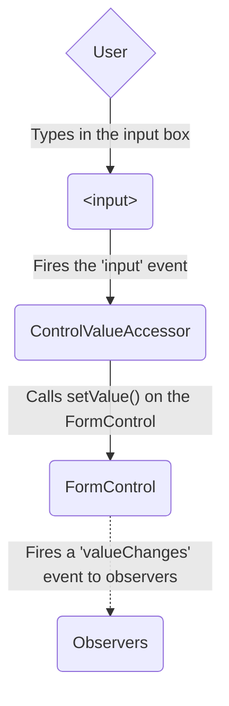
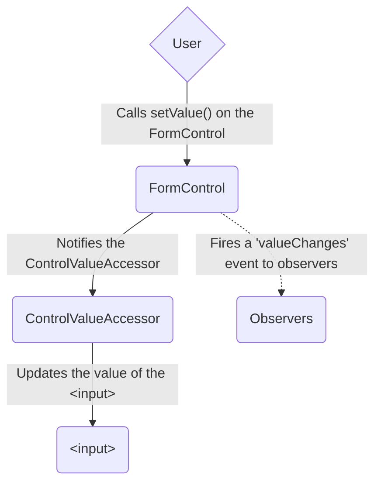
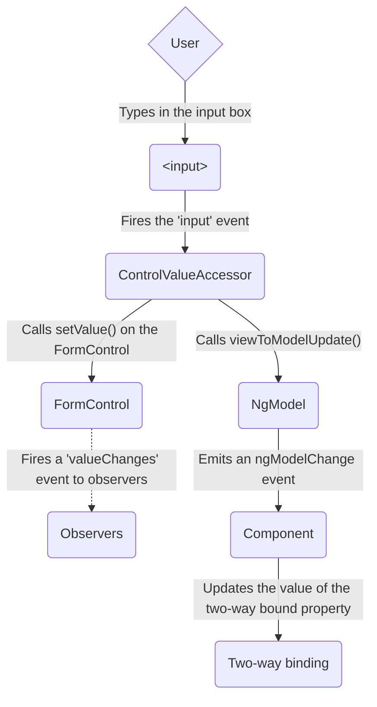
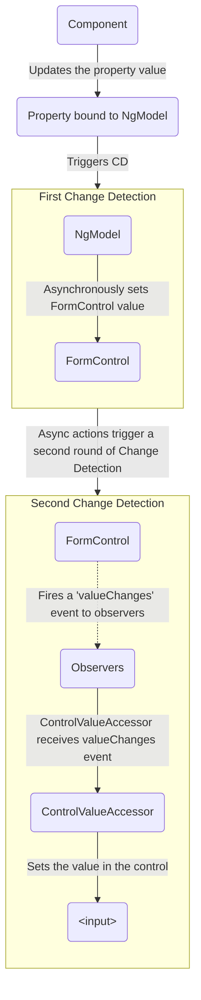

### Use the lightweight injection token for API definition

A component that injects a lightweight injection token might need to invoke a method in the injected class.
The token is now an abstract class. Since the injectable component implements that class, you must also declare an abstract method in the abstract lightweight injection token class.
The implementation of the method, with all its code overhead, resides in the injectable component that can be tree-shaken.
This lets the parent communicate with the child, if it is present, in a type-safe manner.

For example, the `LibCard` now queries `LibHeaderToken` rather than `LibHeader`.
The following example shows how the pattern lets `LibCard` communicate with the `LibHeader` without actually referring to `LibHeader`:

```ts {highlight: [[2],[7],[11],[19]]}
abstract class LibHeaderToken {
  abstract doSomething(): void;
}

@Component({
  selector: 'lib-header',
  providers: [{provide: LibHeaderToken, useExisting: LibHeader}],
})
class LibHeader extends LibHeaderToken {
  doSomething(): void {
    // Concrete implementation of `doSomething`
  }
}

@Component({
  selector: 'lib-card',
})
class LibCard implements AfterContentInit {
  readonly header = contentChild(LibHeaderToken);

  ngAfterContentInit(): void {
    if (this.header() !== undefined) {
      this.header()!.doSomething();
    }
  }
}
```

In this example, the parent queries the token to get the child component, and stores the resulting component reference if it is present.
Before calling a method in the child, the parent component checks to see if the child component is present.
If the child component has been tree-shaken, there is no runtime reference to it, and no call to its method.

### Naming your lightweight injection token

Lightweight injection tokens are only useful with components.
The [Angular Style Guide](style-guide) suggests that you name components without the suffix `Component`.
The example `LibHeader` follows this convention.

You should maintain the relationship between the component and its token while still distinguishing between them.
The recommended style is to use the component base name with the suffix `Token` to name your lightweight injection tokens: `LibHeaderToken`.

---


## RxJS

### RxJS interop with Angular signals
Source: https://angular.dev/ecosystem/rxjs-interop

# RxJS interop with Angular signals

The `@angular/core/rxjs-interop` package offers APIs that help you integrate RxJS and Angular signals.

## Create a signal from an RxJS Observable with `toSignal`

Use the `toSignal` function to create a signal which tracks the value of an Observable. It behaves similarly to the `async` pipe in templates, but is more flexible and can be used anywhere in an application.

```angular-ts
import {Component} from '@angular/core';
import {AsyncPipe} from '@angular/common';
import {interval} from 'rxjs';
import {toSignal} from '@angular/core/rxjs-interop';

@Component({
  template: `{{ counter() }}`,
})
export class Ticker {
  counterObservable = interval(1000);

  // Get a `Signal` representing the `counterObservable`'s value.
  counter = toSignal(this.counterObservable, {initialValue: 0});
}
```

Like the `async` pipe, `toSignal` subscribes to the Observable immediately, which may trigger side effects. The subscription created by `toSignal` automatically unsubscribes from the given Observable when the component or service which calls `toSignal` is destroyed.

IMPORTANT: `toSignal` creates a subscription. You should avoid calling it repeatedly for the same Observable, and instead reuse the signal it returns.

### Injection context

`toSignal` by default needs to run in an [injection context](guide/di/dependency-injection-context), such as during construction of a component or service. If an injection context is not available, you can manually specify the `Injector` to use instead.

### Initial values

Observables may not produce a value synchronously on subscription, but signals always require a current value. There are several ways to deal with this "initial" value of `toSignal` signals.

#### The `initialValue` option

As in the example above, you can specify an `initialValue` option with the value the signal should return before the Observable emits for the first time.

#### `undefined` initial values

If you don't provide an `initialValue`, the resulting signal will return `undefined` until the Observable emits. This is similar to the `async` pipe's behavior of returning `null`.

#### The `requireSync` option

Some Observables are guaranteed to emit synchronously, such as `BehaviorSubject`. In those cases, you can specify the `requireSync: true` option.

When `requireSync` is `true`, `toSignal` enforces that the Observable emits synchronously on subscription. This guarantees that the signal always has a value, and no `undefined` type or initial value is required.

### `manualCleanup`

By default, `toSignal` automatically unsubscribes from the Observable when the component or service that creates it is destroyed.

To override this behavior, you can pass the `manualCleanup` option. You can use this setting for Observables that complete themselves naturally.

#### Custom equality comparison

Some observables may emit values that are **equals** even though they differ by reference or minor detail. The `equal` option lets you define a **custom equal function** to determine when two consecutive values should be considered the same.

When two emitted values are considered equal, the resulting signal **does not update**. This prevents redundant computations, DOM updates, or effects from re-running unnecessarily.

```ts
import {Component} from '@angular/core';
import {toSignal} from '@angular/core/rxjs-interop';
import {interval, map} from 'rxjs';

@Component(/* ... */)
export class EqualExample {
  temperature$ = interval(1000).pipe(
    map(() => ({temperature: Math.floor(Math.random() * 3) + 20})), // 20, 21, or 22 randomly
  );

  // Only update if the temperature changes
  temperature = toSignal(this.temperature$, {
    initialValue: {temperature: 20},
    equal: (prev, curr) => prev.temperature === curr.temperature,
  });
}
```

### Error and Completion

If an Observable used in `toSignal` produces an error, that error is thrown when the signal is read.

If an Observable used in `toSignal` completes, the signal continues to return the most recently emitted value before completion.

## Create an RxJS Observable from a signal with `toObservable`

Use the `toObservable` utility to create an `Observable` which tracks the value of a signal. The signal's value is monitored with an `effect` which emits the value to the Observable when it changes.

```ts
import {Component, signal, Signal, inject} from '@angular/core';
import {toObservable} from '@angular/core/rxjs-interop';
import {switchMap} from 'rxjs';

@Component(/* ... */)
export class SearchResults {
  query: Signal<string> = inject(QueryService).query;
  query$ = toObservable(this.query);

  results$ = this.query$.pipe(switchMap((query) => this.http.get('/search?q=' + query)));
}
```

As the `query` signal changes, the `query$` Observable emits the latest query and triggers a new HTTP request.

### Injection context {#injection-context-to-observable}

`toObservable` by default needs to run in an [injection context](guide/di/dependency-injection-context), such as during construction of a component or service. If an injection context is not available, you can manually specify the `Injector` to use instead.

### Timing of `toObservable`

`toObservable` uses an effect to track the value of the signal in a `ReplaySubject`. On subscription, the first value (if available) may be emitted synchronously, and all subsequent values will be asynchronous.

Unlike Observables, signals never provide a synchronous notification of changes. Even if you update a signal's value multiple times, `toObservable` will only emit the value after the signal stabilizes.

```ts
const obs$ = toObservable(mySignal);
obs$.subscribe((value) => console.log(value));

mySignal.set(1);
mySignal.set(2);
mySignal.set(3);
```

Here, only the last value (3) will be logged.

## Using `rxResource` for async data

Angular's [`resource` function](/guide/signals/resource) gives you a way to incorporate async data into your application's signal-based code. Building on top of this pattern, `rxResource` lets you define a resource where the source of your data is defined in terms of an RxJS `Observable`. Instead of accepting a `loader` function, `rxResource` accepts a `stream` function that returns an RxJS `Observable`.

```typescript
import {Component, inject, input} from '@angular/core';
import {rxResource} from '@angular/core/rxjs-interop';

@Component(/* ... */)
export class UserProfile {
  // This component relies on a service that exposes data through an RxJS Observable.
  private userData = inject(MyUserDataClient);

  protected userId = input<string>();

  private userResource = rxResource({
    params: () => ({userId: this.userId()}),

    // The `stream` property expects a factory function that returns
    // a data stream as an RxJS Observable.
    stream: ({params}) => this.userData.load(params.userId),
  });
}
```

The `stream` property accepts a factory function for an RxJS `Observable`. This factory function is passed the resource's `params` value and returns an `Observable`. The resource calls this factory function every time the `params` computation produces a new value. See [Resource loaders](/guide/signals/resource#resource-loaders) for more details on the parameters passed to the factory function.

In all other ways, `rxResource` behaves like and provides the same APIs as `resource` for specifying parameters, reading values, checking loading state, and examining errors.

The `Observable` returned from `stream` must always emit a value or an error before it completes; see [`NG0991`](/errors/NG0991) for what happens otherwise and how to avoid it.

---

### Component output interop
Source: https://angular.dev/ecosystem/rxjs-interop/output-interop

# RxJS interop with component and directive outputs

TIP: This guide assumes you're familiar with [component and directive outputs](guide/components/outputs).

The `@angular/core/rxjs-interop` package offers two APIs related to component and directive outputs.

## Creating an output based on an RxJS Observable

The `outputFromObservable` lets you create a component or directive output that emits based on an RxJS observable:

```ts {highlight:[9]}
import {Directive} from '@angular/core';
import {outputFromObservable} from '@angular/core/rxjs-interop';
import {Observable} from 'rxjs';

@Directive(/* ... */)
class Draggable {
  pointerMoves$: Observable<PointerMovements> = listenToPointerMoves();

  // Whenever `pointerMoves$` emits, the `pointerMove` event fires.
  pointerMove = outputFromObservable(this.pointerMoves$);
}
```

The `outputFromObservable` function has special meaning to the Angular compiler. **You may only call `outputFromObservable` in component and directive property initializers.**

When you `subscribe` to the output, Angular automatically forwards the subscription to the underlying observable. Angular stops forwarding values when the component or directive is destroyed.

HELPFUL: Consider using `output()` directly if you can emit values imperatively.

## Creating an RxJS Observable from a component or directive output

The `outputToObservable` function lets you create an RxJS observable from a component output.

```ts {highlight:[11]}
import {outputToObservable} from '@angular/core/rxjs-interop';
import {Component, output} from '@angular/core';

@Component(/*...*/)
class CustomSlider {
    valueChange = output<number>();
}

// Instance reference to `CustomSlider`.
const slider: CustomSlider = createSlider();

outputToObservable(slider.valueChange) // Observable<number>
    .pipe(...)
    .subscribe(...);
```

HELPFUL: Consider using the `subscribe` method on `OutputRef` directly if it meets your needs.

---


## Loading Data

### HttpClient overview
Source: https://angular.dev/guide/http

# Understanding communication with backend services using HTTP

Most front-end applications need to communicate with a server over the HTTP protocol to download or upload data and access other back-end services. Angular provides a client HTTP API for Angular applications, the `HttpClient` service class in `@angular/common/http`.

## HTTP client service features

The HTTP client service offers the following major features:

- The ability to request [typed response values](guide/http/making-requests#fetching-json-data)
- Streamlined [error handling](guide/http/making-requests#handling-request-failure)
- Request and response [interception](guide/http/interceptors)
- Robust [testing utilities](guide/http/testing)

## What's next


---

### Setting up the HttpClient
Source: https://angular.dev/guide/http/setup

# Setting up `HttpClient`

`HttpClient` is available for injection by default in Angular v21 and later.

## Providing `HttpClient` through dependency injection

You can use the `provideHttpClient` helper function to configure the default HTTP feature set or add features in the application `providers` in `app.config.ts`.

```ts
export const appConfig: ApplicationConfig = {
  providers: [provideHttpClient(/* add features here, such as withInterceptors(...) */)],
};
```

If your app is using NgModule-based bootstrap instead, you can include `provideHttpClient` in the providers of your app's NgModule to configure the default HTTP feature set or add features:

```ts
@NgModule({
  providers: [provideHttpClient(/* add features here, such as withInterceptors(...) */)],
  // ... other application configuration
})
export class AppModule {}
```

You can then inject the `HttpClient` service as a dependency of your components, services, or other classes:

```ts
@Service()
export class ConfigService {
  private http = inject(HttpClient);
  // This service can now make HTTP requests via `this.http`.
}
```

## Configuring features of `HttpClient`

`provideHttpClient` accepts a list of optional feature configurations to enable or configure different aspects of the client. This section details the optional features and their usage.

### `withXhr`

```ts
export const appConfig: ApplicationConfig = {
  providers: [provideHttpClient(withXhr())],
};
```

By default, `HttpClient` uses the [`fetch`](https://developer.mozilla.org/docs/Web/API/Fetch_API) API to make requests. The `withXhr` feature switches the client to use the [`XMLHttpRequest`](https://developer.mozilla.org/docs/Web/API/XMLHttpRequest) API instead.

`fetch` is a more modern API and is available in a few environments where `XMLHttpRequest` is not supported. It does have a few limitations, such as not producing upload progress events.


XHR support on the server is **deprecated** and is intended to be removed in Angular 23. The underlying `xhr2` library does not safely handle redirects: it can forward `Authorization` headers on cross-origin redirects and is susceptible to denial-of-service (DoS) via redirect loops. For SSR applications, use the default `fetch` backend instead.


### `withInterceptors(...)`

`withInterceptors` configures the set of interceptor functions which will process requests made through `HttpClient`. See the [interceptor guide](guide/http/interceptors) for more information.

### `withInterceptorsFromDi()`

`withInterceptorsFromDi` includes the older style of class-based interceptors in the `HttpClient` configuration. See the [interceptor guide](guide/http/interceptors) for more information.

HELPFUL: Functional interceptors (through `withInterceptors`) have more predictable ordering and we recommend them over DI-based interceptors.

### `withRequestsMadeViaParent()`

By default, when you configure `HttpClient` using `provideHttpClient` within a given injector, this configuration overrides any configuration for `HttpClient` which may be present in the parent injector.

When you add `withRequestsMadeViaParent()`, `HttpClient` is configured to instead pass requests up to the `HttpClient` instance in the parent injector, once they've passed through any configured interceptors at this level. This is useful if you want to _add_ interceptors in a child injector while still sending the request through the parent injector's interceptors.

CRITICAL: You must configure an instance of `HttpClient` above the current injector, or this option is not valid and you'll get a runtime error when you try to use it.

### `withJsonpSupport()`


`withJsonpSupport`, `HttpClientJsonpModule`, and the `.jsonp()` method on `HttpClient` are deprecated because JSONP can cause cross-site scripting (XSS) vulnerabilities. Use standard HTTP requests with [CORS](https://developer.mozilla.org/docs/Web/HTTP/CORS) instead.


Including `withJsonpSupport` enables the `.jsonp()` method on `HttpClient`, which makes a GET request via the [JSONP convention](https://en.wikipedia.org/wiki/JSONP) for cross-domain loading of data.

HELPFUL: Prefer using [CORS](https://developer.mozilla.org/docs/Web/HTTP/CORS) to make cross-domain requests instead of JSONP when possible.

### `withXsrfConfiguration(...)`

Including this option allows customization of `HttpClient`'s built-in XSRF security functionality. See the [security guide](best-practices/security) for more information.

### `withNoXsrfProtection()`

Including this option disables `HttpClient`'s built-in XSRF security functionality. See the [security guide](best-practices/security) for more information.

## `HttpClientModule`-based configuration

Some applications may configure `HttpClient` using the older API based on NgModules.

This table lists the NgModules available from `@angular/common/http` and how they relate to the provider configuration functions above.

| **NgModule**                            | `provideHttpClient()` equivalent                         |
| --------------------------------------- | -------------------------------------------------------- |
| `HttpClientModule`                      | `provideHttpClient(withInterceptorsFromDi(), withXhr())` |
| `HttpClientJsonpModule` (deprecated)    | `withJsonpSupport()` (deprecated)                        |
| `HttpClientXsrfModule.withOptions(...)` | `withXsrfConfiguration(...)`                             |
| `HttpClientXsrfModule.disable()`        | `withNoXsrfProtection()`                                 |

NOTE: `HttpClientModule` and `HttpClientXsrfModule` are also deprecated. Use `provideHttpClient` with the corresponding features instead.

When `HttpClientModule` is present in multiple injectors, the behavior of interceptors is poorly defined and depends on the exact options and provider/import ordering.

Prefer `provideHttpClient` for multi-injector configurations, as it has more stable behavior. See the `withRequestsMadeViaParent` feature above.

---

### Making requests
Source: https://angular.dev/guide/http/making-requests

# Making HTTP requests

`HttpClient` has methods corresponding to the different HTTP verbs used to make requests, both to load data and to apply mutations on the server. Each method returns an [RxJS `Observable`](https://rxjs.dev/guide/observable) which, when subscribed, sends the request and then emits the results when the server responds.

NOTE: `Observable`s created by `HttpClient` may be subscribed any number of times and will make a new backend request for each subscription.

Through an options object passed to the request method, various properties of the request and the returned response type can be adjusted.

## Fetching JSON data

Fetching data from a backend often requires making a GET request using the [`HttpClient.get()`](api/common/http/HttpClient#get) method. This method takes two arguments: the string endpoint URL from which to fetch, and an _optional options_ object to configure the request.

For example, to fetch configuration data from a hypothetical API using the `HttpClient.get()` method:

```ts
http.get<Config>('/api/config').subscribe((config) => {
  // process the configuration.
});
```

Note the generic type argument which specifies that the data returned by the server will be of type `Config`. This argument is optional, and if you omit it, the returned data will have type `Object`.

TIP: When dealing with data of uncertain structure and potential `undefined` or `null` values, consider using the `unknown` type instead of `Object` as the response type.

CRITICAL: The generic type of request methods is a type **assertion** about the data returned by the server. `HttpClient` does not verify that the actual return data matches this type.

## Fetching other types of data

By default, `HttpClient` assumes that servers will return JSON data. When interacting with a non-JSON API, you can tell `HttpClient` what response type to expect when making the request. This is done with the `responseType` option.

| **`responseType` value** | **Returned response type**                                                                                                                |
| ------------------------ | ----------------------------------------------------------------------------------------------------------------------------------------- |
| `'json'` (default)       | JSON data of the given generic type                                                                                                       |
| `'text'`                 | string data                                                                                                                               |
| `'arraybuffer'`          | [`ArrayBuffer`](https://developer.mozilla.org/docs/Web/JavaScript/Reference/Global_Objects/ArrayBuffer) containing the raw response bytes |
| `'blob'`                 | [`Blob`](https://developer.mozilla.org/docs/Web/API/Blob) instance                                                                        |

For example, you can ask `HttpClient` to download the raw bytes of a `.jpeg` image into an `ArrayBuffer`:

```ts
http.get('/images/dog.jpg', {responseType: 'arraybuffer'}).subscribe((buffer) => {
  console.log('The image is ' + buffer.byteLength + ' bytes large');
});
```

Because the value of `responseType` affects the type returned by `HttpClient`, it must have a literal type and not a `string` type.

This happens automatically if the options object passed to the request method is a literal object, but if you're extracting the request options out into a variable or helper method you might need to explicitly specify it as a literal, such as `responseType: 'text' as const`.

## Mutating server state

Server APIs that perform mutations often require making POST requests with a request body specifying the new state or the change to be made.

The [`HttpClient.post()`](api/common/http/HttpClient#post) method behaves similarly to `get()`, and accepts an additional `body` argument before its options:

```ts
http.post<Config>('/api/config', newConfig).subscribe((config) => {
  console.log('Updated config:', config);
});
```

Many different types of values can be provided as the request's `body`, and `HttpClient` will serialize them accordingly:

| **`body` type**                                                                                                               | **Serialized as**                                    |
| ----------------------------------------------------------------------------------------------------------------------------- | ---------------------------------------------------- |
| string                                                                                                                        | Plain text                                           |
| number, boolean, array, or plain object                                                                                       | JSON                                                 |
| [`ArrayBuffer`](https://developer.mozilla.org/docs/Web/JavaScript/Reference/Global_Objects/ArrayBuffer)                       | raw data from the buffer                             |
| [`Blob`](https://developer.mozilla.org/docs/Web/API/Blob)                                                                     | raw data with the `Blob`'s content type              |
| [`FormData`](https://developer.mozilla.org/docs/Web/API/FormData)                                                             | `multipart/form-data` encoded data                   |
| [`HttpParams`](api/common/http/HttpParams) or [`URLSearchParams`](https://developer.mozilla.org/docs/Web/API/URLSearchParams) | `application/x-www-form-urlencoded` formatted string |

IMPORTANT: Remember to `.subscribe()` to mutation request `Observable`s in order to actually fire the request.

## Setting URL parameters

Specify request parameters that should be included in the request URL using the `params` option.

Passing an object literal is the simplest way of configuring URL parameters:

```ts
http
  .get('/api/config', {
    params: {filter: 'all'},
  })
  .subscribe((config) => {
    // ...
  });
```

Alternatively, pass an instance of `HttpParams` if you need more control over the construction or serialization of the parameters.

IMPORTANT: Instances of `HttpParams` are _immutable_ and cannot be directly changed. Instead, mutation methods such as `append()` return a new instance of `HttpParams` with the mutation applied.

```ts
const baseParams = new HttpParams().set('filter', 'all');

http
  .get('/api/config', {
    params: baseParams.set('details', 'enabled'),
  })
  .subscribe((config) => {
    // ...
  });
```

You can instantiate `HttpParams` with a custom `HttpParameterCodec` that determines how `HttpClient` will encode the parameters into the URL.

### Custom parameter encoding

By default, `HttpParams` uses the built-in [`HttpUrlEncodingCodec`](api/common/http/HttpUrlEncodingCodec) to encode and decode parameter keys and values.

You can provide your own implementation of [`HttpParameterCodec`](api/common/http/HttpParameterCodec) to customize how encoding and decoding are applied.

```ts
import {HttpClient, HttpParams, HttpParameterCodec} from '@angular/common/http';
import {inject} from '@angular/core';

export class CustomHttpParamEncoder implements HttpParameterCodec {
  encodeKey(key: string): string {
    return encodeURIComponent(key);
  }

  encodeValue(value: string): string {
    return encodeURIComponent(value);
  }

  decodeKey(key: string): string {
    return decodeURIComponent(key);
  }

  decodeValue(value: string): string {
    return decodeURIComponent(value);
  }
}

export class ApiService {
  private http = inject(HttpClient);

  search() {
    const params = new HttpParams({
      encoder: new CustomHttpParamEncoder(),
    })
      .set('email', 'dev+alerts@example.com')
      .set('q', 'a & b? c/d = e');

    return this.http.get('/api/items', {params});
  }
}
```

## Setting request headers

Specify request headers that should be included in the request using the `headers` option.

Passing an object literal is the simplest way of configuring request headers:

```ts
http
  .get('/api/config', {
    headers: {
      'X-Debug-Level': 'verbose',
    },
  })
  .subscribe((config) => {
    // ...
  });
```

Alternatively, pass an instance of `HttpHeaders` if you need more control over the construction of headers.

IMPORTANT: Instances of `HttpHeaders` are _immutable_ and cannot be directly changed. Instead, mutation methods such as `append()` return a new instance of `HttpHeaders` with the mutation applied.

```ts
const baseHeaders = new HttpHeaders().set('X-Debug-Level', 'minimal');

http
  .get<Config>('/api/config', {
    headers: baseHeaders.set('X-Debug-Level', 'verbose'),
  })
  .subscribe((config) => {
    // ...
  });
```

## Interacting with the server response events

For convenience, `HttpClient` by default returns an `Observable` of the data returned by the server (the response body). Occasionally it's desirable to examine the actual response, for example to retrieve specific response headers.

To access the entire response, set the `observe` option to `'response'`:

```ts
http.get<Config>('/api/config', {observe: 'response'}).subscribe((res) => {
  console.log('Response status:', res.status);
  console.log('Body:', res.body);
});
```

Because the value of `observe` affects the type returned by `HttpClient`, it must have a literal type and not a `string` type.

This happens automatically if the options object passed to the request method is a literal object, but if you're extracting the request options out into a variable or helper method you might need to explicitly specify it as a literal, such as `observe: 'response' as const`.

## Receiving raw progress events

In addition to the response body or response object, `HttpClient` can also return a stream of raw _events_ corresponding to specific moments in the request lifecycle. These events include when the request is sent, when the response header is returned, and when the body is complete. These events can also include _progress events_ that report upload and download status for large request or response bodies.

Progress events are disabled by default (as they have a performance cost) but can be enabled with the `reportUploadProgress` and `reportDownloadProgress` options.

NOTE: The default fetch backend of `HttpClient` does not support _upload_ progress events and throws an error if you set `reportUploadProgress`. If your app needs upload progress events, configure `HttpClient` with `withXhr()` in `provideHttpClient(...)`.

To observe the event stream, set the `observe` option to `'events'`:

```ts
http
  .get('/api/download', {
    reportDownloadProgress: true,
    observe: 'events',
  })
  .subscribe((event) => {
    switch (event.type) {
      case HttpEventType.DownloadProgress:
        console.log('Downloaded ' + event.loaded + ' out of ' + event.total + ' bytes');
        break;
      case HttpEventType.Response:
        console.log('Finished downloading!');
        break;
    }
  });
```

Because the value of `observe` affects the type returned by `HttpClient`, it must have a literal type and not a `string` type.

This happens automatically if the options object passed to the request method is a literal object, but if you're extracting the request options out into a variable or helper method you might need to explicitly specify it as a literal, such as `observe: 'events' as const`.

Each `HttpEvent` reported in the event stream has a `type` which distinguishes what the event represents:

| **`type` value**                 | **Event meaning**                                                                  |
| -------------------------------- | ---------------------------------------------------------------------------------- |
| `HttpEventType.Sent`             | The request has been dispatched to the server                                      |
| `HttpEventType.UploadProgress`   | An `HttpUploadProgressEvent` reporting progress on uploading the request body      |
| `HttpEventType.ResponseHeader`   | The head of the response has been received, including status and headers           |
| `HttpEventType.DownloadProgress` | An `HttpDownloadProgressEvent` reporting progress on downloading the response body |
| `HttpEventType.Response`         | The entire response has been received, including the response body                 |
| `HttpEventType.User`             | A custom event from an HTTP interceptor.                                           |

## Handling request failure

There are three ways an HTTP request can fail:

- A network or connection error can prevent the request from reaching the backend server.
- A request didn't respond in time when the timeout option was set.
- The backend can receive the request but fail to process it, and return an error response.

`HttpClient` captures all of the above kinds of errors in an `HttpErrorResponse` which it returns through the `Observable`'s error channel. Network and timeout errors have a `status` code of `0`. For timeouts, the `error` is a `DOMException` named `TimeoutError`; for network errors, it is the error thrown by `fetch` (or a [`ProgressEvent`](https://developer.mozilla.org/docs/Web/API/ProgressEvent) when using `withXhr()`). Backend errors have the failing `status` code returned by the backend, and the error response as the `error`. Inspect the response to identify the error's cause and the appropriate action to handle the error.

The [RxJS library](https://rxjs.dev/) offers several operators which can be useful for error handling.

You can use the `catchError` operator to transform an error response into a value for the UI. This value can tell the UI to display an error page or value, and capture the error's cause if necessary.

Sometimes transient errors such as network interruptions can cause a request to fail unexpectedly, and simply retrying the request will allow it to succeed. RxJS provides several _retry_ operators which automatically re-subscribe to a failed `Observable` under certain conditions. For example, the `retry()` operator will automatically attempt to re-subscribe a specified number of times.

### Timeouts

To set a timeout for a request, you can set the `timeout` option to a number of milliseconds along with other request options. If the backend request does not complete within the specified time, the request will be aborted and an error will be emitted.

NOTE: The timeout will only apply to the backend HTTP request itself. It is not a timeout for the entire request handling chain. Therefore, this option is not affected by any delay introduced by interceptors.

```ts
http
  .get('/api/config', {
    timeout: 3000,
  })
  .subscribe({
    next: (config) => {
      console.log('Config fetched successfully:', config);
    },
    error: (err) => {
      // If the request times out, an error will have been emitted.
    },
  });
```

## Advanced fetch options

Angular's `HttpClient` supports advanced fetch API options that can improve performance and user experience. These options are available when using the fetch backend, which is the default.

### Fetch options

The following options provide fine-grained control over request behavior when using the fetch backend.

#### Keep-alive connections

The `keepalive` option allows a request to outlive the page that initiated it. This is particularly useful for analytics or logging requests that need to complete even if the user navigates away from the page.

```ts
http
  .post('/api/analytics', analyticsData, {
    keepalive: true,
  })
  .subscribe();
```

#### HTTP caching control

The `cache` option controls how the request interacts with the browser's HTTP cache, which can significantly improve performance for repeated requests.

```ts
//  Use cached response regardless of freshness
http
  .get('/api/config', {
    cache: 'force-cache',
  })
  .subscribe((config) => {
    // ...
  });

// Always fetch from network, bypass cache
http
  .get('/api/live-data', {
    cache: 'no-cache',
  })
  .subscribe((data) => {
    // ...
  });

// Use cached response only, fail if not in cache
http
  .get('/api/static-data', {
    cache: 'only-if-cached',
  })
  .subscribe((data) => {
    // ...
  });
```

#### Request priority for Core Web Vitals

The `priority` option allows you to indicate the relative importance of a request, helping browsers optimize resource loading for better Core Web Vitals scores.

```ts
// High priority for critical resources
http
  .get('/api/user-profile', {
    priority: 'high',
  })
  .subscribe((profile) => {
    // ...
  });

// Low priority for non-critical resources
http
  .get('/api/recommendations', {
    priority: 'low',
  })
  .subscribe((recommendations) => {
    // ...
  });

// Auto priority (default) lets the browser decide
http
  .get('/api/settings', {
    priority: 'auto',
  })
  .subscribe((settings) => {
    // ...
  });
```

Available `priority` values:

- `'high'`: High priority, loaded early (e.g., critical user data, above-the-fold content)
- `'low'`: Low priority, loaded when resources are available (e.g., analytics, prefetch data)
- `'auto'`: Browser determines priority based on request context (default)

TIP: Use `priority: 'high'` for requests that affect Largest Contentful Paint (LCP) and `priority: 'low'` for requests that don't impact initial user experience.

#### Request mode

The `mode` option controls how the request handles cross-origin requests and determines the response type.

```ts
// Same-origin requests only
http
  .get('/api/local-data', {
    mode: 'same-origin',
  })
  .subscribe((data) => {
    // ...
  });

// CORS-enabled cross-origin requests
http
  .get('https://api.external.com/data', {
    mode: 'cors',
  })
  .subscribe((data) => {
    // ...
  });

// No-CORS mode for simple cross-origin requests
http
  .get('https://external-api.com/public-data', {
    mode: 'no-cors',
  })
  .subscribe((data) => {
    // ...
  });
```

Available `mode` values:

- `'same-origin'`: Only allow same-origin requests, fail for cross-origin requests
- `'cors'`: Allow cross-origin requests with CORS (default)
- `'no-cors'`: Allow simple cross-origin requests without CORS, response is opaque

TIP: In the browser, use `mode: 'same-origin'` for sensitive requests that should never go cross-origin.

IMPORTANT: During SSR on Node.js, `HttpClient` uses Node.js's [Undici-based Fetch implementation](https://nodejs.org/api/globals.html#fetch). [Undici does not enforce browser CORS checks](https://undici.nodejs.org/#cors), so `mode: 'same-origin'` does not restrict server-side requests. Validate user-influenced URLs against an allowlist.

#### Redirect handling

The `redirect` option specifies how to handle redirect responses from the server.

```ts
// Follow redirects automatically (default behavior)
http
  .get('/api/resource', {
    redirect: 'follow',
  })
  .subscribe((data) => {
    // ...
  });

// Prevent automatic redirects
http
  .get('/api/resource', {
    redirect: 'manual',
  })
  .subscribe((response) => {
    // Handle redirect manually
  });

// Treat redirects as errors
http
  .get('/api/resource', {
    redirect: 'error',
  })
  .subscribe({
    next: (data) => {
      // Success response
    },
    error: (err) => {
      // Redirect responses will trigger this error handler
    },
  });
```

Available `redirect` values:

- `'follow'`: Automatically follow redirects (default)
- `'error'`: Treat redirects as errors
- `'manual'`: Don't follow redirects automatically, return redirect response

TIP: Use `redirect: 'manual'` when you need to handle redirects with custom logic.

#### Credentials handling

The `credentials` option controls whether cookies, authorization headers, and other credentials are sent with cross-origin requests. This is particularly important for authentication scenarios.

```ts
// Include credentials for cross-origin requests
http
  .get('https://api.example.com/protected-data', {
    credentials: 'include',
  })
  .subscribe((data) => {
    // ...
  });

// Never send credentials (default for cross-origin)
http
  .get('https://api.example.com/public-data', {
    credentials: 'omit',
  })
  .subscribe((data) => {
    // ...
  });

// Send credentials only for same-origin requests
http
  .get('/api/user-data', {
    credentials: 'same-origin',
  })
  .subscribe((data) => {
    // ...
  });

// withCredentials overrides credentials setting
http
  .get('https://api.example.com/data', {
    credentials: 'omit', // This will be ignored
    withCredentials: true, // This forces credentials: 'include'
  })
  .subscribe((data) => {
    // Request will include credentials despite credentials: 'omit'
  });

// Legacy approach (still supported)
http
  .get('https://api.example.com/data', {
    withCredentials: true,
  })
  .subscribe((data) => {
    // Equivalent to credentials: 'include'
  });
```

IMPORTANT: The `withCredentials` option takes precedence over the `credentials` option. If both are specified, `withCredentials: true` will always result in `credentials: 'include'`, regardless of the explicit `credentials` value.

Available `credentials` values:

- `'omit'`: Never send credentials
- `'same-origin'`: Send credentials only for same-origin requests (default)
- `'include'`: Always send credentials, even for cross-origin requests

TIP: Use `credentials: 'include'` when you need to send authentication cookies or headers to a different domain that supports CORS. Avoid mixing `credentials` and `withCredentials` options to prevent confusion.

IMPORTANT: During SSR on Node.js, `credentials: 'include'` does not automatically forward cookies from the incoming browser request. The `credentials` option does not remove `Cookie` or `Authorization` headers that you add explicitly. [Undici permits some headers that browsers forbid](https://undici.nodejs.org/#forbidden-and-safelisted-header-names), so only forward credential headers to trusted origins.

#### Referrer

The `referrer` option allows you to control what referrer information is sent with the request. This is important for privacy and security considerations.

```ts
// Send a specific referrer URL
http
  .get('/api/data', {
    referrer: 'https://example.com/page',
  })
  .subscribe((data) => {
    // ...
  });

// Use the current page as referrer (default behavior)
http
  .get('/api/analytics', {
    referrer: 'about:client',
  })
  .subscribe((data) => {
    // ...
  });
```

The `referrer` option accepts:

- A valid URL string: Sets the specific referrer URL to send
- An empty string `''`: Sends no referrer information
- `'about:client'`: Uses the default referrer (current page URL)

TIP: Use `referrer: ''` for sensitive requests where you don't want to leak the referring page URL.

#### Referrer policy

The `referrerPolicy` option controls how much referrer information—the URL of the page making the request—is sent along with an HTTP request. This setting affects both privacy and analytics, allowing you to balance data visibility with security considerations.

```ts
// Send no referrer information regardless of the current page
http
  .get('/api/data', {
    referrerPolicy: 'no-referrer',
  })
  .subscribe();

// Send origin only (e.g. https://example.com)
http
  .get('/api/analytics', {
    referrerPolicy: 'origin',
  })
  .subscribe();
```

The `referrerPolicy` option accepts:

- `'no-referrer'` Never send the `Referer` header.
- `'no-referrer-when-downgrade'` Sends the referrer for same-origin and secure (HTTPS→HTTPS) requests, but omits it when navigating from a secure to a less secure origin (HTTPS→HTTP).
- `'origin'` Sends only the origin (scheme, host, port) of the referrer, omitting path and query information.
- `'origin-when-cross-origin'` Sends the full URL for same-origin requests, but only the origin for cross-origin requests.
- `'same-origin'` Sends the full URL for same-origin requests and no referrer for cross-origin requests.
- `'strict-origin'` Sends only the origin, and only if the protocol security level is not downgraded (e.g., HTTPS→HTTPS). Omits the referrer on downgrade.
- `'strict-origin-when-cross-origin'` Default browser behavior. Sends the full URL for same-origin requests, the origin for cross-origin requests when not downgraded, and omits the referrer on downgrade.
- `'unsafe-url'` Always sends the full URL (including path and query). This can expose sensitive data and should be used with caution.

TIP: Prefer conservative values such as `'no-referrer'`, `'origin'`, or `'strict-origin-when-cross-origin'` for privacy-sensitive requests.

#### Integrity

The `integrity` option allows you to verify that the response hasn't been tampered with by providing a cryptographic hash of the expected content. This is particularly useful for loading scripts or other resources from CDNs.

```ts
// Verify response integrity with SHA-256 hash
http
  .get('/api/script.js', {
    integrity: 'sha256-ABC123...',
    responseType: 'text',
  })
  .subscribe((script) => {
    // Script content is verified against the hash
  });
```

IMPORTANT: The `integrity` option requires an exact match between the response content and the provided hash. If the content doesn't match, the request will fail with a network error.

CRITICAL: During SSR, the Fetch implementation reads the entire response body to verify `integrity` before returning a response, as required by the [Fetch Standard](https://fetch.spec.whatwg.org/#concept-main-fetch). Angular enforces [`maxResponseBodySize`](/guide/ssr#configuring-the-response-body-size-limit) only after Fetch returns a response, so this limit does not constrain the data buffered during integrity verification.

TIP: Use subresource integrity when loading critical resources from external sources to ensure they haven't been modified. Generate hashes using tools like `openssl`.

## HTTP `Observable`s

Each request method on `HttpClient` constructs and returns an `Observable` of the requested response type. Understanding how these `Observable`s work is important when using `HttpClient`.

`HttpClient` produces what RxJS calls "cold" `Observable`s, meaning that no actual request happens until the `Observable` is subscribed. Only then is the request actually dispatched to the server. Subscribing to the same `Observable` multiple times will trigger multiple backend requests. Each subscription is independent.

TIP: You can think of `HttpClient` `Observable`s as _blueprints_ for actual server requests.

Once subscribed, unsubscribing will abort the in-progress request. This is very useful if the `Observable` is subscribed via the `async` pipe, as it will automatically cancel the request if the user navigates away from the current page. Additionally, if you use the `Observable` with an RxJS combinator like `switchMap`, this cancellation will clean up any stale requests.

Once the response returns, `Observable`s from `HttpClient` usually complete (although interceptors can influence this).

Because of the automatic completion, there is usually no risk of memory leaks if `HttpClient` subscriptions are not cleaned up. However, as with any async operation, we strongly recommend that you clean up subscriptions when the component using them is destroyed, as the subscription callback may otherwise run and encounter errors when it attempts to interact with the destroyed component.

TIP: Using the `async` pipe or the `toSignal` operation to subscribe to `Observable`s ensures that subscriptions are disposed properly.

## Best practices

While `HttpClient` can be injected and used directly from components, generally we recommend you create reusable, injectable services which isolate and encapsulate data access logic. For example, this `UserService` encapsulates the logic to request data for a user by their id:

```ts
@Service()
export class UserService {
  private http = inject(HttpClient);

  getUser(id: string): Observable<User> {
    return this.http.get<User>(`/api/user/${id}`);
  }
}
```

Within a component, you can combine `@if` with the `async` pipe to render the UI for the data only after it's finished loading:

```angular-ts
import {AsyncPipe} from '@angular/common';
import {Component, input, inject, effect} from '@angular/core';
import {Observable} from 'rxjs';

@Component({
  imports: [AsyncPipe],
  template: `
    @if (user$ | async; as user) {
    }
  `,
})
export class UserProfile {
  userId = input.required<string>();
  user$!: Observable<User>;

  private userService = inject(UserService);

  constructor() {
    effect(() => {
      this.user$ = this.userService.getUser(this.userId());
    });
  }
}
```

---

### Intercepting requests
Source: https://angular.dev/guide/http/interceptors

# Interceptors

`HttpClient` supports a form of middleware known as _interceptors_.

TLDR: Interceptors are middleware that allows common patterns around retrying, caching, logging, and authentication to be abstracted away from individual requests.

`HttpClient` supports two kinds of interceptors: functional and DI-based. Our recommendation is to use functional interceptors because they have more predictable behavior, especially in complex setups. Our examples in this guide use functional interceptors, and we cover [DI-based interceptors](#di-based-interceptors) in their own section at the end.

## Interceptors

Interceptors are generally functions that you can run for each request and have broad capabilities to affect the contents and overall flow of requests and responses. You can install multiple interceptors, which form an interceptor chain where each interceptor processes the request or response before forwarding it to the next interceptor in the chain.

You can use interceptors to implement a variety of common patterns, such as:

- Adding authentication headers to outgoing requests to a particular API.
- Retrying failed requests with exponential backoff.
- Caching responses for a period of time, or until invalidated by mutations.
- Customizing the parsing of responses.
- Measuring server response times and logging them.
- Driving UI elements such as a loading spinner while network operations are in progress.
- Collecting and batching requests made within a certain timeframe.
- Automatically failing requests after a configurable deadline or timeout.
- Regularly polling the server and refreshing results.

## Defining an interceptor

The basic form of an interceptor is a function which receives the outgoing `HttpRequest` and a `next` function representing the next processing step in the interceptor chain.

For example, this `loggingInterceptor` will log the outgoing request URL to `console.log` before forwarding the request:

```ts
export function loggingInterceptor(
  req: HttpRequest<unknown>,
  next: HttpHandlerFn,
): Observable<HttpEvent<unknown>> {
  console.log(req.url);
  return next(req);
}
```

In order for this interceptor to actually intercept requests, you must configure `HttpClient` to use it.

## Configuring interceptors

You declare the set of interceptors to use when configuring `HttpClient` through dependency injection, by using the `withInterceptors` feature:

```ts
bootstrapApplication(App, {
  providers: [provideHttpClient(withInterceptors([loggingInterceptor, cachingInterceptor]))],
});
```

The interceptors you configure are chained together in the order that you've listed them in the providers. In the above example, the `loggingInterceptor` would process the request and then forward it to the `cachingInterceptor`.

### Intercepting response events

An interceptor may transform the `Observable` stream of `HttpEvent`s returned by `next` in order to access or manipulate the response. Because this stream includes all response events, inspecting the `.type` of each event may be necessary in order to identify the final response object.

```ts
export function loggingInterceptor(
  req: HttpRequest<unknown>,
  next: HttpHandlerFn,
): Observable<HttpEvent<unknown>> {
  return next(req).pipe(
    tap((event) => {
      if (event.type === HttpEventType.Response) {
        console.log(req.url, 'returned a response with status', event.status);
      }
    }),
  );
}
```

TIP: Interceptors naturally associate responses with their outgoing requests, because they transform the response stream in a closure that captures the request object.

## Modifying requests

Most aspects of `HttpRequest` and `HttpResponse` instances are _immutable_, and interceptors cannot directly modify them. Instead, interceptors apply mutations by cloning these objects using the `.clone()` operation, and specifying which properties should be mutated in the new instance. This might involve performing immutable updates on the value itself (like `HttpHeaders` or `HttpParams`).

For example, to add a header to a request:

```ts
const reqWithHeader = req.clone({
  headers: req.headers.set('X-New-Header', 'new header value'),
});
```

This immutability allows most interceptors to be idempotent if the same `HttpRequest` is submitted to the interceptor chain multiple times. This can happen for a few reasons, including when a request is retried after failure.

CRITICAL: The body of a request or response is **not** protected from deep mutations. If an interceptor must mutate the body, take care to handle running multiple times on the same request.

## Dependency injection in interceptors

Interceptors are run in the _injection context_ of the injector which registered them, and can use Angular's [`inject`](/api/core/inject) API to retrieve dependencies.

For example, suppose an application has a service called `AuthService`, which creates authentication tokens for outgoing requests. An interceptor can inject and use this service:

```ts
export function authInterceptor(req: HttpRequest<unknown>, next: HttpHandlerFn) {
  // Inject the current `AuthService` and use it to get an authentication token:
  const authToken = inject(AuthService).getAuthToken();

  // Clone the request to add the authentication header.
  const newReq = req.clone({
    headers: req.headers.append('X-Authentication-Token', authToken),
  });
  return next(newReq);
}
```

## Request and response metadata

Often it's useful to include information in a request that's not sent to the backend, but is specifically meant for interceptors. `HttpRequest`s have a `.context` object which stores this kind of metadata as an instance of `HttpContext`. This object functions as a typed map, with keys of type `HttpContextToken`.

To illustrate how this system works, let's use metadata to control whether a caching interceptor is enabled for a given request.

### Defining context tokens

To store whether the caching interceptor should cache a particular request in that request's `.context` map, define a new `HttpContextToken` to act as a key:

```ts
export const CACHING_ENABLED = new HttpContextToken<boolean>(() => true);
```

The provided function creates the default value for the token for requests that haven't explicitly set a value for it. Using a function ensures that if the token's value is an object or array, each request gets its own instance.

### Reading the token in an interceptor

An interceptor can then read the token and choose to apply caching logic or not based on its value:

```ts
export function cachingInterceptor(req: HttpRequest<unknown>, next: HttpHandlerFn): Observable<HttpEvent<unknown>> {
  if (req.context.get(CACHING_ENABLED)) {
    // apply caching logic
    return ...;
  } else {
    // caching has been disabled for this request
    return next(req);
  }
}
```

### Setting context tokens when making a request

When making a request via the `HttpClient` API, you can provide values for `HttpContextToken`s:

```ts
const data$ = http.get('/sensitive/data', {
  context: new HttpContext().set(CACHING_ENABLED, false),
});
```

Interceptors can read these values from the `HttpContext` of the request.

### The request context is mutable

Unlike other properties of `HttpRequest`s, the associated `HttpContext` is _mutable_. If an interceptor changes the context of a request that is later retried, the same interceptor will observe the context mutation when it runs again. This is useful for passing state across multiple retries if needed.

## Synthetic responses

Most interceptors will simply invoke the `next` handler while transforming either the request or the response, but this is not strictly a requirement. This section discusses several of the ways in which an interceptor may incorporate more advanced behavior.

Interceptors are not required to invoke `next`. They may instead choose to construct responses through some other mechanism, such as from a cache or by sending the request through an alternate mechanism.

Constructing a response is possible using the `HttpResponse` constructor:

```ts
const resp = new HttpResponse({
  body: 'response body',
});
```

## Working with redirect information

When `HttpClient` uses the fetch backend, responses include a `redirected` property that indicates whether the response was the result of a redirect. This property aligns with the native Fetch API specification and can be useful in interceptors for handling redirect scenarios.

An interceptor can access and act upon the redirect information:

```ts
export function redirectTrackingInterceptor(
  req: HttpRequest<unknown>,
  next: HttpHandlerFn,
): Observable<HttpEvent<unknown>> {
  return next(req).pipe(
    tap((event) => {
      if (event.type === HttpEventType.Response && event.redirected) {
        console.log('Request to', req.url, 'was redirected to', event.url);
        // Handle redirect logic - maybe update analytics, security checks, etc.
      }
    }),
  );
}
```

You can also use the redirect information to implement conditional logic in your interceptors:

```ts
export function authRedirectInterceptor(
  req: HttpRequest<unknown>,
  next: HttpHandlerFn,
): Observable<HttpEvent<unknown>> {
  return next(req).pipe(
    tap((event) => {
      if (event.type === HttpEventType.Response && event.redirected) {
        // Check if we were redirected to a login page
        if (event.url?.includes('/login')) {
          // Handle authentication redirect
          handleAuthRedirect();
        }
      }
    }),
  );
}
```

## Working with response types

When `HttpClient` uses the fetch backend, responses include a `responseType` property that indicates how the browser handled the response based on CORS policies and request mode. This property aligns with the native Fetch API specification and provides valuable insights for debugging CORS issues and understanding response accessibility.

The response `responseType` property can have the following values:

- `'basic'` - Same-origin response with all headers accessible
- `'cors'` - Cross-origin response with CORS headers properly configured
- `'opaque'` - Cross-origin response without CORS, headers and body may be limited
- `'opaqueredirect'` - Response from a redirected request in no-cors mode
- `'error'` - Network error occurred

An interceptor can use response type information for CORS debugging and error handling:

```ts
export function responseTypeInterceptor(
  req: HttpRequest<unknown>,
  next: HttpHandlerFn,
): Observable<HttpEvent<unknown>> {
  return next(req).pipe(
    tap((event) => {
      if (event.type === HttpEventType.Response) {
        // Handle different response types appropriately
        switch (event.responseType) {
          case 'opaque':
            // Limited access to response data
            console.warn('Limited response data due to CORS policy');
            break;
          case 'cors':
          case 'basic':
            // Full access to response data
            break;
          case 'error':
            // Handle network errors
            console.error('Network error in response');
            break;
        }
      }
    }),
  );
}
```

## DI-based interceptors

`HttpClient` also supports interceptors which are defined as injectable classes and configured through the DI system. The capabilities of DI-based interceptors are identical to those of functional interceptors, but the configuration mechanism is different.

A DI-based interceptor is an injectable class which implements the `HttpInterceptor` interface:

```ts
@Injectable()
export class LoggingInterceptor implements HttpInterceptor {
  intercept(req: HttpRequest<any>, handler: HttpHandler): Observable<HttpEvent<any>> {
    console.log('Request URL: ' + req.url);
    return handler.handle(req);
  }
}
```

DI-based interceptors are configured through a dependency injection multi-provider:

```ts
bootstrapApplication(App, {
  providers: [
    provideHttpClient(
      // DI-based interceptors must be explicitly enabled.
      withInterceptorsFromDi(),
    ),

    {provide: HTTP_INTERCEPTORS, useClass: LoggingInterceptor, multi: true},
  ],
});
```

DI-based interceptors run in the order that their providers are registered. In an app with an extensive and hierarchical DI configuration, this order can be very hard to predict.

---

### Reactive data fetching with httpResource
Source: https://angular.dev/guide/http/http-resource

# Reactive data fetching with `httpResource`

`httpResource` is a reactive wrapper around `HttpClient` that gives you the request status and response as signals. You can thus use these signals with `computed`, `effect`, `linkedSignal`, or any other reactive API. Because it's built on top of `HttpClient`, `httpResource` supports all the same features, such as interceptors.

For more about Angular's `resource` pattern, see [Async reactivity with `resource`](/guide/signals/resource).

## `Using httpResource`

TIP: `httpResource` uses the globally available `HttpClient`. Use `provideHttpClient(...)` only when you need to configure HTTP features, such as interceptors or XSRF options. See [Setting up HttpClient](/guide/http/setup) for details.

You can define an HTTP resource by returning a url:

```ts
userId = input.required<string>();

user = httpResource(() => `/api/user/${userId()}`); // A reactive function as argument
```

`httpResource` is reactive, meaning that whenever one of the signals it depends on changes (like `userId`), the resource will emit a new http request.
If a request is already pending, the resource cancels the outstanding request before issuing a new one.

HELPFUL: `httpResource` differs from the `HttpClient` as it initiates the request _eagerly_. In contrast, the `HttpClient` only initiates requests upon subscription to the returned `Observable`.

For more advanced requests, you can define a request object similar to the request taken by `HttpClient`.
Each property of the request object that should be reactive should be composed by a signal.

```ts
user = httpResource(() => ({
  url: `/api/user/${userId()}`,
  method: 'GET',
  headers: {
    'X-Special': 'true',
  },
  params: {
    'fast': 'yes',
  },
  reportProgress: true,
  transferCache: true,
  keepalive: true,
  mode: 'cors',
  redirect: 'error',
  priority: 'high',
  cache: 'force-cache',
  credentials: 'include',
  referrer: 'no-referrer',
  integrity: 'sha384-oqVuAfXRKap7fdgcCY5uykM6+R9GhEXAMPLEKEY=',
  referrerPolicy: 'no-referrer',
}));
```

TIP: Avoid using `httpResource` for _mutations_ like `POST` or `PUT`. Instead, prefer directly using the underlying `HttpClient` APIs.

The signals of the `httpResource` can be used in the template to control which elements should be displayed.

```angular-html
@if (user.hasValue()) {
} @else if (user.error()) {
} @else if (user.isLoading()) {
}
```

HELPFUL: Reading the `value` signal on a `resource` that is in error state throws at runtime. It is recommended to guard `value` reads with `hasValue()`.

### Response types

By default, `httpResource` returns and parses the response as JSON. However, you can specify an alternate return type with additional functions on `httpResource`:

```ts
httpResource.text(() => ({ … })); // returns a string in value()

httpResource.blob(() => ({ … })); // returns a Blob object in value()

httpResource.arrayBuffer(() => ({ … })); // returns an ArrayBuffer in value()
```

### Tracking download progress

Set `reportProgress: true` in the request object to track the download progress of the response. The latest `HttpProgressEvent` is available through the `progress` signal of the resource:

```ts
file = httpResource.blob(() => ({
  url: `/api/files/${fileId()}`,
  reportProgress: true,
}));

downloaded = computed(() => this.file.progress()?.loaded ?? 0);
```

NOTE: Unlike `HttpClient`, where `reportProgress` is deprecated in favor of `reportUploadProgress` and `reportDownloadProgress`, `httpResource` keeps the single `reportProgress` option. It only enables download progress events.

## Response parsing and validation

When fetching data, you may want to validate responses against a predefined schema, often using popular open-source libraries like [Zod](https://zod.dev) or [Valibot](https://valibot.dev). You can integrate validation libraries like this with `httpResource` by specifying a `parse` option. The return type of the `parse` function determines the type of the resource's `value`.

The following example uses Zod to parse and validate the response from the [StarWars API](https://swapi.info/). The resource is then typed the same as the output type of Zod’s parsing.

```ts
const starWarsPersonSchema = z.object({
  name: z.string(),
  height: z.number({coerce: true}),
  edited: z.string().datetime(),
  films: z.array(z.string()),
});

export class CharacterViewer {
  id = signal(1);

  swPersonResource = httpResource(() => `https://swapi.info/api/people/${this.id()}`, {
    parse: starWarsPersonSchema.parse,
  });
}
```

## Testing an httpResource

Because `httpResource` is a wrapper around `HttpClient`, you can test `httpResource` with the exact same APIs as `HttpClient`. See [HttpClient Testing](/guide/http/testing) for details.

The following example shows a unit test for code using `httpResource`.

```ts
TestBed.configureTestingModule({
  providers: [provideHttpClientTesting()],
});

const id = signal(0);
const mockBackend = TestBed.inject(HttpTestingController);
const response = httpResource(() => `/data/${id()}`, {injector: TestBed.inject(Injector)});
TestBed.tick(); // Triggers the effect
const firstRequest = mockBackend.expectOne('/data/0');
firstRequest.flush(0);

// Ensures the values are propagated to the httpResource
await TestBed.inject(ApplicationRef).whenStable();

expect(response.value()).toEqual(0);
```

---

### Testing
Source: https://angular.dev/guide/http/testing

# Test requests

As for any external dependency, you must mock the HTTP backend so your tests can simulate interaction with a remote server. The `@angular/common/http/testing` library provides tools to capture requests made by the application, make assertions about them, and mock the responses to emulate your backend's behavior.

The testing library is designed for a pattern where the app executes code and makes requests first. The test then expects that certain requests have or have not been made, performs assertions against those requests, and finally provides responses by "flushing" each expected request.

Finally, tests can verify that the app made no unexpected requests.

## Setup for testing

To begin testing usage of `HttpClient`, configure `TestBed` and include `provideHttpClientTesting()` in your test's setup. `HttpClient` is provided by Angular's test environment, and `provideHttpClientTesting()` configures it to use a test backend instead of the real network. It also provides `HttpTestingController`, which you'll use to interact with the test backend, set expectations about which requests have been made, and flush responses to those requests. `HttpTestingController` can be injected from `TestBed` once configured.

```ts
TestBed.configureTestingModule({
  providers: [
    // ... other test providers
    provideHttpClientTesting(),
  ],
});

const httpTesting = TestBed.inject(HttpTestingController);
```

Now when your tests make requests, they will hit the testing backend instead of the normal one. You can use `httpTesting` to make assertions about those requests.

### Configuring `HttpClient` in tests

If a test needs to configure `HttpClient` features, such as interceptors, include `provideHttpClient(...)` before `provideHttpClientTesting()`.
IMPORTANT: Keep in mind to provide `provideHttpClient()` **before** `provideHttpClientTesting()`, as `provideHttpClientTesting()` will overwrite parts of `provideHttpClient()`. Doing it the other way around can potentially break your tests.

```ts
TestBed.configureTestingModule({
  providers: [provideHttpClient(withInterceptors([authInterceptor])), provideHttpClientTesting()],
});
```

## Expecting and answering requests

For example, you can write a test that expects a GET request to occur and provides a mock response:

```ts
TestBed.configureTestingModule({
  providers: [ConfigService, provideHttpClientTesting()],
});

const httpTesting = TestBed.inject(HttpTestingController);

// Load `ConfigService` and request the current configuration.
const service = TestBed.inject(ConfigService);
const config$ = service.getConfig<Config>();

// `firstValueFrom` subscribes to the `Observable`, which makes the HTTP request,
// and creates a `Promise` of the response.
const configPromise = firstValueFrom(config$);

// At this point, the request is pending, and we can assert it was made
// via the `HttpTestingController`:
const req = httpTesting.expectOne('/api/config', 'Request to load the configuration');

// We can assert various properties of the request if desired.
expect(req.request.method).toBe('GET');

// Flushing the request causes it to complete, delivering the result.
req.flush(DEFAULT_CONFIG);

// We can then assert that the response was successfully delivered by the `ConfigService`:
expect(await configPromise).toEqual(DEFAULT_CONFIG);

// Finally, we can assert that no other requests were made.
httpTesting.verify();
```

NOTE: `expectOne` will fail if the test has made more than one request which matches the given criteria.

As an alternative to asserting on `req.method`, you could instead use an expanded form of `expectOne` to also match the request method:

```ts
const req = httpTesting.expectOne(
  {
    method: 'GET',
    url: '/api/config',
  },
  'Request to load the configuration',
);
```

HELPFUL: The expectation APIs match against the full URL of requests, including any query parameters.

The last step, verifying that no requests remain outstanding, is common enough for you to move it into an `afterEach()` step:

```ts
afterEach(() => {
  // Verify that none of the tests make any extra HTTP requests.
  TestBed.inject(HttpTestingController).verify();
});
```

## Handling more than one request at once

If you need to respond to duplicate requests in your test, use the `match()` API instead of `expectOne()`. It takes the same arguments but returns an array of matching requests. Once returned, these requests are removed from future matching and you are responsible for flushing and verifying them.

```ts
const allGetRequests = httpTesting.match({method: 'GET'});
for (const req of allGetRequests) {
  // Handle responding to each request.
}
```

## Advanced matching

All matching functions accept a predicate function for custom matching logic:

```ts
// Look for one request that has a request body.
const requestsWithBody = httpTesting.expectOne((req) => req.body !== null);
```

The `expectNone` function asserts that no requests match the given criteria.

```ts
// Assert that no mutation requests have been issued.
httpTesting.expectNone((req) => req.method !== 'GET');
```

## Testing error handling

You should test your app's responses when HTTP requests fail.

### Backend errors

To test handling of backend errors (when the server returns a non-successful status code), flush requests with an error response that emulates what your backend would return when a request fails.

```ts
const req = httpTesting.expectOne('/api/config');
req.flush('Failed!', {status: 500, statusText: 'Internal Server Error'});

// Assert that the application successfully handled the backend error.
```

### Network errors

Requests can also fail due to network errors, which surface as `ProgressEvent` errors. These can be delivered with the `error()` method:

```ts
const req = httpTesting.expectOne('/api/config');
req.error(new ProgressEvent('network error!'));

// Assert that the application successfully handled the network error.
```

## Testing an Interceptor

You should test that your interceptors work under the desired circumstances.

For example, an application may be required to add an authentication token generated by a service to each outgoing request.
This behavior can be enforced with the use of an interceptor:

```ts
export function authInterceptor(
  request: HttpRequest<unknown>,
  next: HttpHandlerFn,
): Observable<HttpEvent<unknown>> {
  const authService = inject(AuthService);

  const clonedRequest = request.clone({
    headers: request.headers.append('X-Authentication-Token', authService.getAuthToken()),
  });
  return next(clonedRequest);
}
```

The `TestBed` configuration for this interceptor should rely on the `withInterceptors` feature.

```ts
TestBed.configureTestingModule({
  providers: [
    AuthService,
    // Testing one interceptor at a time is recommended.
    provideHttpClient(withInterceptors([authInterceptor])),
    provideHttpClientTesting(),
  ],
});
```

The `HttpTestingController` can retrieve the request instance that can then be inspected to ensure that the request was modified.

```ts
const service = TestBed.inject(AuthService);
const http = TestBed.inject(HttpClient);

// Make an HTTP request.
const response = firstValueFrom(http.get('/api/config'));

const req = httpTesting.expectOne('/api/config');

expect(req.request.headers.get('X-Authentication-Token')).toEqual(service.getAuthToken());
```

A similar interceptor could be implemented with class-based interceptors:

```ts
@Injectable()
export class AuthInterceptor implements HttpInterceptor {
  private authService = inject(AuthService);

  intercept(request: HttpRequest<unknown>, next: HttpHandler): Observable<HttpEvent<unknown>> {
    const clonedRequest = request.clone({
      headers: request.headers.append('X-Authentication-Token', this.authService.getAuthToken()),
    });
    return next.handle(clonedRequest);
  }
}
```

In order to test it, the `TestBed` configuration should instead be:

```ts
TestBed.configureTestingModule({
  providers: [
    AuthService,
    provideHttpClient(withInterceptorsFromDi()),
    provideHttpClientTesting(),
    // We rely on the HTTP_INTERCEPTORS token to register the AuthInterceptor as an HttpInterceptor
    {provide: HTTP_INTERCEPTORS, useClass: AuthInterceptor, multi: true},
  ],
});
```

---


## Forms

### Forms overview
Source: https://angular.dev/guide/forms

Handling user input with forms is the cornerstone of many common applications.

Applications use forms to enable users to log in, to update a profile, to enter sensitive information, and to perform many other data-entry tasks.

Angular provides two different approaches to handling user input through forms: reactive and template-driven.

Both capture user input events from the view, validate the input, create a form and data model, and provide a way to track changes.

TIP: If you're looking for the new Signal Forms, check out our [essential Signal Forms guide](/essentials/signal-forms)!

This guide provides information to help you decide which type of form works best for your situation.
It introduces the common building blocks used by both approaches.
It also summarizes the key differences between the two approaches, and demonstrates those differences in the context of setup, data flow, and testing.

## Choosing an approach

Reactive forms and template-driven forms process and manage form data differently.
Each approach offers different advantages.

| Forms                 | Details                                                                                                                                                                                                                                                                                                                                                                                                             |
| :-------------------- | :------------------------------------------------------------------------------------------------------------------------------------------------------------------------------------------------------------------------------------------------------------------------------------------------------------------------------------------------------------------------------------------------------------------ |
| Reactive forms        | Provide direct, explicit access to the underlying form's object model. Compared to template-driven forms, they are more robust: they're more scalable, reusable, and testable. If forms are a key part of your application, or you're already using reactive patterns for building your application, use reactive forms.                                                                                            |
| Template-driven forms | Rely on directives in the template to create and manipulate the underlying object model. They are useful for adding a simple form to an app, such as an email list signup form. They're straightforward to add to an app, but they don't scale as well as reactive forms. If you have very basic form requirements and logic that can be managed solely in the template, template-driven forms could be a good fit. |

### Key differences

The following table summarizes the key differences between reactive and template-driven forms.

|                                                   | Reactive                             | Template-driven                 |
| :------------------------------------------------ | :----------------------------------- | :------------------------------ |
| [Setup of form model](#setting-up-the-form-model) | Explicit, created in component class | Implicit, created by directives |
| [Data model](#mutability-of-the-data-model)       | Structured and immutable             | Unstructured and mutable        |
| [Data flow](#data-flow-in-forms)                  | Synchronous                          | Asynchronous                    |
| [Form validation](#form-validation)               | Functions                            | Directives                      |

### Scalability

If forms are a central part of your application, scalability is very important.
Being able to reuse form models across components is critical.

Reactive forms are more scalable than template-driven forms.
They provide direct access to the underlying form API, and use [synchronous data flow](#data-flow-in-reactive-forms) between the view and the data model, which makes creating large-scale forms easier.
Reactive forms require less setup for testing, and testing does not require deep understanding of change detection to properly test form updates and validation.

Template-driven forms focus on simple scenarios and are not as reusable.
They abstract away the underlying form API, and use [asynchronous data flow](#data-flow-in-template-driven-forms) between the view and the data model.
The abstraction of template-driven forms also affects testing.
Tests are deeply reliant on manual change detection execution to run properly, and require more setup.

## Setting up the form model

Both reactive and template-driven forms track value changes between the form input elements that users interact with and the form data in your component model.
The two approaches share underlying building blocks, but differ in how you create and manage the common form-control instances.

### Common form foundation classes

Both reactive and template-driven forms are built on the following base classes.

| Base classes           | Details                                                                             |
| :--------------------- | :---------------------------------------------------------------------------------- |
| `FormControl`          | Tracks the value and validation status of an individual form control.               |
| `FormGroup`            | Tracks the same values and status for a collection of form controls.                |
| `FormArray`            | Tracks the same values and status for an array of form controls.                    |
| `ControlValueAccessor` | Creates a bridge between Angular `FormControl` instances and built-in DOM elements. |

### Setup in reactive forms

With reactive forms, you define the form model directly in the component class.
The `[formControl]` directive links the explicitly created `FormControl` instance to a specific form element in the view, using an internal value accessor.

The following component implements an input field for a single control, using reactive forms.
In this example, the form model is the `FormControl` instance.


IMPORTANT: In reactive forms, the form model is the source of truth; it provides the value and status of the form element at any given point in time, through the `[formControl]` directive on the `<input>` element.

### Setup in template-driven forms

In template-driven forms, the form model is implicit, rather than explicit.
The directive `NgModel` creates and manages a `FormControl` instance for a given form element.

The following component implements the same input field for a single control, using template-driven forms.


IMPORTANT: In a template-driven form, the source of truth is the template. The `NgModel` directive automatically manages the `FormControl` instance for you.

## Data flow in forms

When an application contains a form, Angular must keep the view in sync with the component model and the component model in sync with the view.
As users change values and make selections through the view, the new values must be reflected in the data model.
Similarly, when the program logic changes values in the data model, those values must be reflected in the view.

Reactive and template-driven forms differ in how they handle data flowing from the user or from programmatic changes.
The following diagrams illustrate both kinds of data flow for each type of form, using the favorite-color input field defined above.

### Data flow in reactive forms

In reactive forms, each form element in the view is directly linked to the form model (a `FormControl` instance).
Updates from the view to the model and from the model to the view are synchronous and do not depend on how the UI is rendered.

The view-to-model diagram shows how data flows when an input field's value is changed from the view through the following steps:

1. The user types a value into the input element, in this case the favorite color _Blue_.
1. The form input element emits an "input" event with the latest value.
1. The `ControlValueAccessor` listening for events on the form input element immediately relays the new value to the `FormControl` instance.
1. The `FormControl` instance emits the new value through the `valueChanges` observable.
1. Any subscribers to the `valueChanges` observable receive the new value.



The model-to-view diagram shows how a programmatic change to the model is propagated to the view through the following steps.

1. The user calls the `favoriteColorControl.setValue()` method, which updates the `FormControl` value.
1. The `FormControl` instance emits the new value through the `valueChanges` observable.
1. Any subscribers to the `valueChanges` observable receive the new value.
1. The control value accessor on the form input element updates the element with the new value.



### Data flow in template-driven forms

In template-driven forms, each form element is linked to a directive that manages the form model internally.

The view-to-model diagram shows how data flows when an input field's value is changed from the view through the following steps.

1. The user types _Blue_ into the input element.
1. The input element emits an "input" event with the value _Blue_.
1. The control value accessor attached to the input triggers the `setValue()` method on the `FormControl` instance.
1. The `FormControl` instance emits the new value through the `valueChanges` observable.
1. Any subscribers to the `valueChanges` observable receive the new value.
1. The control value accessor also calls the `NgModel.viewToModelUpdate()` method which emits an `ngModelChange` event.
1. Because the component template uses two-way data binding for the `favoriteColor` property, the `favoriteColor` property in the component is updated to the value emitted by the `ngModelChange` event \(_Blue_\).



The model-to-view diagram shows how data flows from model to view when the `favoriteColor` changes from _Blue_ to _Red_, through the following steps

1. The `favoriteColor` value is updated in the component.
1. Change detection begins.
1. During change detection, the `ngOnChanges` lifecycle hook is called on the `NgModel` directive instance because the value of one of its inputs has changed.
1. The `ngOnChanges()` method queues an async task to set the value for the internal `FormControl` instance.
1. Change detection completes.
1. On the next tick, the task to set the `FormControl` instance value is executed.
1. The `FormControl` instance emits the latest value through the `valueChanges` observable.
1. Any subscribers to the `valueChanges` observable receive the new value.
1. The control value accessor updates the form input element in the view with the latest `favoriteColor` value.



NOTE: `NgModel` triggers a second change detection to avoid `ExpressionChangedAfterItHasBeenChecked` errors, because the value change originates in an input binding.

### Mutability of the data model

The change-tracking method plays a role in the efficiency of your application.

| Forms                 | Details                                                                                                                                                                                                                                                                                                                                                                                                                                                                                                                                  |
| :-------------------- | :--------------------------------------------------------------------------------------------------------------------------------------------------------------------------------------------------------------------------------------------------------------------------------------------------------------------------------------------------------------------------------------------------------------------------------------------------------------------------------------------------------------------------------------- |
| Reactive forms        | Keep the data model pure by providing it as an immutable data structure. Each time a change is triggered on the data model, the `FormControl` instance returns a new data model rather than updating the existing data model. This gives you the ability to track unique changes to the data model through the control's observable. Change detection is more efficient because it only needs to update on unique changes. Because data updates follow reactive patterns, you can integrate with observable operators to transform data. |
| Template-driven forms | Rely on mutability with two-way data binding to update the data model in the component as changes are made in the template. Because there are no unique changes to track on the data model when using two-way data binding, change detection is less efficient at determining when updates are required.                                                                                                                                                                                                                                 |

The difference is demonstrated in the previous examples that use the favorite-color input element.

- With reactive forms, the **`FormControl` instance** always returns a new value when the control's value is updated
- With template-driven forms, the **favorite color property** is always modified to its new value

## Form validation

Validation is an integral part of managing any set of forms.
Whether you're checking for required fields or querying an external API for an existing username, Angular provides a set of built-in validators as well as the ability to create custom validators.

| Forms                 | Details                                                                                                      |
| :-------------------- | :----------------------------------------------------------------------------------------------------------- |
| Reactive forms        | Define custom validators as **functions** that receive a control to validate                                 |
| Template-driven forms | Tied to template **directives**, and must provide custom validator directives that wrap validation functions |

For more information, see [Form Validation](guide/forms/form-validation#validating-input-in-reactive-forms).

## Testing

Testing plays a large part in complex applications.
A simpler testing strategy is useful when validating that your forms function correctly.
Reactive forms and template-driven forms have different levels of reliance on rendering the UI to perform assertions based on form control and form field changes.
The following examples demonstrate the process of testing forms with reactive and template-driven forms.

### Testing reactive forms

Reactive forms provide a relatively straightforward testing strategy because they provide synchronous access to the form and data models, and they can be tested without rendering the UI.
In these tests, status and data are queried and manipulated through the control without interacting with the change detection cycle.

The following tests use the favorite-color components from previous examples to verify the view-to-model and model-to-view data flows for a reactive form.


#### Verifying view-to-model data flow

The first example performs the following steps to verify the view-to-model data flow.

1. Query the view for the form input element, and create a custom "input" event for the test.
1. Set the new value for the input to _Red_, and dispatch the "input" event on the form input element.
1. Assert that the component's `favoriteColorControl` value matches the value from the input.


The next example performs the following steps to verify the model-to-view data flow.

1. Use the `favoriteColorControl`, a `FormControl` instance, to set the new value.
1. Query the view for the form input element.
1. Assert that the new value set on the control matches the value in the input.


### Testing template-driven forms

Writing tests with template-driven forms requires a detailed knowledge of the change detection process and an understanding of how directives run on each cycle to ensure that elements are queried, tested, or changed at the correct time.

The following tests use the favorite color components mentioned earlier to verify the data flows from view to model and model to view for a template-driven form.

The following test verifies the data flow from view to model.


Here are the steps performed in the view to model test.

1. Query the view for the form input element, and create a custom "input" event for the test.
1. Set the new value for the input to _Red_, and dispatch the "input" event on the form input element.
1. Run change detection through the test fixture.
1. Assert that the component `favoriteColor` property value matches the value from the input.

The following test verifies the data flow from model to view.


Here are the steps performed in the model to view test.

1. Use the component instance to set the value of the `favoriteColor` property.
1. Run change detection through the test fixture.
1. Use `await fixture.whenStable()` to wait for the next rendering.
1. Query the view for the form input element.
1. Assert that the input value matches the value of the `favoriteColor` property in the component instance.

## Next steps

To learn more about reactive forms, see the following guides:


To learn more about template-driven forms, see the following guides:


---

### Reactive Forms
Source: https://angular.dev/guide/forms/reactive-forms

# Reactive forms

Reactive forms provide a model-driven approach to handling form inputs whose values change over time.
This guide shows you how to create and update a basic form control, use multiple controls in a group, validate form values, and create dynamic forms where you can add or remove controls at runtime.

## Overview of reactive forms

Reactive forms use an explicit and immutable approach to managing the state of a form at a given point in time.
Each change to the form state returns a new state, which maintains the integrity of the model between changes.
Reactive forms are built around observable streams, where form inputs and values are provided as streams that can be accessed synchronously.

Reactive forms also provide a straightforward path to testing because you are assured that your data is consistent and predictable when requested.
Any consumers of these streams can safely manipulate the data.

Reactive forms differ from [template-driven forms](guide/forms/template-driven-forms) in distinct ways.
Reactive forms provide synchronous access to the data model, immutability with observable operators, and change tracking through observable streams.

Template-driven forms allow direct access to modify data in your template, but are less explicit than reactive forms because they rely on directives embedded in the template, along with mutable data to track changes asynchronously.
See the [Forms Overview](guide/forms) for detailed comparisons between the two paradigms.

## Adding a basic form control

There are three steps to using form controls.

1. Generate a new component and register the reactive forms module. This module declares the reactive-form directives required to use reactive forms.
1. Instantiate a new `FormControl`.
1. Register the `FormControl` in the template.

You can then display the form by adding the component to the template.

The following examples show how to add a single form control.
In the example, the user enters their name into an input field, captures that input value, and displays the current value of the form control element.


Use the CLI command `ng generate component` to generate a component in your project and import `ReactiveFormsModule` from the `@angular/forms` package and add it to your Component's `imports` array.


Use the constructor of `FormControl` to set its initial value, which in this case is an empty string. By creating these controls in your component class, you get immediate access to listen for, update, and validate the state of the form input.


After you create the control in the component class, you must associate it with a form control element in the template. Update the template with the form control using the `formControl` binding provided by `FormControlDirective`, which is also included in the `ReactiveFormsModule`.


Using the template binding syntax, the form control is now registered to the `name` input element in the template. The form control and DOM element communicate with each other: the view reflects changes in the model, and the model reflects changes in the view.

The `FormControl` assigned to the `name` property is displayed when the `<app-name-editor>` component is added to a template.


### Displaying a form control value

You can display the value in the following ways:

- Through the `valueChanges` observable where you can listen for changes in the form's value in the template using `AsyncPipe` or in the component class using the `subscribe()` method
- With the `value` property, which gives you a snapshot of the current value

The following example shows you how to display the current value using interpolation in the template.


The displayed value changes as you update the form control element.

Reactive forms provide access to information about a given control through properties and methods provided with each instance.
These properties and methods of the underlying [AbstractControl](api/forms/AbstractControl 'API reference') class are used to control form state and determine when to display messages when handling [input validation](#validating-form-input 'Learn more about validating form input').

Read about other `FormControl` properties and methods in the [API Reference](api/forms/FormControl 'Detailed syntax reference').

### Replacing a form control value

Reactive forms have methods to change a control's value programmatically, which gives you the flexibility to update the value without user interaction.
A form control instance provides a `setValue()` method that updates the value of the form control and validates the structure of the value provided against the control's structure.
For example, when retrieving form data from a backend API or service, use the `setValue()` method to update the control to its new value, replacing the old value entirely.

The following example adds a method to the component class to update the value of the control to _Nancy_ using the `setValue()` method.


Update the template with a button to simulate a name update.
When you click the **Update Name** button, the value entered in the form control element is reflected as its current value.


The form model is the source of truth for the control, so when you click the button, the value of the input is changed within the component class, overriding its current value.

HELPFUL: In this example, you're using a single control.
When using the `setValue()` method with a [form group](#grouping-form-controls) or [form array](#creating-dynamic-forms) instance, the value needs to match the structure of the group or array.

## Grouping form controls

Forms typically contain several related controls.
Reactive forms provide two ways of grouping multiple related controls into a single input form.

| Form groups | Details                                                                                                                                                                                                                                                |
| :---------- | :----------------------------------------------------------------------------------------------------------------------------------------------------------------------------------------------------------------------------------------------------- |
| Form group  | Defines a form with a fixed set of controls that you can manage together. Form group basics are discussed in this section. You can also [nest form groups](#creating-nested-form-groups 'See more about nesting groups') to create more complex forms. |
| Form array  | Defines a dynamic form, where you can add and remove controls at run time. You can also nest form arrays to create more complex forms. For more about this option, see [Creating dynamic forms](#creating-dynamic-forms).                              |

Just as a form control instance gives you control over a single input field, a form group instance tracks the form state of a group of form control instances \(for example, a form\).
Each control in a form group instance is tracked by name when creating the form group.
The following example shows how to manage multiple form control instances in a single group.

Generate a `ProfileEditor` component and import the `FormGroup` and `FormControl` classes from the `@angular/forms` package.

```shell
ng generate component ProfileEditor
```


To add a form group to this component, take the following steps.

1. Create a `FormGroup` instance.
1. Associate the `FormGroup` model and view.
1. Save the form data.


Create a property in the component class named `profileForm` and set the property to a new form group instance. To initialize the form group, provide the constructor with an object of named keys mapped to their control.

For the profile form, add two form control instances with the names `firstName` and `lastName`


The individual form controls are now collected within a group. A `FormGroup` instance provides its model value as an object reduced from the values of each control in the group. A form group instance has the same properties (such as `value` and `untouched`) and methods (such as `setValue()`) as a form control instance.

A form group tracks the status and changes for each of its controls, so if one of the controls changes, the parent control also emits a new status or value change. The model for the group is maintained from its members. After you define the model, you must update the template to reflect the model in the view.


Just as a form group contains a group of controls, the _profileForm_ `FormGroup` is bound to the `form` element with the `FormGroup` directive, creating a communication layer between the model and the form containing the inputs. The `formControlName` input provided by the `FormControlName` directive binds each individual input to the form control defined in `FormGroup`. The form controls communicate with their respective elements. They also communicate changes to the form group instance, which provides the source of truth for the model value.

The `ProfileEditor` component accepts input from the user, but in a real scenario you want to capture the form value and make it available for further processing outside the component. The `FormGroup` directive listens for the `submit` event emitted by the `form` element and emits an `ngSubmit` event that you can bind to a callback function. Add an `ngSubmit` event listener to the `form` tag with the `onSubmit()` callback method.


The `onSubmit()` method in the `ProfileEditor` component captures the current value of `profileForm`. Use `output()` to keep the form encapsulated and to provide the form value outside the component. The following example uses `console.warn` to log a message to the browser console.


The `submit` event is emitted by the `form` tag using the built-in DOM event. You trigger the event by clicking a button with `submit` type. This lets the user press the **Enter** key to submit the completed form.

Use a `button` element to add a button to the bottom of the form to trigger the form submission.


The button in the preceding snippet also has a `disabled` binding attached to it to disable the button when `profileForm` is invalid. You aren't performing any validation yet, so the button is always enabled. Basic form validation is covered in the [Validating form input](#validating-form-input) section.

To display the `ProfileEditor` component that contains the form, add it to a component template.


`ProfileEditor` lets you manage the form control instances for the `firstName` and `lastName` controls within the form group instance.

### Creating nested form groups

Form groups can accept both individual form control instances and other form group instances as children.
This makes composing complex form models easier to maintain and logically group together.

When building complex forms, managing the different areas of information is easier in smaller sections.
Using a nested form group instance lets you break large forms groups into smaller, more manageable ones.

To make more complex forms, use the following steps.

1. Create a nested group.
1. Group the nested form in the template.

Some types of information naturally fall into the same group.
A name and address are typical examples of such nested groups, and are used in the following examples.

To create a nested group in `profileForm`, add a nested `address` element to the form group instance.


In this example, `address group` combines the current `firstName` and `lastName` controls with the new `street`, `city`, `state`, and `zip` controls. Even though the `address` element in the form group is a child of the overall `profileForm` element in the form group, the same rules apply with value and status changes. Changes in status and value from the nested form group propagate to the parent form group, maintaining consistency with the overall model.

After you update the model in the component class, update the template to connect the form group instance and its input elements. Add the `address` form group containing the `street`, `city`, `state`, and `zip` fields to the `ProfileEditor` template.


The `ProfileEditor` form is displayed as one group, but the model is broken down further to represent the logical grouping areas.

Display the value for the form group instance in the component template using the `value` property and `JsonPipe`.

### Updating parts of the data model

When updating the value for a form group instance that contains multiple controls, you might only want to update parts of the model.
This section covers how to update specific parts of a form control data model.

There are two ways to update the model value:

| Methods        | Details                                                                                                                                                               |
| :------------- | :-------------------------------------------------------------------------------------------------------------------------------------------------------------------- |
| `setValue()`   | Set a new value for an individual control. The `setValue()` method strictly adheres to the structure of the form group and replaces the entire value for the control. |
| `patchValue()` | Replace any properties defined in the object that have changed in the form model.                                                                                     |

The strict checks of the `setValue()` method help catch nesting errors in complex forms, while `patchValue()` fails silently on those errors.

In `ProfileEditorComponent`, use the `updateProfile` method with the following example to update the first name and street address for the user.


Simulate an update by adding a button to the template to update the user profile on demand.


When a user clicks the button, the `profileForm` model is updated with new values for `firstName` and `street`. Notice that `street` is provided in an object inside the `address` property.
This is necessary because the `patchValue()` method applies the update against the model structure.
`patchValue()` only updates properties that the form model defines.

## Using the FormBuilder service to generate controls

Creating form control instances manually can become repetitive when dealing with multiple forms.
The `FormBuilder` service provides convenient methods for generating controls.

Use the following steps to take advantage of this service.

1. Import the `FormBuilder` class.
1. Inject the `FormBuilder` service.
1. Generate the form contents.

The following examples show how to refactor the `ProfileEditor` component to use the form builder service to create form control and form group instances.

Import the `FormBuilder` class from the `@angular/forms` package.


The `FormBuilder` service is an injectable provider from the reactive forms module. Use the `inject()` function to inject this dependency in your component.


The `FormBuilder` service has three methods: `control()`, `group()`, and `array()`. These are factory methods for generating instances in your component classes including form controls, form groups, and form arrays. Use the `group` method to create the `profileForm` controls.


In the preceding example, you use the `group()` method with the same object to define the properties in the model. The value for each control name is an array containing the initial value as the first item in the array.

TIP: You can define the control with just the initial value, but if your controls need sync or async validation, add sync and async validators as the second and third items in the array. Compare using the form builder to creating the instances manually.


## Validating form input

_Form validation_ is used to ensure that user input is complete and correct.
This section covers adding a single validator to a form control and displaying the overall form status.
Form validation is covered more extensively in the [Form Validation](guide/forms/form-validation) guide.

Use the following steps to add form validation.

1. Import a validator function in your form component.
1. Add the validator to the field in the form.
1. Add logic to handle the validation status.

The most common validation is making a field required.
The following example shows how to add a required validation to the `firstName` control and display the result of validation.

Reactive forms include a set of validator functions for common use cases. These functions receive a control to validate against and return an error object or a null value based on the validation check.

Import the `Validators` class from the `@angular/forms` package.


In the `ProfileEditor` component, add the `Validators.required` static method as the second item in the array for the `firstName` control.


When you add a required field to the form control, its initial status is invalid. This invalid status propagates to the parent form group element, making its status invalid. Access the current status of the form group instance through its `status` property.

Display the current status of `profileForm` using interpolation.


The **Submit** button is disabled because `profileForm` is invalid due to the required `firstName` form control. After you fill out the `firstName` input, the form becomes valid and the **Submit** button is enabled.

For more on form validation, visit the [Form Validation](guide/forms/form-validation) guide.

## Creating dynamic forms

`FormArray` is an alternative to `FormGroup` for managing any number of unnamed controls.
As with form group instances, you can dynamically insert and remove controls from form array instances, and the form array instance value and validation status is calculated from its child controls.
However, you don't need to define a key for each control by name, so this is a great option if you don't know the number of child values in advance.

To define a dynamic form, take the following steps.

1. Import the `FormArray` class.
1. Define a `FormArray` control.
1. Access the `FormArray` control with a getter method.
1. Display the form array in a template.

The following example shows you how to manage an array of _aliases_ in `ProfileEditor`.

Import the `FormArray` class from `@angular/forms` to use for type information. The `FormBuilder` service is ready to create a `FormArray` instance.


You can initialize a form array with any number of controls, from zero to many, by defining them in an array. Add an `aliases` property to the form group instance for `profileForm` to define the form array.

Use the `FormBuilder.array()` method to define the array, and the `FormBuilder.control()` method to populate the array with an initial control.


The aliases control in the form group instance is now populated with a single control until more controls are added dynamically.

A getter provides access to the aliases in the form array instance compared to repeating the `profileForm.get()` method to get each instance. The form array instance represents an undefined number of controls in an array. It's convenient to access a control through a getter, and this approach is straightforward to repeat for additional controls. <br />

Use the getter syntax to create an `aliases` class property to retrieve the alias's form array control from the parent form group.


Because the returned control is of the type `AbstractControl`, you need to provide an explicit type to access the method syntax for the form array instance. Define a method to dynamically insert an alias control into the alias's form array. The `FormArray.push()` method inserts the control as a new item in the array, and you can also pass an array of controls to FormArray.push() to register multiple controls at once.


In the template, each control is displayed as a separate input field.


To attach the aliases from your form model, you must add it to the template. Similar to the `formGroupName` input provided by `FormGroupName`, `formArrayName` binds communication from the form array instance to the template with `FormArrayName`.

Add the following template HTML after the `<div>` closing the `formGroupName` element.


The `@for` block iterates over each form control instance provided by the aliases form array instance. Because form array elements are unnamed, you assign the index to the `i` variable and pass it to each control to bind it to the `formControlName` input.

Each time a new alias instance is added, the new form array instance is provided its control based on the index. This lets you track each individual control when calculating the status and value of the root control.

NOTE: In zoneless applications, mutating a reactive forms model (for example calling `FormArray.push()`) does not automatically schedule component change detection. If your template depends on structural model changes such as `aliases.controls`, make sure the component notifies Angular to run change detection, for example by bridging a forms observable to `ChangeDetectorRef.markForCheck()`:

```ts
import {ChangeDetectorRef, Component, inject} from '@angular/core';
import {takeUntilDestroyed} from '@angular/core/rxjs-interop';

@Component({/* ... */})
export class ProfileEditor {
  private readonly cdr = inject(ChangeDetectorRef);

  constructor() {
    this.profileForm.valueChanges
      .pipe(takeUntilDestroyed())
      .subscribe(() => this.cdr.markForCheck());
  }
}
```


